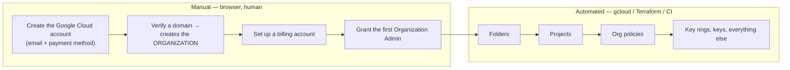

# Organization &amp; Project Setup
{: .no_toc }

**Phase 2 — Foundation.** The manual, human, click-in-a-browser steps that must
happen before any automation can run, plus the audit-log configuration that must
exist before the first key.
{: .fs-5 .fw-300 }

## On this page
{: .no_toc .text-delta }

1. TOC
{:toc}

---

## What cannot be automated, and why



## Step 1 — Create the account and organization

{: .account }
> **Account creation step — browser required.**
>
> 1. Go to [https://console.cloud.google.com/](https://console.cloud.google.com/)
>    and sign in with a Google identity.
> 2. **An organization resource is created only when you have a verified domain**
>    through Google Workspace or Cloud Identity. Without one you get standalone
>    projects with no folders, no org policies, and no central IAM — which makes
>    almost every control in this guide unavailable.
>    - Free option: sign up for **Cloud Identity Free** and verify your domain via
>      a DNS TXT record.
> 3. Use a **role-based email address you control** — e.g. `gcp-admin@contoso.com`
>    — not a personal address.
> 4. Create a **billing account** and link it.

{: .warning }
> **Without an organization resource you cannot use organization policy
> constraints**, which are the preventative guardrails in
> [Policy as Code]() — including
> `restrictNonCmekServices` and `restrictCmekCryptoKeyProjects`. If you are
> currently on standalone projects, migrating them into an organization later is
> possible but disruptive. Do the domain verification first.

```bash
gcloud organizations list
```

```text
DISPLAY_NAME  ID              DIRECTORY_CUSTOMER_ID
contoso.com   123456789012    C01abcdef
```

```bash
export ORG_ID=123456789012
export BILLING_ACCOUNT=$(gcloud billing accounts list \
  --filter="open=true" --format="value(name)" | head -1 | cut -d/ -f2)
echo "org=$ORG_ID billing=$BILLING_ACCOUNT"
```

## Step 2 — Secure the privileged identities

{: .account }
> **Console step — do this immediately.**
>
> 1. **Enforce 2-Step Verification** for every account in the Cloud Identity /
>    Workspace admin console. Prefer hardware security keys for administrators.
> 2. **Create two break-glass accounts.** Cloud Identity accounts, excluded from
>    context-aware access policies, with long random passwords split between
>    custodians and stored in a safe.
> 3. **Reduce the number of Organization Administrators.** The role
>    (`roles/resourcemanager.organizationAdmin`) can grant itself anything.
> 4. **Do not use the `roles/owner` role on production projects.** It bypasses the
>    separation of duties this guide builds.

```bash
# Who holds organization-level privileged roles?
gcloud organizations get-iam-policy "$ORG_ID" \
  --flatten="bindings[].members" \
  --filter="bindings.role:(roles/resourcemanager.organizationAdmin OR roles/owner OR roles/iam.securityAdmin)" \
  --format="table(bindings.role, bindings.members)"
```

{: .tip }
> Two to four Organization Administrators is a reasonable target — the break-glass
> accounts plus a small number of named humans. If that command returns fifteen
> members, that is a finding before you have created a single key.

## Step 3 — Build the folder hierarchy

Folders are where organization policies and broad IAM are applied, so create them
before projects.

```bash
create_folder () {
  local NAME="$1" PARENT="$2"
  local EXISTING
  EXISTING=$(gcloud resource-manager folders list --organization="$ORG_ID" \
    --filter="displayName=$NAME" --format="value(name)" 2>/dev/null | head -1)
  if [ -n "$EXISTING" ]; then echo "${EXISTING##*/}"; return; fi
  gcloud resource-manager folders create \
    --display-name="$NAME" --organization="$PARENT" \
    --format="value(name)" | cut -d/ -f2
}

F_SECURITY=$(create_folder "security"       "$ORG_ID")
F_WORKLOADS=$(create_folder "workloads"     "$ORG_ID")
F_INFRA=$(create_folder "infrastructure"    "$ORG_ID")
F_SANDBOX=$(create_folder "sandbox"         "$ORG_ID")

echo "security=$F_SECURITY workloads=$F_WORKLOADS infra=$F_INFRA sandbox=$F_SANDBOX"

gcloud resource-manager folders list --organization="$ORG_ID" \
  --format="table(displayName, name, lifecycleState)"
```

## Step 4 — Create the projects

```bash
create_project () {
  local ID="$1" NAME="$2" FOLDER="$3"
  if gcloud projects describe "$ID" >/dev/null 2>&1; then
    echo "  $ID already exists"; return
  fi
  gcloud projects create "$ID" --name="$NAME" --folder="$FOLDER" \
    --labels=managed-by=gcloud,environment=prod
  gcloud billing projects link "$ID" --billing-account="$BILLING_ACCOUNT"
  echo "  created $ID"
}

echo "Creating projects"
create_project contoso-keymgmt-prod  "Key Management Prod"  "$F_SECURITY"
create_project contoso-logging-prod  "Logging Prod"         "$F_SECURITY"
create_project contoso-scc-prod      "Security Command Ctr" "$F_SECURITY"
create_project contoso-app-prod      "Application Prod"     "$F_WORKLOADS"
create_project contoso-app-dev       "Application Dev"      "$F_WORKLOADS"
create_project contoso-network-prod  "Network Prod"         "$F_INFRA"

gcloud projects list --format="table(projectId, name, projectNumber, parent.id)"
```

{: .warning }
> **Project IDs are globally unique and permanent.** They cannot be changed or
> reused after deletion, and they appear in every key resource name. Because key
> rings and keys are also undeletable, a badly named key-management project is a
> mistake you carry forever. Pick the name deliberately.

## Step 5 — Enable the APIs

```bash
enable_apis () {
  local PROJECT="$1"; shift
  echo "== $PROJECT =="
  gcloud services enable "$@" --project="$PROJECT"
  gcloud services list --enabled --project="$PROJECT" \
    --filter="config.name:($(printf '%s OR ' "$@" | sed 's/ OR $//'))" \
    --format="value(config.name)" | sed 's/^/  /'
}

enable_apis contoso-keymgmt-prod \
  cloudkms.googleapis.com \
  cloudresourcemanager.googleapis.com \
  iam.googleapis.com \
  logging.googleapis.com \
  monitoring.googleapis.com \
  secretmanager.googleapis.com \
  serviceusage.googleapis.com

enable_apis contoso-app-prod \
  storage.googleapis.com \
  bigquery.googleapis.com \
  compute.googleapis.com \
  container.googleapis.com \
  sqladmin.googleapis.com \
  pubsub.googleapis.com \
  secretmanager.googleapis.com \
  artifactregistry.googleapis.com

enable_apis contoso-logging-prod \
  logging.googleapis.com \
  bigquery.googleapis.com \
  pubsub.googleapis.com
```

## Step 6 — Enable Cloud KMS Data Access audit logs

**Do this before you create the first key.** Admin Activity logs are always on;
Data Access logs — the ones recording encrypt, decrypt, and sign — are not.

```bash
# Read the current organization IAM policy
gcloud organizations get-iam-policy "$ORG_ID" --format=json > /tmp/org-policy.json

# Add the audit config for Cloud KMS (and a few other sensitive services)
python3 - <<'PY'
import json

with open("/tmp/org-policy.json") as fh:
    policy = json.load(fh)

wanted = {
    "cloudkms.googleapis.com": ["ADMIN_READ", "DATA_READ", "DATA_WRITE"],
    "secretmanager.googleapis.com": ["ADMIN_READ", "DATA_READ", "DATA_WRITE"],
    "storage.googleapis.com": ["ADMIN_READ"],
    "iam.googleapis.com": ["ADMIN_READ", "DATA_READ", "DATA_WRITE"],
}

configs = {c["service"]: c for c in policy.get("auditConfigs", [])}
for service, types in wanted.items():
    configs[service] = {
        "service": service,
        "auditLogConfigs": [{"logType": t} for t in types],
    }
policy["auditConfigs"] = list(configs.values())

with open("/tmp/org-policy.json", "w") as fh:
    json.dump(policy, fh, indent=2)
print("audit configs prepared for:", ", ".join(sorted(wanted)))
PY

gcloud organizations set-iam-policy "$ORG_ID" /tmp/org-policy.json

# Verify
gcloud organizations get-iam-policy "$ORG_ID" \
  --format="json(auditConfigs)" | jq '.auditConfigs[] | select(.service=="cloudkms.googleapis.com")'
```

```json
{
  "service": "cloudkms.googleapis.com",
  "auditLogConfigs": [
    { "logType": "ADMIN_READ" },
    { "logType": "DATA_READ" },
    { "logType": "DATA_WRITE" }
  ]
}
```

{: .important }
> **Setting this at the organization level means every current and future project
> inherits it.** Setting it per-project means the next project someone creates has
> no key audit trail and nobody notices for a year. Do it at the org, and enforce
> it with a custom organization policy constraint — see
> [Policy as Code]().

{: .warning }
> **Data Access logs cost money.** They are billed as log ingestion, and a
> high-volume KMS workload can generate a lot of them. That is not a reason to
> disable them — it is a reason to route them to a cheap sink. Send them to a
> BigQuery dataset or a Cloud Storage bucket via a log sink and exclude them from
> the default `_Default` bucket. See
> [Logging &amp; SIEM]().

## Step 7 — Set up centralized log routing

```bash
LOG_PROJECT=contoso-logging-prod
DATASET=cloud_audit_logs

bq --location=US mk --dataset \
  --description="Organization-wide Cloud Audit Logs" \
  --default_partition_expiration=63072000 \
  "${LOG_PROJECT}:${DATASET}"

# Organization-level sink: every project's audit logs, in one place
SINK_SA=$(gcloud logging sinks create org-audit-to-bq \
  "bigquery.googleapis.com/projects/${LOG_PROJECT}/datasets/${DATASET}" \
  --organization="$ORG_ID" \
  --include-children \
  --use-partitioned-tables \
  --log-filter='logName:"cloudaudit.googleapis.com"' \
  --format="value(writerIdentity)")

echo "sink writer: $SINK_SA"

# The sink's service account needs write access to the dataset
gcloud projects add-iam-policy-binding "$LOG_PROJECT" \
  --member="$SINK_SA" \
  --role="roles/bigquery.dataEditor" \
  --condition=None
```

{: .tip }
> `--include-children` is what makes this an *organization* sink rather than a
> project one — it captures every project under the org, including ones created
> next year. Without it you are back to per-project configuration and the
> inevitable gap.

## Step 8 — Baseline organization policies

Apply the guardrails now, so every project inherits them from birth.

```bash
# Require CMEK for the services that support it
cat > /tmp/restrict-non-cmek.yaml <<'YAML'
name: organizations/ORG_ID/policies/gcp.restrictNonCmekServices
spec:
  rules:
    - values:
        deniedValues:
          - storage.googleapis.com
          - bigquery.googleapis.com
          - compute.googleapis.com
          - sqladmin.googleapis.com
          - pubsub.googleapis.com
          - artifactregistry.googleapis.com
          - secretmanager.googleapis.com
YAML
sed -i "s/ORG_ID/${ORG_ID}/" /tmp/restrict-non-cmek.yaml
gcloud org-policies set-policy /tmp/restrict-non-cmek.yaml

# Only keys from the key-management project may be used as CMEK
cat > /tmp/restrict-cmek-projects.yaml <<'YAML'
name: organizations/ORG_ID/policies/gcp.restrictCmekCryptoKeyProjects
spec:
  rules:
    - values:
        allowedValues:
          - under:projects/contoso-keymgmt-prod
YAML
sed -i "s/ORG_ID/${ORG_ID}/" /tmp/restrict-cmek-projects.yaml
gcloud org-policies set-policy /tmp/restrict-cmek-projects.yaml

# Only HSM and EXTERNAL protection levels in production
cat > /tmp/allowed-protection-levels.yaml <<'YAML'
name: folders/FOLDER_ID/policies/cloudkms.allowedProtectionLevels
spec:
  rules:
    - values:
        allowedValues:
          - HSM
          - EXTERNAL
          - EXTERNAL_VPC
YAML
sed -i "s/FOLDER_ID/${F_WORKLOADS}/" /tmp/allowed-protection-levels.yaml
gcloud org-policies set-policy /tmp/allowed-protection-levels.yaml

# General hardening
for CONSTRAINT in \
  iam.disableServiceAccountKeyCreation \
  iam.automaticIamGrantsForDefaultServiceAccounts \
  compute.requireOsLogin \
  storage.uniformBucketLevelAccess \
  sql.restrictPublicIp
do
  gcloud org-policies set-policy - <<YAML
name: organizations/${ORG_ID}/policies/${CONSTRAINT}
spec:
  rules:
    - enforce: true
YAML
  echo "enforced: $CONSTRAINT"
done

gcloud org-policies list --organization="$ORG_ID" --format="table(constraint)"
```

{: .warning }
> **`gcp.restrictNonCmekServices` is a genuine breaking change.** Once enforced,
> creating a Cloud Storage bucket without a CMEK fails. That is the control you
> want in production, and it will break every existing deployment pipeline that
> does not specify a key. Apply it to a sandbox folder first, fix the pipelines,
> then move it up. `iam.disableServiceAccountKeyCreation` is similarly disruptive
> and similarly worth it.

{: .important }
> **`iam.disableServiceAccountKeyCreation` deserves special attention.**
> Long-lived service account keys are the most commonly leaked Google Cloud
> credential, and there is almost always a better option — Workload Identity
> Federation for CI, workload identity for GKE, attached service accounts for
> Compute. Enforcing this constraint is one of the highest-value controls in this
> entire guide, and it costs nothing.

## Step 9 — Create the IAM groups

Grant roles to **groups**, never to individuals.

{: .account }
> **Admin console step.** In the Google Workspace / Cloud Identity admin console,
> create these groups:
>
> | Group | Purpose |
> |:--|:--|
> | `gcp-key-admins@contoso.com` | Create and manage key rings and keys. **Must not** be able to use them |
> | `gcp-key-users@contoso.com` | Perform cryptographic operations |
> | `gcp-key-auditors@contoso.com` | Read-only review of configuration and logs |
> | `gcp-security-admins@contoso.com` | Organization policy and IAM administration |
> | `gcp-breakglass@contoso.com` | Emergency access. Alarmed on every use |

```bash
KEY_PROJECT=contoso-keymgmt-prod

# Key administrators: manage key resources, NOT use them
gcloud projects add-iam-policy-binding "$KEY_PROJECT" \
  --member="group:gcp-key-admins@contoso.com" \
  --role="roles/cloudkms.admin" --condition=None

# Auditors: read configuration; the viewer role does NOT permit crypto operations
gcloud projects add-iam-policy-binding "$KEY_PROJECT" \
  --member="group:gcp-key-auditors@contoso.com" \
  --role="roles/cloudkms.viewer" --condition=None

gcloud projects add-iam-policy-binding contoso-logging-prod \
  --member="group:gcp-key-auditors@contoso.com" \
  --role="roles/logging.viewer" --condition=None
```

{: .important }
> **`roles/cloudkms.admin` does not include cryptographic operations, by design.**
> A key administrator can create, rotate, disable, and destroy keys but cannot
> `Encrypt`, `Decrypt`, or `Sign` with them. That is exactly the separation of
> duties SOC 2 CC6.3 and PCI DSS 3.6.x ask for, and unlike AWS and Azure it is the
> *default* behavior of the built-in role — you get it for free rather than having
> to construct it. Do not undo it by also granting
> `roles/cloudkms.cryptoKeyEncrypterDecrypter` to the same group.

## Step 10 — Enable Security Command Center

```bash
# Premium/Enterprise tier is required for most KMS-relevant detectors
gcloud scc settings services enable \
  --organization="$ORG_ID" --service=SECURITY_HEALTH_ANALYTICS

gcloud scc settings services describe \
  --organization="$ORG_ID" --service=SECURITY_HEALTH_ANALYTICS
```

| SCC detector | What it finds |
|:--|:--|
| `KMS_KEY_NOT_ROTATED` | Keys without a rotation period, or rotating too slowly |
| `KMS_PROJECT_HAS_OWNER` | An `owner` binding on the key project |
| `KMS_PUBLIC_KEY` | A key granted to `allUsers` or `allAuthenticatedUsers` |
| `KMS_ROLE_SEPARATION` | A principal holding both admin and use roles |
| `BUCKET_CMEK_DISABLED` | A bucket without a CMEK |
| `SQL_CMEK_DISABLED` | A Cloud SQL instance without a CMEK |
| `BIGQUERY_TABLE_CMEK_DISABLED` | A BigQuery table without a CMEK |

{: .tip }
> **`KMS_ROLE_SEPARATION` is the detector that watches your separation of
> duties.** It fires when the same principal holds both `roles/cloudkms.admin` and
> a crypto-use role. Wire it to a notification channel — it is the cheapest
> continuous check on the control you just built.

## Foundation checklist

| # | Check | Verify with |
|:--|:--|:--|
| 1 | Organization resource exists (domain verified) | `gcloud organizations list` |
| 2 | 2-Step Verification enforced; break-glass accounts created | Admin console |
| 3 | Small, justified set of Organization Administrators | `get-iam-policy` filter above |
| 4 | Folder hierarchy created | `gcloud resource-manager folders list` |
| 5 | Projects created and linked to billing | `gcloud projects list` |
| 6 | `cloudkms.googleapis.com` enabled on the key project | `gcloud services list --enabled` |
| 7 | **Cloud KMS Data Access audit logs enabled at the org** | `get-iam-policy --format="json(auditConfigs)"` |
| 8 | Organization log sink to BigQuery with `--include-children` | `gcloud logging sinks describe` |
| 9 | `restrictNonCmekServices` and `restrictCmekCryptoKeyProjects` set | `gcloud org-policies list` |
| 10 | `iam.disableServiceAccountKeyCreation` enforced | Same |
| 11 | IAM groups created; `cloudkms.admin` granted to admins only | `gcloud projects get-iam-policy` |
| 12 | Security Command Center enabled | `gcloud scc settings services describe` |

---

[Next: Toolchain Setup](){: .btn .btn-primary }
