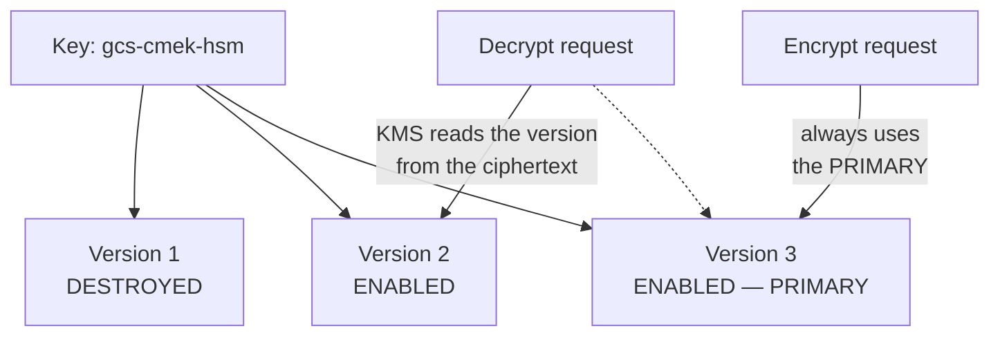
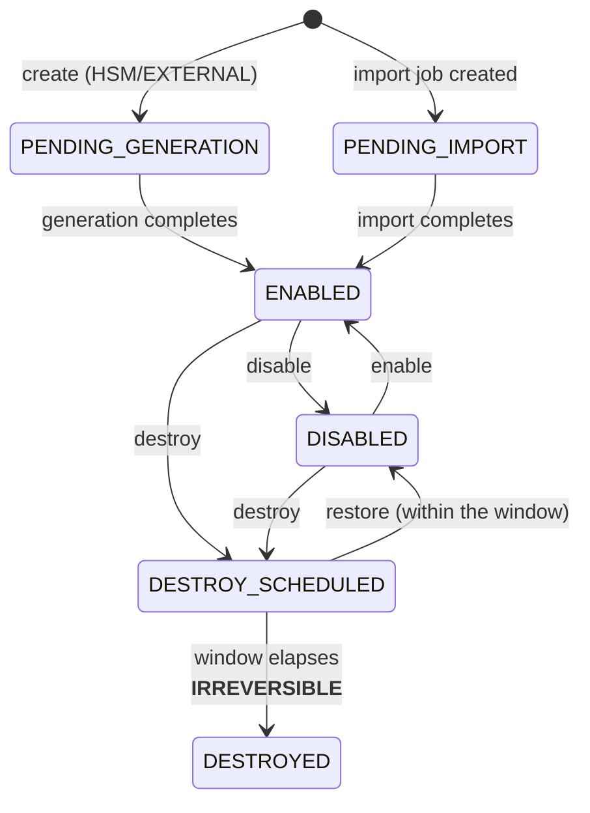
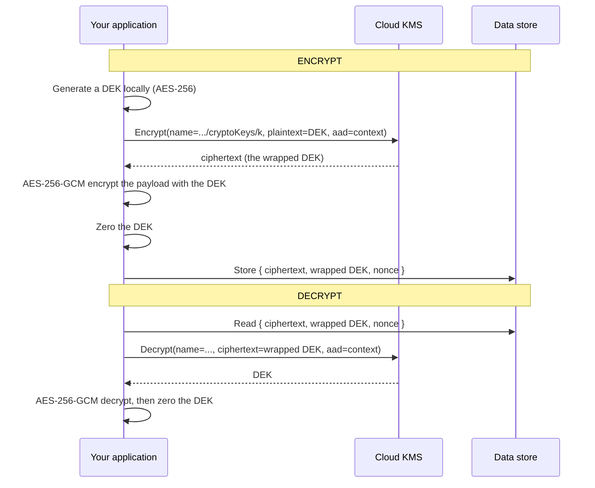
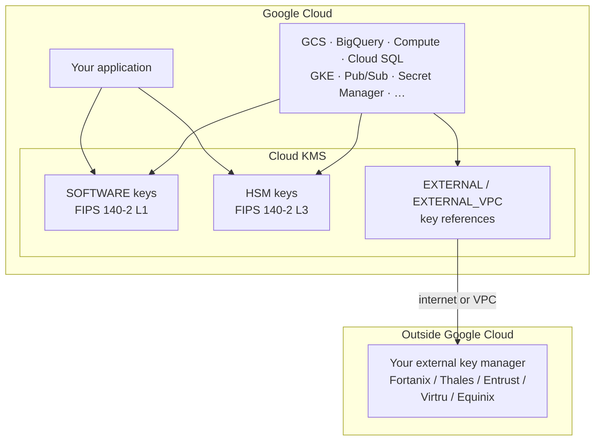
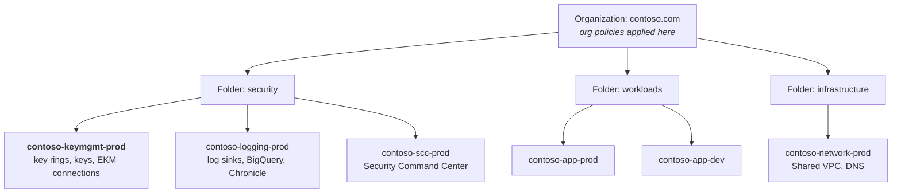

# Architecture &amp; Key Hierarchy
{: .no_toc }

**Phase 1 — Plan.** How Cloud KMS protects key material, the version model that
makes rotation transparent, and the topology you are about to build.
{: .fs-5 .fw-300 }

## On this page
{: .no_toc .text-delta }

1. TOC
{:toc}

---

## The root of trust

```text
   ┌──────────────────────────────────────────────────────────────┐
   │                      Cloud KMS boundary                      │
   │        SOFTWARE: FIPS 140-2 L1 (BoringCrypto)                │
   │        HSM:      FIPS 140-2 L3 validated hardware            │
   │                                                              │
   │   Key version material — never leaves in plaintext           │
   │        Encrypt / Decrypt / Sign / MacSign                    │
   │        all execute INSIDE this boundary                      │
   └───────┬──────────────────────────────────────────────────────┘
           │ wraps (result crosses the boundary as ciphertext)
           ▼
   ┌──────────────────────────────────────────────────────────────┐
   │  Data Encryption Key (DEK)  ── AES-256, held by the service  │
   │       │  GCS: per-object DEK                                 │
   │       │  BigQuery: per-table DEK                             │
   │       │  Persistent Disk: per-disk DEK                       │
   │       ▼ encrypts                                             │
   │  Your data                                                   │
   └──────────────────────────────────────────────────────────────┘
```

Three properties follow, and they are the reason the design works:

1. **Key material never leaves the boundary in plaintext.** There is no export
   API for a Cloud KMS key. Even for imported keys, the material goes in and does
   not come back out.
2. **Cloud KMS only handles small payloads.** The `Encrypt` API is capped at
   64 KiB of plaintext (and 8 KiB of additional authenticated data). This forces
   envelope encryption for anything larger, which keeps bulk cryptography local
   and fast.
3. **Every use is an API call**, which means every use is authorizable, quota-
   limited, and — if Data Access audit logs are enabled — logged.

{: .warning }
> **Cloud KMS Data Access audit logs are OFF by default.** Admin Activity logs
> (key created, IAM changed) are always on and free; **Data Access logs
> (encrypt, decrypt, sign) must be explicitly enabled**, and they are the ones
> that answer "who used this key?" A project running for a year without them has a
> year of unanswerable questions. Enabling them is the first thing in
> [Organization Setup]().

## The version model

This is what makes Cloud KMS rotation different from — and simpler than — the
other clouds.



| Operation | Version used |
|:--|:--|
| `Encrypt` | **Always the primary version.** You cannot choose |
| `Decrypt` | **Whichever version produced the ciphertext.** KMS reads it from the framing — you never specify it |
| `AsymmetricSign` | The version you name explicitly |
| `AsymmetricDecrypt` | The version you name explicitly |
| `MacSign` / `MacVerify` | The version you name explicitly |

{: .important }
> **For symmetric encryption you never think about versions at decrypt time.**
> The ciphertext carries its own version pointer, so rotation is genuinely
> transparent — unlike Azure, where you must record which key version wrapped each
> DEK. The corollary: **destroying a version destroys everything encrypted under
> it**, permanently and silently, and there is no error at destroy time telling you
> so.

### Version states



| State | Can encrypt? | Can decrypt? | Notes |
|:--|:--|:--|:--|
| `PENDING_GENERATION` | No | No | HSM and external keys take a moment |
| `ENABLED` | If primary | Yes | |
| `DISABLED` | No | **No** | Reversible; the containment action |
| `DESTROY_SCHEDULED` | No | No | Reversible with `versions restore` |
| `DESTROYED` | No | **No — permanently** | Data encrypted under it is unrecoverable |

{: .warning }
> **`DISABLED` breaks decryption, not just encryption.** On some platforms
> disabling only stops new encryption; on Cloud KMS a disabled version cannot
> decrypt either. Disabling the primary version of a CMEK immediately breaks every
> service using it. That is the point — it is the containment action — but know the
> blast radius before you press it.

## Envelope encryption



**Why not just call `Encrypt` on the data?** The 64 KiB limit; the network
round-trip per byte; and the per-project request quota. Envelope encryption turns
*N* bytes into one small KMS call plus local symmetric crypto at line rate.

{: .tip }
> **Use [Tink](https://developers.google.com/tink) rather than hand-rolling the
> envelope.** Google's cryptography library has a Cloud KMS integration, handles
> the framing, the AAD binding, and key rotation correctly, and removes a whole
> class of subtle mistakes. The hand-rolled version in
> [Envelope Encryption]() is there so you can
> see the mechanism, not so you ship it.

### Additional authenticated data

`Encrypt` and `Decrypt` accept `additionalAuthenticatedData` — non-secret bytes
cryptographically bound to the ciphertext.

```bash
echo -n "my-data-encryption-key" | gcloud kms encrypt \
  --key=gcs-cmek-hsm --keyring=prod-platform --location=us-east1 \
  --plaintext-file=- --ciphertext-file=- \
  --additional-authenticated-data-file=<(echo -n "tenant=acme-corp") \
  | base64
```

Decryption **fails** unless the exact same AAD is supplied. That gives you
per-tenant binding for free: a ciphertext stolen from tenant A's row cannot be
decrypted into tenant B's context, even by a principal allowed to use the key.

{: .important }
> **Cloud KMS AAD is not logged and is not usable in IAM conditions.** Unlike AWS
> KMS encryption context — which appears in CloudTrail and can be required by key
> policy — GCP's AAD is purely a cryptographic binding. It is still worth using for
> the integrity property, but do not expect it to give you the audit granularity
> or the authorization hook that the AWS equivalent does.

## Where each protection level sits



## The project topology



| Project | Owns | Explicitly does *not* own |
|:--|:--|:--|
| `contoso-keymgmt-prod` | Key rings, keys, EKM connections, key IAM | Application data |
| `contoso-logging-prod` | Log sinks, BigQuery audit dataset | Ability to use keys |
| `contoso-app-prod` | Workloads that *use* keys via service agents | Ability to destroy versions or re-bind key IAM |

{: .important }
> **The separation that matters:** workload service agents get
> `roles/cloudkms.cryptoKeyEncrypterDecrypter` **at the individual key**. They
> never get `roles/cloudkms.admin`, and never at the project or key-ring level. A
> fully compromised production project then still cannot destroy your ability to
> recover the data.

## Key hierarchy for the reference build

```text
contoso-keymgmt-prod / us-east1
│
├── keyRing: prod-platform
│   ├── gcs-cmek-hsm .............. HSM, encryption, 90d rotation
│   │      └── used by: GCS buckets (default CMEK)
│   ├── bq-cmek-hsm ............... HSM, encryption, 90d rotation
│   │      └── used by: BigQuery datasets and tables
│   ├── disk-cmek-hsm ............. HSM, encryption, 90d rotation
│   │      └── used by: Compute Engine disks, GKE node pools
│   ├── sql-cmek-hsm .............. HSM, encryption, 90d rotation
│   │      └── used by: Cloud SQL instances
│   └── secrets-cmek-hsm .......... HSM, encryption, 90d rotation
│          └── used by: Secret Manager
│
├── keyRing: prod-payments
│   ├── pci-chd-hsm ............... HSM, encryption, 90d rotation
│   │      └── used by: payment service envelope encryption
│   └── pci-token-mac-hsm ......... HSM, mac (HMAC_SHA256)
│          └── used by: tokenization integrity
│
└── keyRing: prod-signing
    └── artifact-signing-hsm ...... HSM, asymmetric-signing (EC_SIGN_P384_SHA384)
           └── used by: Binary Authorization, artifact signing

contoso-keymgmt-prod / us  (multi-region)
│
└── keyRing: prod-platform-multi
    └── gcs-multi-cmek-hsm ........ HSM, encryption
           └── used by: multi-region GCS buckets
```

Two things to notice. **Separate key rings per risk domain**, because the key ring
is an IAM boundary — `prod-payments` can have entirely different bindings from
`prod-platform`. And **a separate multi-region key ring**, because a `us-east1`
key cannot serve a `us` multi-region bucket and the location is immutable.

{: .tip }
> **Key rings are the natural IAM boundary; use them.** Binding
> `roles/cloudkms.cryptoKeyEncrypterDecrypter` at the key-ring level is far
> simpler to manage than per-key bindings, and it is the right granularity when
> every key in the ring serves the same trust domain. Reserve per-key bindings for
> service agents, which should only ever touch their own key.

## What you are about to build, in order

| Step | Artifact | Page |
|:--|:--|:--|
| 1 | Org, folders, projects, org policies, audit logs | [Organization Setup]() |
| 2 | `gcloud`, Terraform, Config Connector, Python | [Toolchain]() |
| 3 | Key rings and keys, five ways | [Creating Keys]() |
| 4 | Key-level IAM and service agents | [IAM]() |
| 5 | Rotation and version management | [Rotation]() |
| 6 | CMEK on GCS, BigQuery, Compute, SQL, GKE | [CMEK Integrations]() |
| 7 | Cloud HSM and Cloud EKM | [Cloud HSM &amp; External Keys]() |
| 8 | Audit logs → BigQuery → SIEM | [Logging &amp; SIEM]() |
| 9 | Org policy constraints and a CI gate | [Policy as Code]() |

---

[Next: Organization &amp; Project Setup](){: .btn .btn-primary }
