# Cloud KMS Autokey
{: .no_toc }

Automatic, per-resource CMEK provisioning. Autokey creates the key ring, the key,
and the service-agent IAM binding on demand, so a workload team gets a correctly
scoped CMEK without asking a key administrator.
{: .fs-5 .fw-300 }

## On this page
{: .no_toc .text-delta }

1. TOC
{:toc}

---

## What Autokey solves

The manual CMEK flow in [7.3]() has a
bottleneck: every new resource needs a key administrator to create a key and
grant a service agent. At scale that becomes either a ticket queue or an
over-broad key that everything shares.

```mermaid
flowchart TB
    subgraph MANUAL["Manual CMEK"]
        M1["Team requests a key"] --> M2["Key admin creates it"]
        M2 --> M3["Key admin grants the<br/>service agent"]
        M3 --> M4["Team creates the resource"]
        M4 --> M5["Days of latency, or<br/>one shared key for everything"]
    end
    subgraph AUTO["Autokey"]
        A1["Team creates the resource<br/>with a key handle"] --> A2["Autokey creates the key ring,<br/>the key, and the IAM binding"]
        A2 --> A3["Resource is encrypted with a<br/>purpose-scoped, HSM-backed key"]
        A3 --> A4["Seconds, and correctly scoped"]
    end
    style M5 fill:#4a1e1e,stroke:#f87171
    style A4 fill:#1e4620,stroke:#4ade80
```



| Property | Autokey-created keys |
|:--|:--|
| Protection level | **HSM** |
| Location | Matches the resource |
| Rotation | Configured automatically |
| IAM | Only the requesting resource's service agent |
| Key ring | Per resource type, in the key project |
| Naming | Deterministic, derived from the resource type |
| Ownership | The **key project**, not the workload project |

{: .important }
> **The keys live in your key-management project, not the workload project.**
> That is the whole point: workload teams get self-service key provisioning while
> the keys remain under the key administrators' control, in the project your
> `restrictCmekCryptoKeyProjects` org policy allows. It preserves the separation of
> duties that ad-hoc self-service would otherwise destroy.

## Supported resources

| Service | Resource |
|:--|:--|
| Cloud Storage | Buckets |
| BigQuery | Datasets and tables |
| Compute Engine | Disks, images, snapshots, instances |
| Cloud SQL | Instances |
| Secret Manager | Secrets |
| Spanner | Instances |

{: .note }
> The supported-resource list expands over time. Verify against the
> [current Autokey documentation](https://cloud.google.com/kms/docs/autokey-overview)
> before designing around it — a resource type that is not yet supported still
> needs the manual flow.

## Step 1 — Enable Autokey on a folder

{: .account }
> **This requires folder-level permissions** (`roles/cloudkms.autokeyAdmin` on the
> folder) and a key project that already exists.

```bash
FOLDER_ID=987654321098          # the workloads folder
KEY_PROJECT=contoso-keymgmt-prod
KEY_PROJECT_NUMBER=$(gcloud projects describe "$KEY_PROJECT" \
  --format="value(projectNumber)")

# 1. Enable the API on the key project
gcloud services enable cloudkms.googleapis.com --project="$KEY_PROJECT"

# 2. Create the Autokey service agent in the key project
gcloud beta services identity create \
  --service=cloudkms.googleapis.com --project="$KEY_PROJECT"

# 3. The Autokey service agent needs admin on the key project so it can
#    create key rings and keys there
gcloud projects add-iam-policy-binding "$KEY_PROJECT" \
  --member="serviceAccount:service-${KEY_PROJECT_NUMBER}@gcp-sa-cloudkms.iam.gserviceaccount.com" \
  --role="roles/cloudkms.admin" --condition=None

# 4. Point the folder's Autokey config at the key project
gcloud kms autokey-config update \
  --folder="$FOLDER_ID" \
  --key-project="$KEY_PROJECT"

gcloud kms autokey-config describe --folder="$FOLDER_ID"
```

```yaml
keyProject: projects/contoso-keymgmt-prod
name: folders/987654321098/autokeyConfig
state: ACTIVE
```

{: .warning }
> **Granting `roles/cloudkms.admin` to the Autokey service agent is a real
> delegation.** That agent can create key rings and keys in your key project on
> behalf of any resource creation in the folder. It cannot *use* the keys — the
> role separation still holds — but it does mean key resources appear in your
> project without a human in the loop. Since key rings cannot be deleted, monitor
> what Autokey creates:
>
> ```bash
> gcloud kms keyrings list --location=us-east1 --project="$KEY_PROJECT" \
>   --format="table(name.basename(), createTime)" | sort -k2
> ```

## Step 2 — Grant workload teams the ability to request keys

```bash
WORKLOAD_PROJECT=contoso-app-prod

gcloud projects add-iam-policy-binding "$WORKLOAD_PROJECT" \
  --member="group:gcp-platform-engineers@contoso.com" \
  --role="roles/cloudkms.autokeyUser" --condition=None
```

| Role | Grants |
|:--|:--|
| `roles/cloudkms.autokeyAdmin` | Configure Autokey on a folder |
| `roles/cloudkms.autokeyUser` | Create key handles — i.e. request keys |

## Step 3 — Create resources with a key handle

A **key handle** is the request. Creating one asynchronously provisions a key and
returns its resource name.

```bash
LOCATION=us-east1

# Request a key for a Cloud Storage bucket
gcloud kms key-handles create \
  --project="$WORKLOAD_PROJECT" \
  --location="$LOCATION" \
  --resource-type=storage.googleapis.com/Bucket \
  --key-handle-id=prod-data-bucket

# Poll for the provisioned key
gcloud kms key-handles describe prod-data-bucket \
  --project="$WORKLOAD_PROJECT" --location="$LOCATION" \
  --format="yaml(name,resourceTypeSelector,kmsKey)"
```

```yaml
kmsKey: projects/contoso-keymgmt-prod/locations/us-east1/keyRings/autokey/cryptoKeys/storage-googleapis-com-bucket-a1b2c3
name: projects/contoso-app-prod/locations/us-east1/keyHandles/prod-data-bucket
resourceTypeSelector: storage.googleapis.com/Bucket
```

```bash
# Use it
KEY=$(gcloud kms key-handles describe prod-data-bucket \
  --project="$WORKLOAD_PROJECT" --location="$LOCATION" \
  --format="value(kmsKey)")

gcloud storage buckets create gs://contoso-prod-data \
  --project="$WORKLOAD_PROJECT" --location="$LOCATION" \
  --uniform-bucket-level-access --public-access-prevention \
  --default-encryption-key="$KEY"
```

```bash
# Key handles for other resource types
for RT in \
  bigquery.googleapis.com/Dataset \
  compute.googleapis.com/Disk \
  sqladmin.googleapis.com/Instance \
  secretmanager.googleapis.com/Secret
do
  ID=$(echo "$RT" | tr '/.' '--' | tr '[:upper:]' '[:lower:]')
  gcloud kms key-handles create \
    --project="$WORKLOAD_PROJECT" --location="$LOCATION" \
    --resource-type="$RT" --key-handle-id="prod-${ID}" 2>/dev/null || true
done

gcloud kms key-handles list --project="$WORKLOAD_PROJECT" --location="$LOCATION" \
  --format="table(name.basename(), resourceTypeSelector, kmsKey.basename())"
```

## Terraform

```hcl
resource "google_kms_autokey_config" "workloads" {
  provider    = google-beta
  folder      = "folders/987654321098"
  key_project = "projects/contoso-keymgmt-prod"

  depends_on = [
    google_project_iam_member.autokey_agent_admin,
  ]
}

resource "google_project_service_identity" "kms_autokey" {
  provider = google-beta
  project  = var.key_project_id
  service  = "cloudkms.googleapis.com"
}

resource "google_project_iam_member" "autokey_agent_admin" {
  project = var.key_project_id
  role    = "roles/cloudkms.admin"
  member  = "serviceAccount:${google_project_service_identity.kms_autokey.email}"
}

resource "google_kms_key_handle" "bucket" {
  provider               = google-beta
  project                = var.workload_project_id
  name                   = "prod-data-bucket"
  location               = var.region
  resource_type_selector = "storage.googleapis.com/Bucket"

  depends_on = [google_kms_autokey_config.workloads]
}

resource "google_storage_bucket" "data" {
  project                     = var.workload_project_id
  name                        = "contoso-prod-data"
  location                    = var.region
  uniform_bucket_level_access = true
  public_access_prevention    = "enforced"

  encryption {
    default_kms_key_name = google_kms_key_handle.bucket.kms_key
  }
}
```

{: .warning }
> **Autokey resources are frequently `google-beta` provider only**, and the
> resource shapes have changed. Check the current provider documentation before
> relying on the block above, and pin the provider version.

## When Autokey is and is not the right answer

| Use Autokey when | Use manual keys when |
|:--|:--|
| Many teams create many resources | A small, stable set of keys |
| Per-resource key isolation is wanted | A deliberate shared-key design |
| Key admins are a bottleneck | Keys need bespoke IAM or rotation |
| Standard rotation and protection are fine | Non-standard purpose, algorithm, or protection level |
| The resource type is supported | It is not |

{: .warning }
> **Autokey creates a key per resource, and keys cannot be deleted.** A team that
> churns through ephemeral buckets accumulates permanent keys in your key project
> forever — with the monthly per-key charge that comes with them. Combine Autokey
> with a policy that ephemeral environments live in ephemeral *projects* (which can
> be deleted), and monitor key growth:
>
> ```bash
> gcloud kms keys list --keyring=autokey --location=us-east1 \
>   --project="$KEY_PROJECT" --format="value(name)" | wc -l
> ```

## Monitoring what Autokey creates

```sql
-- Keys created by the Autokey service agent, over time
SELECT
  DATE(timestamp)                                          AS day,
  COUNT(*)                                                 AS keys_created,
  ARRAY_AGG(DISTINCT JSON_VALUE(
    protopayload_auditlog.requestJson, '$.cryptoKeyId') LIMIT 5) AS sample_keys
FROM `contoso-logging-prod.cloud_audit_logs.cloudaudit_googleapis_com_activity`
WHERE protopayload_auditlog.serviceName = 'cloudkms.googleapis.com'
  AND protopayload_auditlog.methodName LIKE '%CreateCryptoKey'
  AND protopayload_auditlog.authenticationInfo.principalEmail
      LIKE 'service-%@gcp-sa-cloudkms.iam.gserviceaccount.com'
  AND timestamp > TIMESTAMP_SUB(CURRENT_TIMESTAMP(), INTERVAL 90 DAY)
GROUP BY day
ORDER BY day DESC;
```

{: .tip }
> **Alert on an unusual spike in Autokey key creation.** A runaway pipeline
> creating key handles in a loop produces permanent, billable keys at whatever rate
> it runs — and because they cannot be deleted, there is no cleanup. A simple
> threshold alert on that query is cheap insurance.

---

[Next: 8. Cloud HSM &amp; External Keys](){: .btn .btn-primary }
