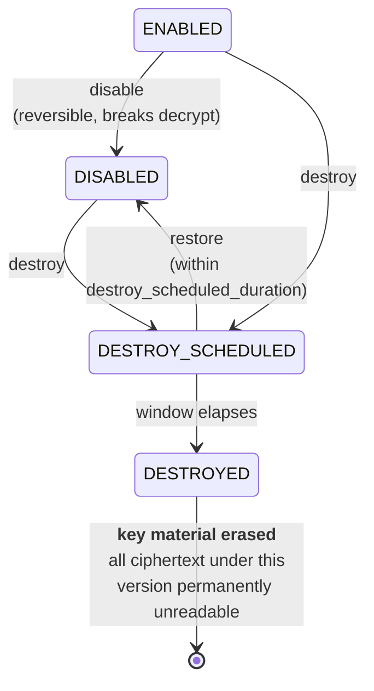

# Backup, Disaster Recovery &amp; Destruction
{: .no_toc }

**Phase 5 — Operate.** Cloud KMS has no backup API and no delete API. Both facts
shape the whole chapter.
{: .fs-5 .fw-300 }

## On this page
{: .no_toc .text-delta }

1. TOC
{:toc}

---

## What can and cannot be backed up

| Asset | Backed up by | Your responsibility |
|:--|:--|:--|
| Cloud KMS key material | Google, automatically and durably | **Nothing — there is no export or backup API** |
| Key **configuration** (IAM, rotation, labels) | Nobody by default | **Export and version it** |
| Imported (BYOK) key material | Google holds a copy you cannot retrieve | **You hold the master copy** |
| EKM key material | Your external key manager's backup regime | **Everything** |
| Key rings and keys | Permanent by construction | Nothing — they cannot be lost or deleted |

{: .important }
> **There is no `gcloud kms keys backup`, and you do not need one.** Google stores
> key material redundantly within the key ring's location. What you *do* need to
> back up is the **configuration** — IAM bindings, rotation schedules, labels, and
> which resources point at which key — because a binding removed by a bad
> `terraform apply` is just as much an outage as a lost key, and that one *is* your
> fault.

## Backing up the configuration

```bash
#!/usr/bin/env bash
# scripts/backup_kms_config.sh — export every key's full configuration
set -euo pipefail

PROJECTS="${PROJECTS:-contoso-keymgmt-prod}"
LOCATIONS="${LOCATIONS:-us-east1 us-west1 us europe-west4 global}"
STAMP="$(date -u +%Y%m%dT%H%M%SZ)"
OUT="kms-config-backup-${STAMP}"
mkdir -p "$OUT"

for PROJECT in $PROJECTS; do
  echo "== $PROJECT =="
  mkdir -p "$OUT/$PROJECT"

  # Project-level IAM
  gcloud projects get-iam-policy "$PROJECT" --format=json \
    > "$OUT/$PROJECT/project-iam.json"

  for LOCATION in $LOCATIONS; do
    RINGS=$(gcloud kms keyrings list --location="$LOCATION" --project="$PROJECT" \
      --format="value(name.basename())" 2>/dev/null) || continue
    [ -z "$RINGS" ] && continue

    mkdir -p "$OUT/$PROJECT/$LOCATION"

    for RING in $RINGS; do
      gcloud kms keyrings get-iam-policy "$RING" --location="$LOCATION" \
        --project="$PROJECT" --format=json \
        > "$OUT/$PROJECT/$LOCATION/ring-${RING}-iam.json"

      for KEY in $(gcloud kms keys list --keyring="$RING" --location="$LOCATION" \
                     --project="$PROJECT" --format="value(name.basename())"); do
        BASE="$OUT/$PROJECT/$LOCATION/${RING}-${KEY}"

        gcloud kms keys describe "$KEY" --keyring="$RING" --location="$LOCATION" \
          --project="$PROJECT" --format=json > "${BASE}.json"

        gcloud kms keys get-iam-policy "$KEY" --keyring="$RING" \
          --location="$LOCATION" --project="$PROJECT" --format=json \
          > "${BASE}-iam.json"

        gcloud kms keys versions list --key="$KEY" --keyring="$RING" \
          --location="$LOCATION" --project="$PROJECT" --format=json \
          > "${BASE}-versions.json"

        echo "  saved ${LOCATION}/${RING}/${KEY}"
      done
    done
  done
done

tar czf "${OUT}.tar.gz" "$OUT" && rm -rf "$OUT"

gcloud storage cp "${OUT}.tar.gz" \
  "gs://contoso-keymgmt-artifacts/kms-config-backups/${OUT}.tar.gz"

echo "Backup: ${OUT}.tar.gz"
```

Schedule it daily with Cloud Scheduler and a Cloud Run job, and keep 90 days.
When someone asks "what were the IAM bindings on this key before the change?",
you have the answer.

{: .tip }
> **The `-versions.json` file is the one you will actually need.** It records which
> versions existed, their states, and their creation times — which is what tells you
> whether a version you are about to destroy was ever primary, and for how long. The
> audit log will not reconstruct that for you cheaply.

## Multi-region and DR design

Cloud KMS has no cross-region key replication. A key exists in exactly one
location.

```mermaid
flowchart TB
    subgraph P["Primary — us-east1"]
        PK["Key ring: prod-platform<br/>gcs-cmek-hsm"]
        PD["Encrypted data"]
    end
    subgraph D["DR — us-west1"]
        DK["Key ring: dr-platform<br/>gcs-cmek-hsm<br/><b>DIFFERENT key material</b>"]
        DD["Replicated data"]
    end
    PK --> PD
    DK --> DD
    PD -.->|"must be RE-ENCRYPTED,<br/>not just copied"| DD
    style DK fill:#4a1e1e,stroke:#f87171
```



{: .warning }
> **There is no equivalent of an AWS multi-Region key.** The DR region's
> `gcs-cmek-hsm` is a *different key* with different material — it cannot decrypt
> anything the primary encrypted. This is the single most important architectural
> difference from AWS in this guide, and it must be designed for rather than
> discovered during a failover.

### The three workable patterns

| Pattern | How it works | Trade-off |
|:--|:--|:--|
| **Multi-region key ring** | Create the key ring in `us`, `eur`, or `asia` rather than a specific region | Works for multi-region GCS and BigQuery; higher latency for regional workloads |
| **Cross-region key access** | The DR region's resources use the *primary* region's key | Simple; the DR region depends on the primary region's KMS |
| **Re-encrypt at replication** | Decrypt with the primary key, re-encrypt with the DR key during replication | Full independence; plaintext transits your pipeline |

```bash
# Pattern 1 — a multi-region key ring for multi-region resources
gcloud kms keyrings create prod-platform-multi --location=us --project="$PROJECT"

gcloud kms keys create gcs-multi-cmek-hsm \
  --keyring=prod-platform-multi --location=us --project="$PROJECT" \
  --purpose=encryption --protection-level=hsm \
  --rotation-period=90d \
  --next-rotation-time="$(date -u -d '+90 days' +%Y-%m-%dT%H:%M:%SZ)"

# A multi-region bucket can only use a multi-region key in the SAME multi-region
gcloud storage buckets create gs://contoso-prod-multi \
  --project=contoso-app-prod --location=us \
  --default-encryption-key="projects/${PROJECT}/locations/us/keyRings/prod-platform-multi/cryptoKeys/gcs-multi-cmek-hsm"
```

```bash
# Pattern 2 — DR resources use the primary region's key
gcloud storage buckets create gs://contoso-dr-data \
  --project=contoso-app-prod --location=us-west1 \
  --default-encryption-key="projects/${PROJECT}/locations/us-east1/keyRings/prod-platform/cryptoKeys/gcs-cmek-hsm"
```

{: .important }
> **Pattern 2 works and is often the right answer, but read what it means.** Your
> DR region now depends on the primary region's Cloud KMS being available. For a
> region-level outage that is usually fine — Cloud KMS regional availability is
> Google's problem and its record is strong. For a scenario where you must operate
> with the primary region entirely unreachable, it is not. Decide which failure you
> are designing for and write it down.

### The DR matrix

| Failure | Impact on keys | Recovery |
|:--|:--|:--|
| Zone lost | None — Cloud KMS is regional | Automatic |
| Region degraded | Keys in that location unavailable | Google's recovery; no action from you |
| Region lost | Regional keys unreachable | Multi-region keys, or cross-region key access |
| Key version disabled | Everything under it unreadable | `versions enable` |
| Key version destroy scheduled | Nothing yet | `versions restore` within the window |
| **Key version destroyed** | **Data permanently unrecoverable** | **None** |
| EKM unreachable | All `EXTERNAL` keys unusable | Restore the EKM; no Google-side mitigation |
| Project deleted | Keys unreachable | Undelete within the project's grace period |

{: .warning }
> **Deleting the key-management *project* is the one way to lose keys wholesale.**
> Projects have a recovery window (roughly 30 days), after which everything in them
> is gone — including keys that could not otherwise be deleted. Apply a project lien
> so it cannot happen by accident:
>
> ```bash
> gcloud alpha resource-manager liens create \
>   --project="$PROJECT" \
>   --restrictions=resourcemanager.projects.delete \
>   --reason="Contains production key material; deletion is unrecoverable" \
>   --origin=security-team
>
> gcloud alpha resource-manager liens list --project="$PROJECT"
> ```

{: .tip }
> **The project lien is the single most valuable control on this page.** It costs
> nothing, takes one command, and prevents the only genuinely catastrophic,
> irreversible action available against a Cloud KMS estate. Apply it to every
> project holding production keys.

## Version destruction — the irreversible operation



### The safe destruction procedure

```bash
PROJECT=contoso-keymgmt-prod
LOCATION=us-east1
KEYRING=prod-platform
KEY=gcs-cmek-hsm
VERSION=1

# --- Step 1: is this version still primary? --------------------------------
PRIMARY=$(gcloud kms keys describe "$KEY" --keyring="$KEYRING" \
  --location="$LOCATION" --project="$PROJECT" \
  --format="value(primary.name.basename())")
[ "$PRIMARY" = "$VERSION" ] && { echo "REFUSING: version $VERSION is primary"; exit 1; }

# --- Step 2: find resources still wrapped under it --------------------------
FULL="projects/${PROJECT}/locations/${LOCATION}/keyRings/${KEYRING}/cryptoKeys/${KEY}/cryptoKeyVersions/${VERSION}"

# GCS objects carry the version explicitly
gcloud storage ls -L "gs://contoso-prod-data/**" 2>/dev/null \
  | grep -B10 "$FULL" | grep "^gs://" | head -20

# BigQuery tables
bq ls --project_id=contoso-app-prod --format=json analytics 2>/dev/null \
  | jq -r '.[].tableReference.tableId' \
  | while read -r T; do
      K=$(bq show --format=json "contoso-app-prod:analytics.${T}" 2>/dev/null \
            | jq -r '.encryptionConfiguration.kmsKeyName // empty')
      [ "$K" = "$FULL" ] && echo "  BigQuery table: $T"
    done

# --- Step 3: DISABLE and soak (30 days minimum) -----------------------------
gcloud kms keys versions disable "$VERSION" --key="$KEY" \
  --keyring="$KEYRING" --location="$LOCATION" --project="$PROJECT"

# ... watch for errors for a FULL business cycle ...

# --- Step 4: schedule destruction -------------------------------------------
gcloud kms keys versions destroy "$VERSION" --key="$KEY" \
  --keyring="$KEYRING" --location="$LOCATION" --project="$PROJECT"

gcloud kms keys versions describe "$VERSION" --key="$KEY" \
  --keyring="$KEYRING" --location="$LOCATION" --project="$PROJECT" \
  --format="yaml(state,destroyTime)"
```

```yaml
destroyTime: '2026-12-16T09:12:04.000000Z'
state: DESTROY_SCHEDULED
```

```bash
# Cancel — returns to DISABLED, not ENABLED
gcloud kms keys versions restore "$VERSION" --key="$KEY" \
  --keyring="$KEYRING" --location="$LOCATION" --project="$PROJECT"
gcloud kms keys versions enable "$VERSION" --key="$KEY" \
  --keyring="$KEYRING" --location="$LOCATION" --project="$PROJECT"
```

{: .warning }
> **The audit log cannot tell you whether a version is still in use.** Cloud KMS
> logs the *key* on `Decrypt`, not the version — the service picks the version from
> the ciphertext, so the request never names one. The only reliable test is
> behavioral: **disable the version and watch for errors** for a full business
> cycle. A quarterly batch job reading year-old archives will not fail until the
> quarter turns. This is why the soak period is not a formality here, and why
> 30 days is a floor.

### Alert on every destruction request

```bash
gcloud logging metrics create kms_version_destroy \
  --project="$PROJECT" \
  --description="A Cloud KMS key version was scheduled for destruction" \
  --log-filter='
    protoPayload.serviceName="cloudkms.googleapis.com"
    AND protoPayload.methodName="DestroyCryptoKeyVersion"'

gcloud monitoring policies create --policy-from-file=- <<'YAML'
displayName: Cloud KMS key version scheduled for destruction
documentation:
  content: |
    A key version was scheduled for destruction. Verify this was intentional and
    approved. If not, restore it IMMEDIATELY:
      gcloud kms keys versions restore VERSION --key=KEY --keyring=RING --location=LOC
      gcloud kms keys versions enable  VERSION --key=KEY --keyring=RING --location=LOC
conditions:
  - displayName: Any destroy event
    conditionThreshold:
      filter: >-
        metric.type = "logging.googleapis.com/user/kms_version_destroy"
      comparison: COMPARISON_GT
      thresholdValue: 0
      duration: 0s
combiner: OR
severity: CRITICAL
notificationChannels:
  - projects/contoso-keymgmt-prod/notificationChannels/REPLACE_ME
YAML
```

## Restricting who can destroy

```bash
# A custom role that manages keys but CANNOT destroy versions
gcloud iam roles create kmsKeyManagerNoDestroy \
  --project="$PROJECT" \
  --title="KMS Key Manager (no destroy)" \
  --description="Full key lifecycle except version destruction" \
  --permissions="cloudkms.cryptoKeys.create,cloudkms.cryptoKeys.get,cloudkms.cryptoKeys.list,cloudkms.cryptoKeys.update,cloudkms.cryptoKeyVersions.create,cloudkms.cryptoKeyVersions.get,cloudkms.cryptoKeyVersions.list,cloudkms.cryptoKeyVersions.update,cloudkms.keyRings.create,cloudkms.keyRings.get,cloudkms.keyRings.list,cloudkms.cryptoKeys.getIamPolicy,cloudkms.cryptoKeys.setIamPolicy" \
  --stage=GA

# Day-to-day admins get this instead of roles/cloudkms.admin
gcloud projects add-iam-policy-binding "$PROJECT" \
  --member="group:gcp-key-admins@contoso.com" \
  --role="projects/${PROJECT}/roles/kmsKeyManagerNoDestroy" --condition=None

# Destruction goes through break-glass or PAM only
gcloud projects add-iam-policy-binding "$PROJECT" \
  --member="group:gcp-breakglass@contoso.com" \
  --role="roles/cloudkms.admin" --condition=None
```

{: .tip }
> **A custom role without `cloudkms.cryptoKeyVersions.destroy` is the cleanest
> destruction control on Google Cloud.** It means the routine key administrators
> genuinely cannot perform the one irreversible operation, and destruction requires
> a deliberate, separately-audited escalation. Combine it with PAM
> ([IAM]()) for a request-and-approve workflow.

## The destruction checklist

Require every line before destroying a production key version.

| # | Check | Evidence |
|:--|:--|:--|
| 1 | The version is not primary | `keys describe --format="value(primary.name)"` |
| 2 | No GCS objects reference the version | `gcloud storage ls -L` scan |
| 3 | No BigQuery table references it | `bq show` scan |
| 4 | No disk, SQL instance, or secret references it | Resource scan |
| 5 | Version disabled for ≥ 30 days with no incident | Change record |
| 6 | Data owner confirmed in writing that the data is expendable or re-encrypted | Ticket |
| 7 | Configuration backup exists | Backup archive |
| 8 | `destroy_scheduled_duration` is ≥ 30 days | `keys describe` |
| 9 | Alert configured so the team is notified | Monitoring policy |
| 10 | Calendar reminder for the destruction date | Calendar |
| 11 | Destruction performed via break-glass, not routine admin | Audit log |

{: .warning }
> **There is no support ticket that recovers a destroyed key version.** Not for
> premium support, not for a large customer, not for a regulator. The key material
> is erased. This checklist exists because the failure mode is unrecoverable and the
> operation takes ten seconds.

## Restoring a deleted project

```bash
gcloud projects list --filter="lifecycleState:DELETE_REQUESTED" \
  --format="table(projectId, name, lifecycleState)"

gcloud projects undelete contoso-keymgmt-prod

# Verify the keys survived
gcloud kms keyrings list --location=us-east1 --project=contoso-keymgmt-prod
```

{: .important }
> **Project undelete is the only recovery path for a deleted key project, and it
> has a hard deadline.** Roughly 30 days, after which the project and everything in
> it — including keys that could not otherwise be deleted — are permanently gone.
> The lien from earlier on this page is what prevents this from being reachable by
> accident.

---

[Next: 10. Logging &amp; SIEM](){: .btn .btn-primary }
