# CI/CD Automation with GitHub Actions
{: .no_toc }

**Phase 8 — Govern.** Key infrastructure that changes only through a reviewed,
scanned, logged pipeline — authenticated with Workload Identity Federation, so
there are no service account keys anywhere.
{: .fs-5 .fw-300 }

## On this page
{: .no_toc .text-delta }

1. TOC
{:toc}

---

## The pipeline

```mermaid
flowchart LR
    PR["Pull request"] --> FMT["terraform fmt<br/>terraform validate"]
    FMT --> SCAN["Checkov +<br/>Conftest/OPA"]
    SCAN --> PLAN["terraform plan"]
    PLAN --> GATE["Policy gate on<br/>the plan JSON"]
    GATE --> COMMENT["Plan posted<br/>as a PR comment"]
    COMMENT --> REVIEW["Human review<br/>+ CODEOWNERS approval"]
    REVIEW --> MERGE["Merge to main"]
    MERGE --> APPLY["terraform apply<br/>(environment gate)"]
    APPLY --> VERIFY["Post-apply<br/>canary + inventory"]
```



## Workload Identity Federation — no service account keys

```bash
PROJECT=contoso-keymgmt-prod
PN=$(gcloud projects describe "$PROJECT" --format="value(projectNumber)")
REPO="SmittyStuff/gcp-key-management"

# --- 1. The pool and provider ------------------------------------------------
gcloud iam workload-identity-pools create github \
  --project="$PROJECT" --location=global \
  --display-name="GitHub Actions"

gcloud iam workload-identity-pools providers create-oidc github-oidc \
  --project="$PROJECT" --location=global --workload-identity-pool=github \
  --issuer-uri="https://token.actions.githubusercontent.com" \
  --attribute-mapping="google.subject=assertion.sub,attribute.repository=assertion.repository,attribute.ref=assertion.ref,attribute.event=assertion.event_name" \
  --attribute-condition="assertion.repository == '${REPO}'"

POOL="projects/${PN}/locations/global/workloadIdentityPools/github"

# --- 2. Two service accounts: plan (read-only) and apply (write) --------------
gcloud iam service-accounts create gha-keymgmt-plan --project="$PROJECT" \
  --display-name="GitHub Actions — plan (read-only)"
gcloud iam service-accounts create gha-keymgmt-apply --project="$PROJECT" \
  --display-name="GitHub Actions — apply"

# Plan: any ref may impersonate, but it can only read
gcloud iam service-accounts add-iam-policy-binding \
  "gha-keymgmt-plan@${PROJECT}.iam.gserviceaccount.com" \
  --project="$PROJECT" --role="roles/iam.workloadIdentityUser" \
  --member="principalSet://iam.googleapis.com/${POOL}/attribute.repository/${REPO}"

# Apply: ONLY the main branch
gcloud iam service-accounts add-iam-policy-binding \
  "gha-keymgmt-apply@${PROJECT}.iam.gserviceaccount.com" \
  --project="$PROJECT" --role="roles/iam.workloadIdentityUser" \
  --member="principalSet://iam.googleapis.com/${POOL}/attribute.ref/refs/heads/main"
```

{: .warning }
> **The `--attribute-condition` and the `principalSet` are the entire security
> boundary.** Without the condition, *any* GitHub repository can obtain a token for
> your service account, including a fork's pull request. Pin the provider to the
> exact repository, and pin the apply identity's `principalSet` to
> `attribute.ref/refs/heads/main`. A `principalSet` on `attribute.repository` alone
> lets a pull request from a branch obtain apply credentials.

### Roles for each identity

```bash
# --- Plan: read-only, plus state access -------------------------------------
gcloud projects add-iam-policy-binding "$PROJECT" \
  --member="serviceAccount:gha-keymgmt-plan@${PROJECT}.iam.gserviceaccount.com" \
  --role="roles/cloudkms.viewer" --condition=None

gcloud projects add-iam-policy-binding "$PROJECT" \
  --member="serviceAccount:gha-keymgmt-plan@${PROJECT}.iam.gserviceaccount.com" \
  --role="roles/iam.securityReviewer" --condition=None

gcloud storage buckets add-iam-policy-binding "gs://contoso-tfstate-keymgmt-${PN}" \
  --member="serviceAccount:gha-keymgmt-plan@${PROJECT}.iam.gserviceaccount.com" \
  --role="roles/storage.objectAdmin"

# --- Apply: a CUSTOM role that cannot destroy versions ----------------------
gcloud iam roles create ciKeyManager --project="$PROJECT" \
  --title="CI Key Manager" \
  --description="Create and manage keys; CANNOT destroy versions or use keys" \
  --permissions="cloudkms.keyRings.create,cloudkms.keyRings.get,cloudkms.keyRings.list,cloudkms.keyRings.getIamPolicy,cloudkms.keyRings.setIamPolicy,cloudkms.cryptoKeys.create,cloudkms.cryptoKeys.get,cloudkms.cryptoKeys.list,cloudkms.cryptoKeys.update,cloudkms.cryptoKeys.getIamPolicy,cloudkms.cryptoKeys.setIamPolicy,cloudkms.cryptoKeyVersions.create,cloudkms.cryptoKeyVersions.get,cloudkms.cryptoKeyVersions.list,cloudkms.cryptoKeyVersions.update,cloudkms.importJobs.create,cloudkms.importJobs.get,cloudkms.importJobs.list" \
  --stage=GA

gcloud projects add-iam-policy-binding "$PROJECT" \
  --member="serviceAccount:gha-keymgmt-apply@${PROJECT}.iam.gserviceaccount.com" \
  --role="projects/${PROJECT}/roles/ciKeyManager" --condition=None

gcloud storage buckets add-iam-policy-binding "gs://contoso-tfstate-keymgmt-${PN}" \
  --member="serviceAccount:gha-keymgmt-apply@${PROJECT}.iam.gserviceaccount.com" \
  --role="roles/storage.objectAdmin"
```

{: .important }
> **The custom role deliberately omits `cloudkms.cryptoKeyVersions.destroy` and
> every crypto-use permission.** The pipeline can create and configure keys but
> cannot perform the one irreversible operation, and cannot decrypt anything.
> Destruction goes through the break-glass runbook with a human and a change record;
> cryptographic use belongs to workloads. Automation that can destroy what it built
> is one bad merge away from an unrecoverable incident — and on Google Cloud,
> "unrecoverable" is literal.

```bash
# Verify the CI identity genuinely cannot destroy
gcloud iam roles describe ciKeyManager --project="$PROJECT" \
  --format="value(includedPermissions)" | tr ';' '\n' | grep -c destroy
# -> 0
```

## Workflow: plan on pull request

`.github/workflows/terraform-plan.yml`


```yaml
name: Terraform Plan

on:
  pull_request:
    paths:
      - 'modules/**'
      - 'environments/**'
      - 'policies/**'
      - '.github/workflows/terraform-*.yml'

permissions:
  id-token: write        # required for Workload Identity Federation
  contents: read
  pull-requests: write

concurrency:
  group: terraform-plan-${{ github.ref }}
  cancel-in-progress: true

jobs:
  plan:
    runs-on: ubuntu-latest
    strategy:
      fail-fast: false
      matrix:
        environment: [keymgmt-prod, keymgmt-dev]

    defaults:
      run:
        working-directory: environments/${{ matrix.environment }}

    steps:
      - uses: actions/checkout@v4

      - uses: hashicorp/setup-terraform@v3
        with:
          terraform_version: 1.9.5
          terraform_wrapper: false

      - name: Authenticate to Google Cloud (WIF)
        uses: google-github-actions/auth@v2
        with:
          workload_identity_provider: projects/123456789012/locations/global/workloadIdentityPools/github/providers/github-oidc
          service_account: gha-keymgmt-plan@contoso-keymgmt-prod.iam.gserviceaccount.com

      - uses: google-github-actions/setup-gcloud@v2

      - name: Terraform fmt
        run: terraform fmt -check -recursive -diff

      - name: Terraform init
        run: terraform init -input=false

      - name: Terraform validate
        run: terraform validate -no-color

      # --- Static analysis on the source ---------------------------------
      - name: Checkov
        uses: bridgecrewio/checkov-action@master
        with:
          directory: .
          framework: terraform
          soft_fail: false
          external_checks_dirs: ../../policies/checkov
          output_format: cli,sarif
          output_file_path: console,checkov.sarif

      - name: Upload Checkov SARIF
        if: always()
        uses: github/codeql-action/upload-sarif@v3
        with:
          sarif_file: environments/${{ matrix.environment }}/checkov.sarif

      # --- Plan, then gate on the PLAN ------------------------------------
      - name: Terraform plan
        id: plan
        run: |
          terraform plan -input=false -no-color -lock-timeout=5m -out=tfplan
          terraform show -json tfplan > tfplan.json
          terraform show -no-color tfplan > plan.txt

      - name: Install Conftest
        run: |
          curl -fsSL https://github.com/open-policy-agent/conftest/releases/latest/download/conftest_Linux_x86_64.tar.gz \
            | sudo tar xz -C /usr/local/bin conftest

      - name: Policy gate (OPA/Rego on the plan)
        run: conftest test --policy ../../policies/opa tfplan.json

      # --- Cloud KMS specific guards --------------------------------------
      - name: Fail on key resource destruction
        run: |
          DANGEROUS=$(jq -r '
            [.resource_changes[]?
             | select(.type | test("^google_kms_(key_ring|crypto_key)$"))
             | select(.change.actions[] | . == "delete")
             | .address] | join(", ")' tfplan.json)
          if [ -n "$DANGEROUS" ]; then
            echo "::error::Plan would destroy key resources: $DANGEROUS"
            echo "Cloud KMS key rings and keys CANNOT be deleted — this plan is wrong."
            exit 1
          fi
          echo "No destructive key changes in this plan."

      - name: Warn on new key rings (they are permanent)
        run: |
          NEW=$(jq -r '
            [.resource_changes[]?
             | select(.type == "google_kms_key_ring")
             | select(.change.actions[] | . == "create")
             | .change.after.name] | join(", ")' tfplan.json)
          if [ -n "$NEW" ]; then
            echo "::warning::This plan creates PERMANENT key rings: $NEW"
            echo "Key rings cannot be renamed, moved, or deleted. Confirm the name and location."
          fi

      - name: Post plan to the pull request
        uses: actions/github-script@v7
        with:
          script: |
            const fs = require('fs');
            const dir = 'environments/${{ matrix.environment }}';
            let plan = fs.readFileSync(`${dir}/plan.txt`, 'utf8');
            if (plan.length > 60000) {
              plan = plan.substring(0, 60000) + '\n\n... truncated, see the job log ...';
            }
            await github.rest.issues.createComment({
              issue_number: context.issue.number,
              owner: context.repo.owner,
              repo: context.repo.repo,
              body: [
                `### Terraform plan — \`${{ matrix.environment }}\``,
                '',
                '> **Reminder:** Cloud KMS key rings and keys are **permanent**.',
                '> Check every new `google_kms_key_ring` name and location carefully.',
                '',
                '<details><summary>Show plan</summary>',
                '',
                '```terraform',
                plan,
                '```',
                '',
                '</details>',
              ].join('\n'),
            });
```


{: .tip }
> **The "new key rings are permanent" warning is a small thing that pays for
> itself.** On AWS or Azure a mistyped resource name is an annoyance; on Google
> Cloud it is a permanent artifact in your inventory. Surfacing it in the PR comment
> puts the reviewer's attention exactly where it needs to be.

## Workflow: apply on merge

`.github/workflows/terraform-apply.yml`


```yaml
name: Terraform Apply

on:
  push:
    branches: [main]
    paths: ['modules/**', 'environments/**']
  workflow_dispatch:
    inputs:
      environment:
        description: Environment to apply
        required: true
        type: choice
        options: [keymgmt-dev, keymgmt-prod]

permissions:
  id-token: write
  contents: read

concurrency:
  group: terraform-apply
  cancel-in-progress: false      # never cancel an in-flight apply

jobs:
  apply:
    runs-on: ubuntu-latest
    # A GitHub Environment with required reviewers turns this into a
    # human-approved gate for production.
    environment:
      name: ${{ inputs.environment || 'keymgmt-prod' }}

    defaults:
      run:
        working-directory: environments/${{ inputs.environment || 'keymgmt-prod' }}

    steps:
      - uses: actions/checkout@v4

      - uses: hashicorp/setup-terraform@v3
        with:
          terraform_version: 1.9.5
          terraform_wrapper: false

      - uses: google-github-actions/auth@v2
        with:
          workload_identity_provider: projects/123456789012/locations/global/workloadIdentityPools/github/providers/github-oidc
          service_account: gha-keymgmt-apply@contoso-keymgmt-prod.iam.gserviceaccount.com

      - uses: google-github-actions/setup-gcloud@v2

      - name: Terraform init
        run: terraform init -input=false

      - name: Terraform apply
        run: terraform apply -input=false -auto-approve -lock-timeout=10m

      # --- Prove the applied infrastructure actually works ----------------
      - name: Post-apply verification
        run: |
          set -euo pipefail
          PROJECT=$(terraform output -raw project_id)
          LOCATION=$(terraform output -raw region)

          for RING in $(gcloud kms keyrings list --location="$LOCATION" \
                          --project="$PROJECT" --format="value(name.basename())"); do
            for KEY in $(gcloud kms keys list --keyring="$RING" --location="$LOCATION" \
                           --project="$PROJECT" \
                           --filter="purpose=ENCRYPT_DECRYPT" \
                           --format="value(name.basename())"); do

              # Every production key must be HSM-backed
              PROT=$(gcloud kms keys describe "$KEY" --keyring="$RING" \
                       --location="$LOCATION" --project="$PROJECT" \
                       --format="value(versionTemplate.protectionLevel)")
              if [ "$PROT" != "HSM" ] && [ "$PROT" != "EXTERNAL" ] && [ "$PROT" != "EXTERNAL_VPC" ]; then
                echo "::error::$RING/$KEY has protection level $PROT"
                exit 1
              fi

              # And must have a rotation schedule
              ROT=$(gcloud kms keys describe "$KEY" --keyring="$RING" \
                      --location="$LOCATION" --project="$PROJECT" \
                      --format="value(rotationPeriod)")
              [ -n "$ROT" ] || { echo "::error::$RING/$KEY has no rotation period"; exit 1; }

              echo "verified: $RING/$KEY ($PROT, rotation=$ROT)"
            done
          done

      - name: Export key inventory as evidence
        run: |
          pip install --quiet google-cloud-kms google-cloud-resource-manager
          python ../../scripts/key_inventory.py "$(terraform output -raw project_id)" || true

      - uses: actions/upload-artifact@v4
        with:
          name: kms-inventory-${{ github.run_id }}
          path: environments/*/kms-inventory-*.{json,csv}
          retention-days: 365
```


{: .warning }
> **The CI identity cannot perform a crypto round-trip canary**, because it
> deliberately holds no crypto-use role. That is the correct trade-off: verification
> here checks *configuration* (protection level, rotation), and the functional
> canary runs separately with its own narrowly-scoped identity — see
> [Monitoring](). Do not be tempted to grant the
> pipeline `cryptoKeyEncrypterDecrypter` just to make the canary fit in this job.

## Workflow: nightly drift detection

`.github/workflows/drift-detect.yml`


```yaml
name: Drift Detection

on:
  schedule:
    - cron: '0 6 * * *'
  workflow_dispatch:

permissions:
  id-token: write
  contents: read
  issues: write

jobs:
  drift:
    runs-on: ubuntu-latest
    strategy:
      fail-fast: false
      matrix:
        environment: [keymgmt-prod, keymgmt-dev]

    defaults:
      run:
        working-directory: environments/${{ matrix.environment }}

    steps:
      - uses: actions/checkout@v4
      - uses: hashicorp/setup-terraform@v3
        with:
          terraform_version: 1.9.5
          terraform_wrapper: false

      - uses: google-github-actions/auth@v2
        with:
          workload_identity_provider: projects/123456789012/locations/global/workloadIdentityPools/github/providers/github-oidc
          service_account: gha-keymgmt-plan@contoso-keymgmt-prod.iam.gserviceaccount.com

      - run: terraform init -input=false

      - name: Detect drift
        id: drift
        run: |
          set +e
          terraform plan -detailed-exitcode -no-color -input=false -out=drift.tfplan
          CODE=$?
          set -e
          echo "exitcode=$CODE" >> "$GITHUB_OUTPUT"
          [ "$CODE" = "2" ] && terraform show -no-color drift.tfplan > drift.txt
          [ "$CODE" = "1" ] && exit 1 || exit 0

      - name: Open an issue when drift is found
        if: steps.drift.outputs.exitcode == '2'
        uses: actions/github-script@v7
        with:
          script: |
            const fs = require('fs');
            const drift = fs.readFileSync(
              'environments/${{ matrix.environment }}/drift.txt', 'utf8'
            ).substring(0, 60000);
            await github.rest.issues.create({
              owner: context.repo.owner,
              repo: context.repo.repo,
              title: `Key infrastructure drift — ${{ matrix.environment }}`,
              labels: ['drift', 'security', 'key-management'],
              body: [
                'Nightly drift detection found changes made outside Terraform.',
                '',
                '**Investigate before reconciling** — an unexplained change to an',
                'IAM binding or a rotation schedule may be an incident.',
                '',
                'Check the audit log for the responsible principal:',
                '```bash',
                'gcloud logging read \\',
                '  \'protoPayload.serviceName="cloudkms.googleapis.com"',
                '   AND timestamp>="\'"$(date -u -d \'24 hours ago\' +%Y-%m-%dT%H:%M:%SZ)"\'"\' \\',
                '  --project=contoso-keymgmt-prod \\',
                '  --format="table(timestamp, protoPayload.methodName,',
                '                  protoPayload.authenticationInfo.principalEmail)"',
                '```',
                '',
                '<details><summary>Drift plan</summary>',
                '',
                '```terraform',
                drift,
                '```',
                '',
                '</details>',
              ].join('\n'),
            });
```


{: .warning }
> **Do not auto-remediate drift on key infrastructure.** An automatic
> `terraform apply` that reverts drift will happily revert a legitimate emergency
> change — an IAM binding added at 3 a.m. to restore service — and will just as
> happily revert an attacker's change *after* they have used it. Open an issue,
> investigate, then reconcile deliberately.

## Repository controls

```bash
cat > .github/CODEOWNERS <<'OWNERS'
/modules/kms-keyring/   @contoso/security-engineering
/modules/kms-key/       @contoso/security-engineering
/modules/ekm-connection/ @contoso/security-engineering
/environments/          @contoso/security-engineering @contoso/platform
/policies/              @contoso/security-engineering
/.github/workflows/     @contoso/security-engineering
OWNERS

gh api -X PUT repos/SmittyStuff/gcp-key-management/branches/main/protection \
  --input - <<'JSON'
{
  "required_status_checks": {
    "strict": true,
    "contexts": ["plan (keymgmt-prod)", "plan (keymgmt-dev)"]
  },
  "enforce_admins": true,
  "required_pull_request_reviews": {
    "required_approving_review_count": 2,
    "require_code_owner_reviews": true,
    "dismiss_stale_reviews": true
  },
  "restrictions": null,
  "required_linear_history": true,
  "allow_force_pushes": false,
  "allow_deletions": false,
  "required_signatures": true
}
JSON
```

| Control | Setting | Why |
|:--|:--|:--|
| Required reviewers | 2, including a code owner | No single person creates a permanent key ring |
| `enforce_admins` | true | Admins are the most likely to bypass |
| `required_signatures` | true | Commits are attributable |
| `allow_force_pushes` | false | History cannot be rewritten to hide a change |
| Environment protection | Required reviewers on `keymgmt-prod` | Apply is a second, explicit approval |

## Cloud Build as an alternative

If your organization mandates Google-native CI:

```yaml
# cloudbuild.yaml
steps:
  - id: init
    name: hashicorp/terraform:1.9.5
    dir: environments/keymgmt-prod
    args: ['init', '-input=false']

  - id: validate
    name: hashicorp/terraform:1.9.5
    dir: environments/keymgmt-prod
    args: ['validate', '-no-color']

  - id: plan
    name: hashicorp/terraform:1.9.5
    dir: environments/keymgmt-prod
    args: ['plan', '-input=false', '-no-color', '-out=tfplan']

  - id: policy-gate
    name: openpolicyagent/conftest:latest
    dir: environments/keymgmt-prod
    entrypoint: sh
    args:
      - -c
      - |
        terraform show -json tfplan > tfplan.json
        conftest test --policy ../../policies/opa tfplan.json

  - id: apply
    name: hashicorp/terraform:1.9.5
    dir: environments/keymgmt-prod
    args: ['apply', '-input=false', '-auto-approve', 'tfplan']

options:
  logging: CLOUD_LOGGING_ONLY
  requestedVerifyOption: VERIFIED

serviceAccount: projects/contoso-keymgmt-prod/serviceAccounts/cloudbuild-keymgmt@contoso-keymgmt-prod.iam.gserviceaccount.com
```

```bash
gcloud builds triggers create github \
  --project=contoso-keymgmt-prod \
  --name=keymgmt-apply \
  --repo-owner=SmittyStuff --repo-name=gcp-key-management \
  --branch-pattern='^main$' \
  --build-config=cloudbuild.yaml \
  --require-approval \
  --service-account="projects/contoso-keymgmt-prod/serviceAccounts/cloudbuild-keymgmt@contoso-keymgmt-prod.iam.gserviceaccount.com"
```

{: .tip }
> **`--require-approval` on the Cloud Build trigger is the Google-native
> equivalent of a GitHub Environment gate**, and `requestedVerifyOption: VERIFIED`
> produces a signed build provenance record. Together they give you a human approval
> and an attestable build for key infrastructure changes — which pairs well with
> Binary Authorization if you are already using it.

---

[Next: 13. Policy as Code](){: .btn .btn-primary }
