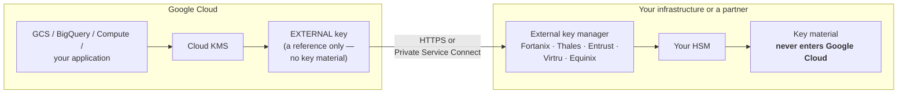
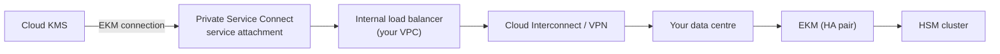

# Cloud External Key Manager (EKM)
{: .no_toc }

The hold-your-own-key tier. Key material lives in *your* external key manager,
outside Google Cloud, and Cloud KMS calls out to you for every cryptographic
operation.
{: .fs-5 .fw-300 }

## On this page
{: .no_toc .text-delta }

1. TOC
{:toc}

---

## The architecture



Every `Decrypt` against an EKM key becomes a synchronous request from Cloud KMS
to your external key manager. That single sentence contains all of this design's
benefits and all of its costs.

| | Cloud HSM | Cloud EKM | Cloud EKM via VPC |
|:--|:--|:--|:--|
| Key material | Google's HSMs | **Yours** | **Yours** |
| Network path | Internal | Public internet | **Private Service Connect** |
| Added latency | Negligible | Tens to hundreds of ms | Lower |
| Availability dependency | Google | **Your EKM + network + DNS** | **Your EKM + PSC** |
| Can you revoke Google's access? | No | **Yes, unilaterally** | **Yes, unilaterally** |

{: .warning }
> **Your external key manager becomes a hard dependency of every Google Cloud
> service reading that data.** An EKM outage is an outage of your buckets, your
> datasets, and your databases. Cloud KMS does not cache around it. Build the EKM to
> the same availability standard as the workload it gates, then prove that
> assumption with a failure test — the drill is at the end of this page.

## When Cloud EKM is the right answer

| Driver | Why EKM fits |
|:--|:--|
| Regulator requires keys outside the cloud provider | Material genuinely never enters Google Cloud |
| Contractual right to unilaterally revoke provider access | Turning off the EKM is instant, verifiable revocation |
| Data-sovereignty rules pinning key custody to a jurisdiction | The HSM sits where the law requires |
| Existing enterprise HSM estate must remain the system of record | One key hierarchy across cloud and on-prem |
| Single-tenant hardware is specifically required | Cloud HSM is multi-tenant; your EKM is not |

If none of those apply, use [Cloud HSM]().

## Supported partners

Cloud EKM works with any key manager that implements Google's EKM API. In
practice you will use a partner product rather than building one.

| Partner | Deployment |
|:--|:--|
| Fortanix Data Security Manager | SaaS or self-hosted |
| Thales CipherTrust Manager | Self-hosted or Thales-hosted |
| Entrust KeyControl | Self-hosted |
| Virtru | SaaS |
| Equinix SmartKey (Fortanix-based) | Colocation |

{: .note }
> The partner list changes. Confirm against the current
> [Cloud EKM documentation](https://cloud.google.com/kms/docs/ekm) and — more
> importantly — confirm that your chosen partner supports **Cloud EKM via VPC** if
> you need the private path. Not all of them do, and discovering that after
> procurement is expensive.

## Cloud EKM over the internet

### Step 1 — Create the key in your external key manager

{: .account }
> **Vendor step.** In your EKM's console or API, create the key and obtain its
> **key URI** — an HTTPS URL Cloud KMS will call. The exact shape is vendor-specific;
> what Google needs is a URI it can reach and authenticate to.

```text
https://ekm.contoso.com/v0/cryptospaces/prod/keys/sovereign-eu-data
```

### Step 2 — Create the Cloud KMS key

```bash
PROJECT=contoso-keymgmt-prod
LOCATION=europe-west4
KEYRING=prod-sovereign

gcloud kms keyrings create "$KEYRING" --location="$LOCATION" --project="$PROJECT"

# The key is created with NO initial version — you attach one explicitly
gcloud kms keys create sovereign-eu-data \
  --keyring="$KEYRING" --location="$LOCATION" --project="$PROJECT" \
  --purpose=encryption \
  --protection-level=external \
  --skip-initial-version-creation \
  --destroy-scheduled-duration=30d \
  --labels=environment=prod,data-class=restricted,custody=external,managed-by=gcloud

# Attach the external key
gcloud kms keys versions create \
  --key=sovereign-eu-data --keyring="$KEYRING" --location="$LOCATION" \
  --project="$PROJECT" \
  --external-key-uri="https://ekm.contoso.com/v0/cryptospaces/prod/keys/sovereign-eu-data" \
  --primary

gcloud kms keys versions list --key=sovereign-eu-data \
  --keyring="$KEYRING" --location="$LOCATION" --project="$PROJECT" \
  --format="yaml(name,state,protectionLevel,externalProtectionLevelOptions)"
```

```yaml
externalProtectionLevelOptions:
  externalKeyUri: https://ekm.contoso.com/v0/cryptospaces/prod/keys/sovereign-eu-data
name: projects/contoso-keymgmt-prod/locations/europe-west4/keyRings/prod-sovereign/cryptoKeys/sovereign-eu-data/cryptoKeyVersions/1
protectionLevel: EXTERNAL
state: ENABLED
```

{: .warning }
> **`--skip-initial-version-creation` is mandatory for `EXTERNAL` keys.** Without
> it, Cloud KMS tries to generate a version it has no material for and the create
> fails. The version is attached separately, pointing at your EKM's URI.

### Step 3 — Verify

```bash
KEY_ARGS="--key=sovereign-eu-data --keyring=$KEYRING --location=$LOCATION --project=$PROJECT"

time (echo -n "ekm-canary" \
  | gcloud kms encrypt $KEY_ARGS --plaintext-file=- --ciphertext-file=/tmp/ct.bin)

time (gcloud kms decrypt $KEY_ARGS --ciphertext-file=/tmp/ct.bin --plaintext-file=-)
echo
rm -f /tmp/ct.bin
```

```text
ekm-canary

real    0m1.284s
```

{: .tip }
> **Time it, and record the number.** EKM latency is the thing that surprises
> teams in production — every `Decrypt` traverses the public internet to your key
> manager. Measure it now, under normal conditions, and compare against your
> workload's latency budget before you wire it to anything.

## Cloud EKM via VPC

The private path. Cloud KMS reaches your EKM through Private Service Connect
rather than the public internet.



### Step 1 — Publish your EKM through Private Service Connect

```bash
WORKLOAD_PROJECT=contoso-network-prod
REGION=europe-west4

# An internal load balancer fronting your EKM, reachable from the VPC
# (assumes the ILB and backend already exist)

gcloud compute service-attachments create ekm-attachment \
  --project="$WORKLOAD_PROJECT" --region="$REGION" \
  --producer-forwarding-rule=ekm-ilb-forwarding-rule \
  --connection-preference=ACCEPT_MANUAL \
  --nat-subnets=ekm-psc-nat-subnet \
  --consumer-accept-list="${PROJECT}=10"

gcloud compute service-attachments describe ekm-attachment \
  --project="$WORKLOAD_PROJECT" --region="$REGION" \
  --format="value(selfLink)"
```

### Step 2 — Create the EKM connection

```bash
gcloud kms ekm-connections create contoso-ekm \
  --location="$REGION" --project="$PROJECT" \
  --service-directory-service="projects/${WORKLOAD_PROJECT}/locations/${REGION}/namespaces/ekm/services/ekm-service" \
  --hostname="ekm.internal.contoso.com" \
  --server-certificates-files=/tmp/ekm-server-cert.pem \
  --key-management-mode=MANUAL

gcloud kms ekm-connections describe contoso-ekm \
  --location="$REGION" --project="$PROJECT" \
  --format="yaml(name,serviceResolvers,keyManagementMode,cryptoSpacePath)"
```

### Step 3 — Create the key against the connection

```bash
gcloud kms keys create sovereign-eu-vpc \
  --keyring="$KEYRING" --location="$REGION" --project="$PROJECT" \
  --purpose=encryption \
  --protection-level=external-vpc \
  --skip-initial-version-creation \
  --destroy-scheduled-duration=30d \
  --labels=environment=prod,data-class=restricted,custody=external

gcloud kms keys versions create \
  --key=sovereign-eu-vpc --keyring="$KEYRING" --location="$REGION" \
  --project="$PROJECT" \
  --ekm-connection=contoso-ekm \
  --external-key-uri="v0/cryptospaces/prod/keys/sovereign-eu-data" \
  --primary
```

{: .important }
> **`EXTERNAL_VPC` keys reference an EKM connection, not a public URI.** The path
> is `<crypto-space>/keys/<key>` relative to the connection's crypto space, rather
> than a full HTTPS URL. Mixing the two forms is the most common configuration error
> when moving from public EKM to EKM via VPC.

### Coordinated external key management

Some partners support `--key-management-mode=CLOUD_KMS`, which lets Cloud KMS
create and manage keys in the EKM on your behalf.

```bash
gcloud kms ekm-connections update contoso-ekm \
  --location="$REGION" --project="$PROJECT" \
  --key-management-mode=CLOUD_KMS \
  --crypto-space-path="v0/cryptospaces/prod"

# Now keys can be created without pre-provisioning them in the EKM
gcloud kms keys create sovereign-managed \
  --keyring="$KEYRING" --location="$REGION" --project="$PROJECT" \
  --purpose=encryption --protection-level=external-vpc \
  --ekm-connection=contoso-ekm \
  --rotation-period=90d \
  --next-rotation-time="$(date -u -d '+90 days' +%Y-%m-%dT%H:%M:%SZ)"
```

{: .tip }
> **Coordinated mode is the only way to get automatic rotation on an EKM key**, and
> it removes the two-system provisioning dance. The trade-off: Cloud KMS now creates
> key material in your EKM, which some readings of a key-custody requirement will
> reject. Check whether your requirement says "keys must live outside the provider"
> (coordinated mode is fine) or "the provider must not create keys" (it is not).

## Using an EKM key

```bash
# Identical to any other key — the API surface does not change
gcloud storage buckets create gs://contoso-eu-sovereign \
  --project=contoso-app-prod --location="$REGION" \
  --uniform-bucket-level-access --public-access-prevention \
  --default-encryption-key="projects/${PROJECT}/locations/${REGION}/keyRings/${KEYRING}/cryptoKeys/sovereign-eu-data"

bq mk --dataset --location="$REGION" \
  --default_kms_key="projects/${PROJECT}/locations/${REGION}/keyRings/${KEYRING}/cryptoKeys/sovereign-eu-data" \
  contoso-app-prod:eu_sovereign
```

## Testing the failure

This is the most important thing on this page.

```bash
# 1. Baseline
gcloud storage cat gs://contoso-eu-sovereign/test.txt

# 2. In a NON-PRODUCTION EKM, stop the service or block the network path

# 3. Observe
gcloud storage cat gs://contoso-eu-sovereign/test.txt 2>&1 | tail -3
```

```text
ERROR: (gcloud.storage.cat) HTTPError 500: Internal error encountered.
Cloud KMS could not reach the external key manager for key
projects/.../cryptoKeys/sovereign-eu-data.
```

```bash
# 4. Watch it in the audit log
gcloud logging read '
  protoPayload.serviceName="cloudkms.googleapis.com"
  AND severity>=ERROR
  AND protoPayload.resourceName:"sovereign-eu-data"' \
  --project="$PROJECT" --limit=20 \
  --format="table(timestamp, protoPayload.methodName, protoPayload.status.message)"

# 5. Restore the EKM and confirm recovery, timing it
```

{: .warning }
> **Run this drill deliberately, in a non-production key ring, before you go
> live.** Watch what dependent services do — how Cloud Storage reports the error,
> how your application handles it, whether your alerts fire, how long recovery takes
> once the EKM returns. An EKM design that has never been failure-tested is an
> untested single point of failure sitting under your most sensitive data.

## Revocation — the capability you bought

```bash
# Option 1: disable the Cloud KMS version (Google-side, reversible)
gcloud kms keys versions disable 1 --key=sovereign-eu-data \
  --keyring="$KEYRING" --location="$LOCATION" --project="$PROJECT"

# Option 2: disable the key in YOUR EKM (your side, instant, provable)
#   -- vendor-specific; this is the one that matters for the compliance story

# Option 3: stop the EKM service entirely (your side, total)
```

{: .tip }
> **Option 2 is the reason Cloud EKM exists.** You can demonstrate to an auditor or
> a regulator that access is revoked by an action taken entirely within your own
> infrastructure, requiring no cooperation from Google and verifiable in your own
> logs. That is a stronger statement than any contractual clause — and it is
> exactly what "we retain control of our keys" is supposed to mean.

## Operational requirements before production

| # | Requirement | Why |
|:--|:--|:--|
| 1 | EKM deployed HA across ≥ 2 sites | It is now on the critical path of your data |
| 2 | HSM cluster behind it is redundant | Same |
| 3 | Latency measured under peak load | Cloud KMS times out; slow is the same as down |
| 4 | Network path redundant (2× Interconnect, or Interconnect + VPN) | A fibre cut becomes a data outage |
| 5 | TLS certificate expiry monitored | Expiry breaks the EKM connection |
| 6 | EKM credential rotation procedure written and rehearsed | |
| 7 | EKM request and error metrics in your SIEM | Cloud KMS-side visibility is limited |
| 8 | Game day: EKM failure, network failure, certificate expiry | Untested DR is not DR |
| 9 | Documented RTO for EKM recovery | |
| 10 | Every dependent resource inventoried | You must know the blast radius before you revoke |

```bash
# 10. The blast radius query — which resources use EKM keys?
for RING in $(gcloud kms keyrings list --location="$LOCATION" --project="$PROJECT" \
                --format="value(name.basename())"); do
  for KEY in $(gcloud kms keys list --keyring="$RING" --location="$LOCATION" \
                 --project="$PROJECT" \
                 --filter="versionTemplate.protectionLevel:EXTERNAL" \
                 --format="value(name)"); do
    echo "EKM key: $KEY"
    gcloud asset search-all-resources \
      --scope="organizations/${ORG_ID}" \
      --query="kmsKey:${KEY}" \
      --format="table(name, assetType, location)" 2>/dev/null
  done
done
```

## Monitoring an EKM key

```bash
gcloud monitoring policies create --policy-from-file=- <<'YAML'
displayName: Cloud EKM key operation failures
documentation:
  content: |
    Cloud KMS could not reach the external key manager. Every service using an
    EXTERNAL key is failing. Check the EKM, the network path, and the TLS
    certificate. Runbook: https://steven-smith-itnet.github.io/gcp-cloud-kms-hsm-key-management-guide/docs/verification/
conditions:
  - displayName: EKM errors above threshold
    conditionThreshold:
      filter: >-
        resource.type = "audited_resource"
        AND resource.label.service = "cloudkms.googleapis.com"
        AND metric.type = "logging.googleapis.com/user/kms_external_errors"
      comparison: COMPARISON_GT
      thresholdValue: 0
      duration: 60s
combiner: OR
notificationChannels:
  - projects/contoso-keymgmt-prod/notificationChannels/REPLACE_ME
YAML
```

```bash
# The log-based metric behind it
gcloud logging metrics create kms_external_errors \
  --project="$PROJECT" \
  --description="Cloud KMS operations failing against an external key manager" \
  --log-filter='
    protoPayload.serviceName="cloudkms.googleapis.com"
    AND severity>=ERROR
    AND (protoPayload.status.message:"external" OR protoPayload.status.message:"EKM")'
```

{: .important }
> **Alert on the first EKM error, not on a threshold.** Unlike a throttling
> metric, where a few errors are normal, an EKM error means data is currently
> unreadable. `thresholdValue: 0` with a 60-second duration is the right setting.

---

[Next: 9. Backup, DR &amp; Destruction](){: .btn .btn-primary }
