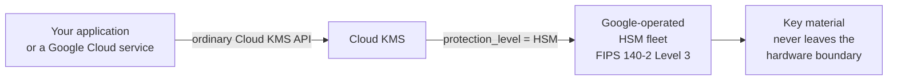

# Cloud HSM
{: .no_toc }

FIPS 140-2 Level 3 key material for the cost of one flag. This is the shortest
chapter in any of the three guides, and that is the point.
{: .fs-5 .fw-300 }

## On this page
{: .no_toc .text-delta }

1. TOC
{:toc}

---

## What Cloud HSM is



| Aspect | Cloud HSM |
|:--|:--|
| API surface | **Identical to software keys** |
| Works with every CMEK integration | **Yes** |
| Cluster to provision | **None** |
| Ceremony to run | **None** |
| Backups to manage | **None** |
| Users to create inside the HSM | **None** |
| Availability responsibility | **Google's** |
| What you change | `--protection-level=hsm` |

{: .tip }
> **Compare this to the other clouds and the difference is stark.** AWS CloudHSM
> requires a VPC design, a cluster, a trust-anchor CA ceremony, CO/CU user
> management, quorum configuration, backup retention, and client SDK deployment on
> every host. Azure Managed HSM requires a pool, a security domain quorum ceremony,
> local RBAC, and your own backup regime. Cloud HSM requires a flag. If FIPS 140-2
> Level 3 is your requirement — rather than *single tenancy* specifically — Google
> Cloud is by a wide margin the cheapest place to satisfy it operationally.

{: .warning }
> **Cloud HSM is not single-tenant.** The HSM fleet is Google-operated and shared,
> with your key material isolated inside the FIPS boundary. If your requirement is
> specifically *dedicated hardware you control* — as some regulators and contracts
> demand — Cloud HSM does not satisfy it, and Cloud EKM pointed at your own HSM is
> the Google Cloud answer. Read the requirement carefully: "FIPS 140-2 Level 3" and
> "single-tenant HSM" are different requirements that are often conflated.

## Creating HSM keys

```bash
PROJECT=contoso-keymgmt-prod
LOCATION=us-east1
KEYRING=prod-platform

gcloud kms keys create pci-chd-hsm \
  --keyring=prod-payments --location="$LOCATION" --project="$PROJECT" \
  --purpose=encryption \
  --protection-level=hsm \
  --default-algorithm=google-symmetric-encryption \
  --rotation-period=90d \
  --next-rotation-time="$(date -u -d '+90 days' +%Y-%m-%dT%H:%M:%SZ)" \
  --destroy-scheduled-duration=30d \
  --labels=environment=prod,data-class=restricted,compliance=pci,managed-by=gcloud
```

That is the whole thing. Everything else in this guide — IAM, rotation, CMEK
integration, logging, monitoring — works identically.

### Verify the protection level

```bash
gcloud kms keys versions list --key=pci-chd-hsm \
  --keyring=prod-payments --location="$LOCATION" --project="$PROJECT" \
  --format="table(name.basename(), state, protectionLevel, algorithm)"
```

```text
NAME  STATE    PROTECTION_LEVEL  ALGORITHM
1     ENABLED  HSM               GOOGLE_SYMMETRIC_ENCRYPTION
```

```bash
# Find every key that is NOT HSM-backed — the audit query
for RING in $(gcloud kms keyrings list --location="$LOCATION" --project="$PROJECT" \
                --format="value(name.basename())"); do
  gcloud kms keys list --keyring="$RING" --location="$LOCATION" --project="$PROJECT" \
    --filter="versionTemplate.protectionLevel!=HSM" \
    --format="value[separator='/']('$RING',name.basename())" \
    | sed 's/^/  SOFTWARE: /'
done
```

{: .important }
> **`protectionLevel` is immutable per version and per key.** A key created as
> `SOFTWARE` can never become `HSM` — you create a new key and re-encrypt. Since
> keys cannot be deleted, the software key remains in your inventory forever as a
> permanent reminder. Check the protection level in every plan and every review.

## Key attestations

HSM key versions can produce a signed attestation: cryptographic evidence, chained
to the manufacturer, that the key was generated inside a genuine HSM.

```bash
gcloud kms keys versions describe 1 --key=pci-chd-hsm \
  --keyring=prod-payments --location="$LOCATION" --project="$PROJECT" \
  --attestation-file=/tmp/attestation.dat \
  --format="yaml(name,state,protectionLevel,attestation.format)"
```

```yaml
attestation:
  format: CAVIUM_V2_COMPRESSED
name: projects/contoso-keymgmt-prod/locations/us-east1/keyRings/prod-payments/cryptoKeys/pci-chd-hsm/cryptoKeyVersions/1
protectionLevel: HSM
state: ENABLED
```

```bash
# Download the certificate chains needed to verify it
gcloud kms keys versions get-certificate-chain 1 \
  --key=pci-chd-hsm --keyring=prod-payments --location="$LOCATION" \
  --project="$PROJECT" \
  --certificate-chain-type=all --output-file=/tmp/chains.pem

# The attestation is a compressed bundle
file /tmp/attestation.dat
gunzip -c /tmp/attestation.dat > /tmp/attestation.raw 2>/dev/null \
  || cp /tmp/attestation.dat /tmp/attestation.raw

openssl crl2pkcs7 -nocrl -certfile /tmp/chains.pem \
  | openssl pkcs7 -print_certs -noout | head -20
```

| Chain type | Contains |
|:--|:--|
| `cavium` | The HSM manufacturer's chain |
| `google-card` | Google's card-level certificate |
| `google-partition` | Google's partition-level certificate |
| `all` | All of the above |

{: .tip }
> **The attestation is the strongest evidence available that a key was generated
> in hardware.** It is signed by the HSM itself and chains to the manufacturer's
> root — an assurance neither AWS KMS nor Azure Key Vault Premium exposes to you
> directly. Capture it at key creation for any key that carries a regulatory FIPS
> claim, store it with the key inventory, and reference it in the control
> narrative. Google publishes verification tooling; follow the current
> [attestation documentation](https://cloud.google.com/kms/docs/attest-key) for the
> exact procedure.

```bash
#!/usr/bin/env bash
# scripts/collect_attestations.sh — capture attestations as compliance evidence
set -euo pipefail
PROJECT="${PROJECT:-contoso-keymgmt-prod}"
LOCATION="${LOCATION:-us-east1}"
STAMP="$(date -u +%Y%m%dT%H%M%SZ)"
OUT="hsm-attestations-${STAMP}"
mkdir -p "$OUT"

for RING in $(gcloud kms keyrings list --location="$LOCATION" --project="$PROJECT" \
                --format="value(name.basename())"); do
  for KEY in $(gcloud kms keys list --keyring="$RING" --location="$LOCATION" \
                 --project="$PROJECT" \
                 --filter="versionTemplate.protectionLevel=HSM" \
                 --format="value(name.basename())"); do
    for V in $(gcloud kms keys versions list --key="$KEY" --keyring="$RING" \
                 --location="$LOCATION" --project="$PROJECT" \
                 --filter="state=ENABLED" --format="value(name.basename())"); do
      gcloud kms keys versions describe "$V" --key="$KEY" --keyring="$RING" \
        --location="$LOCATION" --project="$PROJECT" \
        --attestation-file="$OUT/${RING}-${KEY}-v${V}.attestation" >/dev/null
      gcloud kms keys versions get-certificate-chain "$V" --key="$KEY" \
        --keyring="$RING" --location="$LOCATION" --project="$PROJECT" \
        --certificate-chain-type=all \
        --output-file="$OUT/${RING}-${KEY}-v${V}-chains.pem" >/dev/null
      echo "  captured ${RING}/${KEY} v${V}"
    done
  done
done

tar czf "${OUT}.tar.gz" "$OUT" && rm -rf "$OUT"
sha256sum "${OUT}.tar.gz" | tee "${OUT}.tar.gz.sha256"
```

## Quotas and performance

HSM operations have a lower per-project request quota than software operations.

```bash
# Current quota usage
gcloud services quota list \
  --service=cloudkms.googleapis.com \
  --consumer="projects/${PROJECT}" \
  --format="table(metric, unit, quotaBuckets[0].effectiveLimit)"

# Request an increase
gcloud alpha services quota update \
  --service=cloudkms.googleapis.com \
  --consumer="projects/${PROJECT}" \
  --metric=cloudkms.googleapis.com/hsm_requests \
  --unit="1/min/{project}/{region}" \
  --value=60000 --force
```

{: .warning }
> **HSM quota is per project *and* per region, and it is the constraint that bites
> in production.** A workload calling `Encrypt` per record against an HSM key will
> hit `RESOURCE_EXHAUSTED` long before a software key would. Two answers, in order:
> use the envelope pattern with a bounded DEK cache
> ([7.4]()), and request a quota increase
> *before* the load test, not after the incident.

```bash
# Alert before you hit the ceiling
gcloud monitoring policies create --policy-from-file=- <<'YAML'
displayName: Cloud KMS HSM request quota approaching limit
conditions:
  - displayName: HSM requests above 80% of quota
    conditionThreshold:
      filter: >-
        resource.type = "consumer_quota"
        AND metric.type = "serviceruntime.googleapis.com/quota/allocation/usage"
        AND resource.label.service = "cloudkms.googleapis.com"
      comparison: COMPARISON_GT
      thresholdValue: 0.8
      duration: 300s
combiner: OR
notificationChannels:
  - projects/contoso-keymgmt-prod/notificationChannels/REPLACE_ME
YAML
```

## Cost

Cloud HSM costs more per key and per operation than software protection.

```bash
# Live pricing for your region
gcloud billing accounts list --format="value(name)" | head -1
# Then check https://cloud.google.com/kms/pricing for current figures —
# there is no fully authoritative CLI for KMS unit pricing.

# How many HSM keys do you have, and where?
for LOC in us-east1 us-west1 us europe-west4 global; do
  N=0
  for RING in $(gcloud kms keyrings list --location="$LOC" --project="$PROJECT" \
                  --format="value(name.basename())" 2>/dev/null); do
    C=$(gcloud kms keys list --keyring="$RING" --location="$LOC" --project="$PROJECT" \
          --filter="versionTemplate.protectionLevel=HSM" \
          --format="value(name)" 2>/dev/null | wc -l)
    N=$((N + C))
  done
  [ "$N" -gt 0 ] && echo "  $LOC: $N HSM key(s)"
done

# Version count matters too — you are billed per active key version
for RING in $(gcloud kms keyrings list --location="$LOCATION" --project="$PROJECT" \
                --format="value(name.basename())"); do
  for KEY in $(gcloud kms keys list --keyring="$RING" --location="$LOCATION" \
                 --project="$PROJECT" --format="value(name.basename())"); do
    V=$(gcloud kms keys versions list --key="$KEY" --keyring="$RING" \
          --location="$LOCATION" --project="$PROJECT" \
          --filter="state=ENABLED OR state=DISABLED" --format="value(name)" | wc -l)
    [ "$V" -gt 4 ] && printf '  %s/%s: %s billable versions\n' "$RING" "$KEY" "$V"
  done
done
```

{: .important }
> **You are billed per *active key version*, not per key.** A key rotating every
> 90 days accumulates four versions a year, and old versions stay `ENABLED` and
> billable indefinitely unless you disable and destroy them. Over five years that is
> twenty billable versions on one key. Build version retirement into your rotation
> runbook — see [Rotation](#retiring-an-old-version) —
> and note that the retention you choose is a data-recovery decision as much as a
> cost one.

## Terraform

```hcl
module "pci_chd" {
  source = "../../modules/kms-key"

  name        = "pci-chd-hsm"
  key_ring_id = module.payments_ring.id

  purpose          = "ENCRYPT_DECRYPT"
  algorithm        = "GOOGLE_SYMMETRIC_ENCRYPTION"
  protection_level = "HSM"          # the only line that differs from software

  rotation_period            = "7776000s"
  destroy_scheduled_duration = "2592000s"

  iam_bindings = {
    payments_app = {
      role   = "roles/cloudkms.cryptoKeyEncrypterDecrypter"
      member = "serviceAccount:payments-api@contoso-app-prod.iam.gserviceaccount.com"
    }
  }

  labels = {
    environment = "prod"
    data-class  = "restricted"
    compliance  = "pci"
  }
}
```

## Enforcing HSM organization-wide

```bash
cat > /tmp/allowed-protection-levels.yaml <<YAML
name: folders/${WORKLOADS_FOLDER}/policies/cloudkms.allowedProtectionLevels
spec:
  rules:
    - values:
        allowedValues:
          - HSM
          - EXTERNAL
          - EXTERNAL_VPC
YAML

gcloud org-policies set-policy /tmp/allowed-protection-levels.yaml

# Verify: creating a SOFTWARE key in that folder should now fail
gcloud kms keys create should-fail \
  --keyring=prod-platform --location="$LOCATION" --project="$PROJECT" \
  --purpose=encryption --protection-level=software 2>&1 | tail -2
```

```text
ERROR: (gcloud.kms.keys.create) FAILED_PRECONDITION: Constraint
constraints/cloudkms.allowedProtectionLevels violated for projects/contoso-keymgmt-prod.
```

{: .tip }
> **`cloudkms.allowedProtectionLevels` is the single highest-value organization
> policy for key management on Google Cloud.** It makes "all production keys are
> HSM-backed" a structural fact rather than a convention, and because the protection
> level is immutable, it prevents a mistake that can never be corrected in place.
> Apply it to the workloads folder, and keep a sandbox folder without it for
> development.

## Cloud HSM checklist

| # | Check | Command |
|:--|:--|:--|
| 1 | Every production key reports `protectionLevel: HSM` | `gcloud kms keys versions list` |
| 2 | `cloudkms.allowedProtectionLevels` enforced on workload folders | `gcloud org-policies describe` |
| 3 | Attestations captured for keys with a FIPS claim | `scripts/collect_attestations.sh` |
| 4 | Certificate chains stored with the attestations | Same |
| 5 | HSM request quota reviewed against peak load | `gcloud services quota list` |
| 6 | Quota alert configured at 80% | Monitoring policy |
| 7 | Billable version count reviewed | The version-count loop above |
| 8 | Version retirement in the rotation runbook | Runbook |

---

[Next: 8.2 Cloud EKM](){: .btn .btn-primary }
