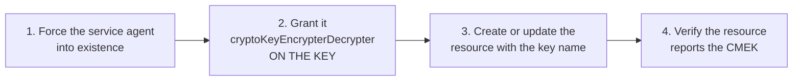

# Customer-Managed Encryption Keys Across Google Cloud
{: .no_toc }

Every integration follows the same shape: find the service agent, grant it
`cryptoKeyEncrypterDecrypter` on one key, point the resource at the key's
resource name.
{: .fs-5 .fw-300 }

## On this page
{: .no_toc .text-delta }

1. TOC
{:toc}

---

## The universal pattern



If an integration fails, the diagnosis order is almost always:

1. **Does the service agent exist?** (`gcloud beta services identity create`)
2. **Does it hold `roles/cloudkms.cryptoKeyEncrypterDecrypter` on the key?**
3. **Do the key and the resource share a location?** (regional vs. multi-region)
4. **Is the key `ENCRYPT_DECRYPT` purpose with an `ENABLED` primary version?**
5. **Does `gcp.restrictCmekCryptoKeyProjects` allow the key's project?**

```bash
KEY_PROJECT=contoso-keymgmt-prod
WORKLOAD_PROJECT=contoso-app-prod
LOCATION=us-east1
KEYRING=prod-platform
PN=$(gcloud projects describe "$WORKLOAD_PROJECT" --format="value(projectNumber)")

key_name () {
  echo "projects/${KEY_PROJECT}/locations/${LOCATION}/keyRings/${KEYRING}/cryptoKeys/$1"
}

grant_agent () {          # grant_agent <key> <agent-email> <api>
  gcloud beta services identity create --service="$3" \
    --project="$WORKLOAD_PROJECT" >/dev/null 2>&1 || true
  gcloud kms keys add-iam-policy-binding "$1" \
    --keyring="$KEYRING" --location="$LOCATION" --project="$KEY_PROJECT" \
    --member="serviceAccount:$2" \
    --role="roles/cloudkms.cryptoKeyEncrypterDecrypter" --condition=None >/dev/null
  echo "  granted $2 on $1"
}
```

## Cloud Storage

```bash
grant_agent gcs-cmek-hsm \
  "service-${PN}@gs-project-accounts.iam.gserviceaccount.com" \
  storage.googleapis.com

# New bucket with a default CMEK
gcloud storage buckets create gs://contoso-prod-data \
  --project="$WORKLOAD_PROJECT" \
  --location="$LOCATION" \
  --uniform-bucket-level-access \
  --public-access-prevention \
  --default-encryption-key="$(key_name gcs-cmek-hsm)"

# Existing bucket
gcloud storage buckets update gs://contoso-prod-data \
  --default-encryption-key="$(key_name gcs-cmek-hsm)"

gcloud storage buckets describe gs://contoso-prod-data \
  --format="value(default_kms_key)"
```

```text
projects/contoso-keymgmt-prod/locations/us-east1/keyRings/prod-platform/cryptoKeys/gcs-cmek-hsm
```

{: .warning }
> **Setting a default CMEK does not re-encrypt existing objects.** Objects written
> before the change keep their previous encryption — Google-managed, or an older key
> version. Check and rewrite:
>
> ```bash
> # Objects NOT using the CMEK
> gcloud storage ls -L gs://contoso-prod-data/** \
>   | grep -B5 "Kms key:.*None" | grep "^gs://"
>
> # Rewrite in place to apply the current key version
> gcloud storage objects update "gs://contoso-prod-data/**" \
>   --encryption-key="$(key_name gcs-cmek-hsm)"
> ```

### Per-object keys

```bash
# Override the bucket default for one object
gcloud storage cp sensitive.csv gs://contoso-prod-data/ \
  --encryption-key="$(key_name pci-chd-hsm)"

# Which key VERSION is this object using?
gcloud storage objects describe gs://contoso-prod-data/sensitive.csv \
  --format="value(kms_key)"
```

{: .tip }
> `objects describe --format="value(kms_key)"` returns the full **version** path.
> That is the only reliable way to find objects still wrapped under a key version
> you want to retire, and it is what you run before disabling one.

## BigQuery

```bash
grant_agent bq-cmek-hsm \
  "bq-${PN}@bigquery-encryption.iam.gserviceaccount.com" \
  bigquery.googleapis.com

# Dataset-level default: every table inherits it
bq mk --dataset \
  --location="$LOCATION" \
  --default_kms_key="$(key_name bq-cmek-hsm)" \
  --description="Production analytics" \
  "${WORKLOAD_PROJECT}:analytics"

# Existing dataset
bq update --default_kms_key="$(key_name bq-cmek-hsm)" \
  "${WORKLOAD_PROJECT}:analytics"

# Table-level override
bq mk --table \
  --destination_kms_key="$(key_name pci-chd-hsm)" \
  "${WORKLOAD_PROJECT}:analytics.cardholders" \
  "pk:STRING,pan_encrypted:BYTES,created:TIMESTAMP"

bq show --format=prettyjson "${WORKLOAD_PROJECT}:analytics.cardholders" \
  | jq '.encryptionConfiguration'
```

```json
{
  "kmsKeyName": "projects/contoso-keymgmt-prod/locations/us-east1/keyRings/prod-payments/cryptoKeys/pci-chd-hsm/cryptoKeyVersions/1"
}
```

{: .important }
> **The BigQuery key location must match the dataset location exactly.** A
> `us-east1` key cannot encrypt a dataset in the `US` multi-region, and vice versa.
> Because key ring locations are immutable, this is the mistake that most often
> forces a *second* key ring. Decide dataset locations before creating key rings.

## Compute Engine and Persistent Disk

```bash
grant_agent disk-cmek-hsm \
  "service-${PN}@compute-system.iam.gserviceaccount.com" \
  compute.googleapis.com

# A disk with a CMEK
gcloud compute disks create data-disk-01 \
  --project="$WORKLOAD_PROJECT" --zone="${LOCATION}-b" --size=500GB --type=pd-ssd \
  --kms-key="$(key_name disk-cmek-hsm)"

# A VM whose boot and data disks both use it
gcloud compute instances create app-01 \
  --project="$WORKLOAD_PROJECT" --zone="${LOCATION}-b" \
  --machine-type=n2-standard-4 \
  --image-family=debian-12 --image-project=debian-cloud \
  --boot-disk-kms-key="$(key_name disk-cmek-hsm)" \
  --create-disk="name=app-01-data,size=500GB,type=pd-ssd,kms-key=$(key_name disk-cmek-hsm)" \
  --shielded-secure-boot --shielded-vtpm --shielded-integrity-monitoring

# Project-wide default for all new disks in a region
gcloud compute project-info add-metadata \
  --project="$WORKLOAD_PROJECT" \
  --metadata="google-compute-default-kms-key=$(key_name disk-cmek-hsm)"

gcloud compute disks describe data-disk-01 --zone="${LOCATION}-b" \
  --format="value(diskEncryptionKey.kmsKeyName)"
```

{: .warning }
> **A disk's CMEK cannot be changed in place.** There is no update operation. The
> path is: snapshot → create a new disk from the snapshot with the new key → detach
> and swap. Plan the downtime, and set the CMEK at creation.

## Cloud SQL

```bash
grant_agent sql-cmek-hsm \
  "service-${PN}@gcp-sa-cloud-sql.iam.gserviceaccount.com" \
  sqladmin.googleapis.com

gcloud sql instances create prod-orders \
  --project="$WORKLOAD_PROJECT" \
  --database-version=POSTGRES_16 \
  --tier=db-custom-4-16384 \
  --region="$LOCATION" \
  --disk-encryption-key="$(key_name sql-cmek-hsm)" \
  --storage-size=200GB --storage-type=SSD --storage-auto-increase \
  --backup --backup-start-time=03:00 \
  --retained-backups-count=30 \
  --availability-type=REGIONAL \
  --no-assign-ip

gcloud sql instances describe prod-orders \
  --format="value(diskEncryptionConfiguration.kmsKeyName)"
```

{: .warning }
> **Cloud SQL disk encryption cannot be enabled on an existing instance.** The
> only path is export → create a new instance with the CMEK → import → cut over.
> This is the most common "we'll encrypt it later" trap on Google Cloud, and
> "later" means an outage window and a connection-string change.

## GKE

```bash
# 1. Node boot disks
grant_agent disk-cmek-hsm \
  "service-${PN}@compute-system.iam.gserviceaccount.com" \
  compute.googleapis.com

# 2. Application-layer Secrets encryption in etcd
grant_agent gke-etcd-cmek-hsm \
  "service-${PN}@container-engine-robot.iam.gserviceaccount.com" \
  container.googleapis.com

gcloud container clusters create platform-prod \
  --project="$WORKLOAD_PROJECT" --location="$LOCATION" \
  --database-encryption-key="$(key_name gke-etcd-cmek-hsm)" \
  --boot-disk-kms-key="$(key_name disk-cmek-hsm)" \
  --enable-private-nodes --enable-ip-alias \
  --workload-pool="${WORKLOAD_PROJECT}.svc.id.goog" \
  --enable-shielded-nodes --release-channel=regular

# Enable etcd encryption on an existing cluster
gcloud container clusters update platform-prod --location="$LOCATION" \
  --database-encryption-key="$(key_name gke-etcd-cmek-hsm)"

gcloud container clusters describe platform-prod --location="$LOCATION" \
  --format="yaml(databaseEncryption)"
```

```yaml
databaseEncryption:
  keyName: projects/contoso-keymgmt-prod/locations/us-east1/keyRings/prod-platform/cryptoKeys/gke-etcd-cmek-hsm
  state: ENCRYPTED
```

{: .important }
> **`--database-encryption-key` and `--boot-disk-kms-key` protect different
> things.** The first envelope-encrypts Kubernetes `Secret` objects inside etcd; the
> second encrypts the node disks. Both are worth having and neither substitutes for
> the other. Without etcd encryption, a Secret is base64 in etcd.

{: .warning }
> **Disabling etcd encryption on a running cluster is a heavyweight operation**
> that rewrites every Secret. Doing it because a key is broken, under pressure, is
> a bad time. Alarm on the etcd key's health specifically.

## Other integrations

| Service | Flag / field | Notes |
|:--|:--|:--|
| **Pub/Sub** | `--topic-encryption-key` | Set at topic creation or update |
| **Secret Manager** | `--kms-key-name` on the replication policy | Per-location for user-managed replication |
| **Artifact Registry** | `--kms-key` | **At repository creation only** |
| **Spanner** | `--kms-key` | At instance/database creation |
| **Filestore** | `--kms-key-name` | At creation |
| **Dataflow** | `--dataflow-kms-key` | Per job |
| **Composer** | `--kms-key` | At environment creation |
| **Bigtable** | `--kms-key` on the cluster | At cluster creation |
| **Cloud Run** | `--key` | Encrypts the container image and env |
| **Firestore** | `--kms-key-name` | At database creation |
| **Logging** | CMEK on a log bucket | Requires a specific service agent |

```bash
# Pub/Sub
grant_agent secrets-cmek-hsm "service-${PN}@gcp-sa-pubsub.iam.gserviceaccount.com" pubsub.googleapis.com
gcloud pubsub topics create payments-events \
  --project="$WORKLOAD_PROJECT" \
  --topic-encryption-key="$(key_name secrets-cmek-hsm)"

# Secret Manager — user-managed replication pins the CMEK per location
grant_agent secrets-cmek-hsm "service-${PN}@gcp-sa-secretmanager.iam.gserviceaccount.com" secretmanager.googleapis.com
gcloud secrets create stripe-api-key \
  --project="$WORKLOAD_PROJECT" \
  --replication-policy=user-managed \
  --locations="$LOCATION" \
  --kms-key-name="$(key_name secrets-cmek-hsm)"

# Artifact Registry — creation only
grant_agent secrets-cmek-hsm "service-${PN}@gcp-sa-artifactregistry.iam.gserviceaccount.com" artifactregistry.googleapis.com
gcloud artifacts repositories create apps \
  --project="$WORKLOAD_PROJECT" --location="$LOCATION" \
  --repository-format=docker \
  --kms-key="$(key_name secrets-cmek-hsm)"

# Logging bucket
gcloud logging buckets update _Default \
  --location=global --project=contoso-logging-prod \
  --cmek-kms-key-name="$(key_name gcs-cmek-hsm)"
```

{: .warning }
> **Several integrations are creation-time only** — Artifact Registry, Spanner,
> Filestore, Bigtable, Firestore. You cannot add a CMEK to an existing resource;
> you must recreate it and migrate the data. Decide on CMEK *before* you provision
> these, or budget for a migration.

## Enforcing CMEK organization-wide

```bash
# Deny resource creation without a CMEK for the listed services
cat > /tmp/restrict-non-cmek.yaml <<YAML
name: organizations/${ORG_ID}/policies/gcp.restrictNonCmekServices
spec:
  rules:
    - values:
        deniedValues:
          - storage.googleapis.com
          - bigquery.googleapis.com
          - compute.googleapis.com
          - sqladmin.googleapis.com
          - pubsub.googleapis.com
          - secretmanager.googleapis.com
          - artifactregistry.googleapis.com
          - container.googleapis.com
YAML
gcloud org-policies set-policy /tmp/restrict-non-cmek.yaml

# And restrict WHICH project's keys may be used
cat > /tmp/restrict-cmek-projects.yaml <<YAML
name: organizations/${ORG_ID}/policies/gcp.restrictCmekCryptoKeyProjects
spec:
  rules:
    - values:
        allowedValues:
          - under:projects/contoso-keymgmt-prod
YAML
gcloud org-policies set-policy /tmp/restrict-cmek-projects.yaml
```

{: .important }
> **`restrictCmekCryptoKeyProjects` is the control that makes the separate
> key-management project meaningful.** Without it, a workload team can create keys
> in their own project and use those — which looks compliant on a CMEK dashboard
> while defeating the entire separation of duties. With it, only keys from the
> key-management project are acceptable, and the key admins remain a distinct set
> of people.

## Verifying an integration actually used your key

```bash
#!/usr/bin/env bash
# scripts/verify_cmek.sh — is every eligible resource actually using a CMEK?
set -euo pipefail
PROJECT="${1:-contoso-app-prod}"

echo "== Cloud Storage buckets =="
for B in $(gcloud storage buckets list --project="$PROJECT" --format="value(name)"); do
  KEY=$(gcloud storage buckets describe "gs://$B" --format="value(default_kms_key)" 2>/dev/null)
  printf '  %-40s %s\n' "$B" "${KEY:-*** NO CMEK ***}"
done

echo "== BigQuery datasets =="
for DS in $(bq ls --project_id="$PROJECT" --format=json 2>/dev/null \
              | jq -r '.[].datasetReference.datasetId'); do
  KEY=$(bq show --format=json "${PROJECT}:${DS}" 2>/dev/null \
          | jq -r '.defaultEncryptionConfiguration.kmsKeyName // empty')
  printf '  %-40s %s\n' "$DS" "${KEY:-*** NO CMEK ***}"
done

echo "== Persistent disks =="
gcloud compute disks list --project="$PROJECT" \
  --format="table(name, zone.basename(), diskEncryptionKey.kmsKeyName)"

echo "== Cloud SQL instances =="
gcloud sql instances list --project="$PROJECT" \
  --format="table(name, region, diskEncryptionConfiguration.kmsKeyName)"

echo "== GKE clusters =="
gcloud container clusters list --project="$PROJECT" \
  --format="table(name, location, databaseEncryption.state, databaseEncryption.keyName)"
```

```sql
-- Confirm in the audit log that the service agent really called Cloud KMS
SELECT
  protopayload_auditlog.authenticationInfo.principalEmail AS service_agent,
  protopayload_auditlog.methodName                        AS method,
  JSON_VALUE(protopayload_auditlog.requestJson, '$.name')  AS key_name,
  COUNT(*)                                                 AS operations,
  MAX(timestamp)                                           AS last_seen
FROM `contoso-logging-prod.cloud_audit_logs.cloudaudit_googleapis_com_data_access`
WHERE protopayload_auditlog.serviceName = 'cloudkms.googleapis.com'
  AND timestamp > TIMESTAMP_SUB(CURRENT_TIMESTAMP(), INTERVAL 24 HOUR)
  AND protopayload_auditlog.authenticationInfo.principalEmail LIKE '%gserviceaccount.com'
GROUP BY 1, 2, 3
ORDER BY operations DESC;
```

{: .important }
> **A resource can report a `kmsKeyName` while never actually calling Cloud KMS**,
> if it is serving entirely from a cached DEK. The query above is what proves the
> integration is live. Run it after every CMEK change and keep the output — it is
> the difference between "we configured a CMEK" and "the CMEK is in use," which is
> what an assessor is actually asking.

## The revocation drill

```bash
# 1. Record the current state
gcloud storage buckets describe gs://contoso-prod-data \
  --format=json > /tmp/pre-revocation.json

# 2. Revoke — two options
#    a) Disable the key version (fastest, most complete)
gcloud kms keys versions disable 1 --key=gcs-cmek-hsm \
  --keyring="$KEYRING" --location="$LOCATION" --project="$KEY_PROJECT"

#    b) Remove the service agent's IAM binding (revokes one consumer)
gcloud kms keys remove-iam-policy-binding gcs-cmek-hsm \
  --keyring="$KEYRING" --location="$LOCATION" --project="$KEY_PROJECT" \
  --member="serviceAccount:service-${PN}@gs-project-accounts.iam.gserviceaccount.com" \
  --role="roles/cloudkms.cryptoKeyEncrypterDecrypter"

# 3. Confirm the outage
gcloud storage cat gs://contoso-prod-data/report.parquet 2>&1 | tail -3

# 4. Restore
gcloud kms keys versions enable 1 --key=gcs-cmek-hsm \
  --keyring="$KEYRING" --location="$LOCATION" --project="$KEY_PROJECT"
```

{: .warning }
> **Run this drill in a non-production project first, and time it.** The delay
> between revocation and actual loss of access is service-specific and genuinely
> useful information — a regulator asking "how quickly can you revoke access?" wants
> a measured number, not "immediately." Record it in the runbook.

---

[Next: 7.4 Envelope Encryption](){: .btn .btn-primary }
