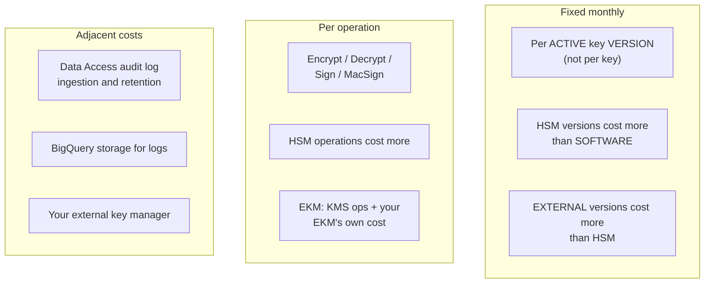

# Cost Model
{: .no_toc }

What each component actually costs, where the surprises are, and the levers that
move the bill by orders of magnitude.
{: .fs-5 .fw-300 }

## On this page
{: .no_toc .text-delta }

1. TOC
{:toc}

---

{: .warning }
> **Every figure on this page must be verified against current pricing.** Google
> Cloud pricing changes, varies by location, and this guide is not authoritative for
> it. Check the [Cloud KMS pricing page](https://cloud.google.com/kms/pricing) for
> your region before building a business case.

## The cost structure



{: .important }
> **You are billed per *active key version*, not per key.** This is the single most
> important cost fact about Cloud KMS, and it interacts badly with two other facts:
> keys cannot be deleted, and rotation creates versions that stay `ENABLED` forever
> unless you retire them. A key rotating every 90 days accumulates four billable
> versions a year, indefinitely.

## The version accumulation problem

```text
Key: gcs-cmek-hsm, rotating every 90 days, never retired

Year 1:  4 versions   ← 4× the monthly HSM version charge
Year 2:  8 versions
Year 3: 12 versions
Year 5: 20 versions   ← 20× the charge for ONE logical key
```

```bash
#!/usr/bin/env bash
# scripts/version_cost_report.sh — find keys accumulating billable versions
set -euo pipefail
PROJECT="${PROJECT:-contoso-keymgmt-prod}"
LOCATIONS="${LOCATIONS:-us-east1 us-west1 us europe-west4 global}"
THRESHOLD="${THRESHOLD:-4}"

TOTAL=0
printf '%-12s %-18s %-24s %-10s %-10s %s\n' \
  LOCATION KEYRING KEY PROTECTION BILLABLE ROTATION
printf '%.0s-' {1..90}; echo

for LOC in $LOCATIONS; do
  for RING in $(gcloud kms keyrings list --location="$LOC" --project="$PROJECT" \
                  --format="value(name.basename())" 2>/dev/null); do
    for KEY in $(gcloud kms keys list --keyring="$RING" --location="$LOC" \
                   --project="$PROJECT" --format="value(name.basename())"); do
      PROT=$(gcloud kms keys describe "$KEY" --keyring="$RING" --location="$LOC" \
        --project="$PROJECT" --format="value(versionTemplate.protectionLevel)")
      ROT=$(gcloud kms keys describe "$KEY" --keyring="$RING" --location="$LOC" \
        --project="$PROJECT" --format="value(rotationPeriod)")
      # ENABLED and DISABLED versions are both billable; DESTROYED are not
      N=$(gcloud kms keys versions list --key="$KEY" --keyring="$RING" \
        --location="$LOC" --project="$PROJECT" \
        --filter="state=ENABLED OR state=DISABLED" --format="value(name)" | wc -l)
      TOTAL=$((TOTAL + N))
      MARK=""
      [ "$N" -gt "$THRESHOLD" ] && MARK="  <-- review"
      printf '%-12s %-18s %-24s %-10s %-10s %s%s\n' \
        "$LOC" "$RING" "$KEY" "$PROT" "$N" "${ROT:--}" "$MARK"
    done
  done
done

echo
echo "Total billable key versions: $TOTAL"
```

```text
LOCATION     KEYRING            KEY                      PROTECTION BILLABLE   ROTATION
------------------------------------------------------------------------------------------
us-east1     prod-platform      gcs-cmek-hsm             HSM        14         7776000s  <-- review
us-east1     prod-platform      bq-cmek-hsm              HSM        4          7776000s
us-east1     prod-payments      pci-chd-hsm              HSM        9          7776000s  <-- review
us-east1     prod-signing       artifact-signing-hsm     HSM        2          -
global       old-ring           experiment-2024          SOFTWARE   1          -

Total billable key versions: 30
```

{: .tip }
> **Build version retirement into the rotation runbook, not into a cleanup
> project.** Every rotation should schedule the disable-and-destroy of the
> version *N* rotations back, where *N* is your documented data-recovery window.
> Without that, the version count only ever grows, and so does the bill.

## Where the surprises are

### 1. Test and sandbox keys that cannot be deleted

```bash
# Keys that look like experiments
for LOC in us-east1 us-west1 us global; do
  for RING in $(gcloud kms keyrings list --location="$LOC" --project="$PROJECT" \
                  --format="value(name.basename())" 2>/dev/null); do
    gcloud kms keys list --keyring="$RING" --location="$LOC" --project="$PROJECT" \
      --filter="labels.environment!=prod OR NOT labels.environment:*" \
      --format="value[separator='/']('$LOC','$RING',name.basename())" 2>/dev/null
  done
done | sed 's/^/  non-prod: /'
```

{: .warning }
> **A key created during a proof of concept is billable forever.** There is no
> delete. The only cleanup is destroying every version — which stops the charge but
> leaves the resource — or deleting the whole project. Do all experimentation in a
> project you intend to delete, and enforce it as a team norm.

### 2. Autokey creating keys per resource

```sql
-- How fast is Autokey creating keys?
SELECT
  DATE(timestamp)  AS day,
  COUNT(*)         AS keys_created
FROM `contoso-logging-prod.cloud_audit_logs.cloudaudit_googleapis_com_activity`
WHERE protopayload_auditlog.serviceName = 'cloudkms.googleapis.com'
  AND protopayload_auditlog.methodName LIKE '%CreateCryptoKey'
  AND protopayload_auditlog.authenticationInfo.principalEmail
      LIKE 'service-%@gcp-sa-cloudkms.iam.gserviceaccount.com'
  AND timestamp > TIMESTAMP_SUB(CURRENT_TIMESTAMP(), INTERVAL 90 DAY)
GROUP BY day ORDER BY day DESC;
```

A team churning through ephemeral buckets with Autokey accumulates permanent,
billable keys at whatever rate they create resources.

### 3. Per-record encryption with no envelope

An application calling `Encrypt` once per row at 1,000 rows/second issues 2.6
billion KMS operations a month — and hits `RESOURCE_EXHAUSTED` long before the
bill arrives.

```sql
-- Operations by principal — find the chatty ones
SELECT
  protopayload_auditlog.authenticationInfo.principalEmail AS principal,
  REGEXP_EXTRACT(protopayload_auditlog.methodName, r'\.(\w+)$') AS operation,
  COUNT(*) AS operations
FROM `contoso-logging-prod.cloud_audit_logs.cloudaudit_googleapis_com_data_access`
WHERE protopayload_auditlog.serviceName = 'cloudkms.googleapis.com'
  AND timestamp > TIMESTAMP_SUB(CURRENT_TIMESTAMP(), INTERVAL 30 DAY)
GROUP BY 1, 2
ORDER BY operations DESC
LIMIT 25;
```

**Fix:** the envelope pattern with a bounded DEK cache —
[Envelope Encryption](#caching--the-costisolation-trade-off).

### 4. Data Access audit log volume

```sql
-- KMS log volume, which is billed as ingestion
SELECT
  DATE(timestamp)  AS day,
  COUNT(*)         AS log_entries
FROM `contoso-logging-prod.cloud_audit_logs.cloudaudit_googleapis_com_data_access`
WHERE protopayload_auditlog.serviceName = 'cloudkms.googleapis.com'
GROUP BY day
ORDER BY day DESC
LIMIT 30;
```

| Lever | Effect |
|:--|:--|
| Exclude `ADMIN_READ` (`GetCryptoKey`, `ListCryptoKeys`) from sinks | Large; those are noisy and rarely investigated |
| Route to BigQuery and Cloud Storage rather than the `_Default` log bucket | Large |
| Partition-expire the BigQuery table beyond the retention requirement | Moderate |
| Reduce per-record KMS calls (envelope pattern) | **Very large — fewer operations means fewer log entries** |

{: .important }
> **Do not disable `DATA_READ` to save money.** That is the log recording every
> `Decrypt`, and losing it converts a cost line into an audit finding. Exclude the
> noisy `ADMIN_READ` entries instead, and address the volume at its source by
> reducing per-record operations.

### 5. EXTERNAL keys

`EXTERNAL` and `EXTERNAL_VPC` versions cost more per version and per operation
than HSM — *and* you pay for your external key manager, its hosting, and the
network path. Price the whole thing, not just the Cloud KMS line.

### 6. Multi-region key rings

A key in a multi-region key ring (`us`, `europe`) is a single billable key, but
operations may cost more than in a single region. Use multi-region only where the
resource genuinely requires it — multi-region GCS buckets and BigQuery datasets.

## Cost attribution

```bash
# Enable billing export to BigQuery (once, in the billing account)
bq mk --dataset --location=US contoso-logging-prod:billing_export

# Then query KMS spend by project and SKU
bq query --project_id=contoso-logging-prod --nouse_legacy_sql '
SELECT
  project.id                                     AS project,
  service.description                            AS service,
  sku.description                                AS sku,
  ROUND(SUM(cost), 2)                            AS cost,
  currency
FROM `contoso-logging-prod.billing_export.gcp_billing_export_v1_XXXXXX`
WHERE service.description = "Cloud Key Management Service (KMS)"
  AND usage_start_time > TIMESTAMP_SUB(CURRENT_TIMESTAMP(), INTERVAL 30 DAY)
GROUP BY 1, 2, 3, 5
ORDER BY cost DESC'
```

```text
+------------------------+---------------------------------------+--------------------------------------+--------+----------+
| project                | service                               | sku                                  | cost   | currency |
+------------------------+---------------------------------------+--------------------------------------+--------+----------+
| contoso-keymgmt-prod   | Cloud Key Management Service (KMS)     | HSM Key version                      | 187.50 | USD      |
| contoso-keymgmt-prod   | Cloud Key Management Service (KMS)     | HSM symmetric key operations         |  42.18 | USD      |
| contoso-keymgmt-prod   | Cloud Key Management Service (KMS)     | External key version                 |  30.00 | USD      |
| contoso-keymgmt-prod   | Cloud Key Management Service (KMS)     | Software key version                 |   1.14 | USD      |
+------------------------+---------------------------------------+--------------------------------------+--------+----------+
```

{: .tip }
> **The "HSM Key version" line being much larger than the operations line is the
> normal, healthy shape** — it means your envelope pattern is working. If operations
> dominate, you have a per-record encryption problem. That ratio is the fastest
> diagnostic on this page.

### Budget alerts

```bash
BILLING_ACCOUNT=$(gcloud billing accounts list --filter="open=true" \
  --format="value(name)" | head -1 | cut -d/ -f2)

gcloud billing budgets create \
  --billing-account="$BILLING_ACCOUNT" \
  --display-name="Key management monthly" \
  --budget-amount=2000USD \
  --filter-projects="projects/contoso-keymgmt-prod" \
  --filter-services="services/E505-1C79-9F13" \
  --threshold-rule=percent=0.5 \
  --threshold-rule=percent=0.8 \
  --threshold-rule=percent=1.0,basis=forecasted-spend
```

## The optimization checklist

| # | Lever | Typical impact |
|:--|:--|:--|
| 1 | Retire old key versions as part of rotation | **Very large** over time |
| 2 | Use the envelope pattern with a bounded DEK cache | **Very large** for per-record workloads |
| 3 | Do all experimentation in a disposable project | Large; and it is the only real cleanup |
| 4 | Exclude `ADMIN_READ` KMS logs from sinks | Large where log volume is high |
| 5 | Use `SOFTWARE` for genuinely non-sensitive dev keys | Moderate |
| 6 | Monitor and cap Autokey key creation | Moderate to large |
| 7 | Route audit logs to BigQuery rather than the default log bucket | Moderate |
| 8 | Use direct `Encrypt` for small fields instead of an envelope | Moderate; also a security improvement |
| 9 | Use multi-region key rings only where required | Small |
| 10 | Cache `GetCryptoKey` results in applications | Small; reduces log noise too |

{: .important }
> **Do not optimize item 5 into production.** Software-protected keys are cheaper
> and give you FIPS 140-2 Level 1 instead of Level 3. For anything with a compliance
> obligation, HSM is the point — and unlike AWS or Azure, the HSM tier here costs you
> no additional operational effort at all. Save money somewhere that is not a
> control.

## Deciding between tiers

| | `SOFTWARE` | `HSM` | `EXTERNAL` / `EXTERNAL_VPC` |
|:--|:--|:--|:--|
| Per-version cost | Lowest | Higher | Highest |
| Per-operation cost | Lowest | Higher | Highest + your EKM |
| Staff time | Zero | **Zero** | Substantial — you run an HA service |
| Availability risk you own | None | **None** | **All of it** |
| FIPS | 140-2 Level 1 | **140-2 Level 3** | Your EKM's |
| What you get | Managed software keys | Managed FIPS L3 hardware | Key custody outside Google Cloud |

{: .tip }
> **The HSM-versus-software decision on Google Cloud is almost purely a cost
> question, and the cost difference is small.** There is no cluster to run, no
> ceremony, no backup regime — the operational column is identical. That makes
> "production keys are HSM" an easy standard to adopt and enforce, and it is what
> `cloudkms.allowedProtectionLevels` exists to guarantee. The genuinely
> consequential decision is `EXTERNAL`, where you take on an availability
> obligation: frame that one as *what specific written requirement does this satisfy
> that HSM does not?*

---

[Next: Sources](){: .btn .btn-primary }
