# Envelope Encryption in Application Code
{: .no_toc }

The pattern every Google Cloud CMEK integration uses internally, implemented
directly so you can apply it to data those integrations do not reach — and then
the library you should actually ship.
{: .fs-5 .fw-300 }

## On this page
{: .no_toc .text-delta }

1. TOC
{:toc}

---

## Why you cannot just call `Encrypt`

| Constraint | Value | Consequence |
|:--|:--|:--|
| `Encrypt` max plaintext | 64 KiB | Anything larger needs a DEK |
| `Encrypt` max AAD | 8 KiB | Context must be compact |
| Network round trip | ~10–50 ms | Per-record KMS calls destroy throughput |
| Request quota | Per-project, per-region; **HSM is lower than software** | High-volume workloads hit `RESOURCE_EXHAUSTED` |
| Cost | Per 10,000 operations | Per-record calls are the classic surprise bill |

Envelope encryption solves all five: one KMS call yields a DEK you use locally,
at memory speed, for as many records as your caching policy allows.

## Doing it by hand

`scripts/envelope_encrypt.py`

```python
#!/usr/bin/env python3
"""Envelope encryption with Cloud KMS + local AES-256-GCM, step by step.

This exists to show the mechanism. For production, use Tink (below).
"""
from __future__ import annotations

import json
import os
import struct
from dataclasses import dataclass

import crcmod
from cryptography.hazmat.primitives.ciphers.aead import AESGCM
from google.cloud import kms

ENVELOPE_MAGIC = b"GKM1"
NONCE_BYTES = 12


def _crc32c(data: bytes) -> int:
    return crcmod.predefined.mkPredefinedCrcFun("crc-32c")(data)


@dataclass
class Envelope:
    key_name: str          # the KEY, not the version — KMS picks the version
    wrapped_dek: bytes
    nonce: bytes
    ciphertext: bytes      # includes the 16-byte GCM tag
    aad: bytes

    def serialize(self) -> bytes:
        name = self.key_name.encode()
        return b"".join([
            ENVELOPE_MAGIC,
            struct.pack(">H", len(name)), name,
            struct.pack(">H", len(self.wrapped_dek)), self.wrapped_dek,
            struct.pack(">H", len(self.aad)), self.aad,
            self.nonce,
            self.ciphertext,
        ])

    @classmethod
    def deserialize(cls, blob: bytes) -> "Envelope":
        if blob[:4] != ENVELOPE_MAGIC:
            raise ValueError("Not a GKM1 envelope")
        off = 4
        (n,) = struct.unpack(">H", blob[off:off + 2]); off += 2
        name = blob[off:off + n].decode(); off += n
        (n,) = struct.unpack(">H", blob[off:off + 2]); off += 2
        wrapped = blob[off:off + n]; off += n
        (n,) = struct.unpack(">H", blob[off:off + 2]); off += 2
        aad = blob[off:off + n]; off += n
        nonce = blob[off:off + NONCE_BYTES]; off += NONCE_BYTES
        return cls(name, wrapped, nonce, blob[off:], aad)


class EnvelopeCrypto:
    def __init__(self, key_name: str) -> None:
        self.client = kms.KeyManagementServiceClient()
        self.key_name = key_name

    def encrypt(self, plaintext: bytes, context: dict[str, str]) -> bytes:
        aad = json.dumps(context, sort_keys=True).encode()

        # 1. Generate the DEK locally. Cloud KMS has no GenerateDataKey API —
        #    unlike AWS, you create the DEK yourself and ask KMS to wrap it.
        dek = AESGCM.generate_key(bit_length=256)
        try:
            # 2. Encrypt locally, binding the context as AES-GCM AAD.
            nonce = os.urandom(NONCE_BYTES)
            ciphertext = AESGCM(dek).encrypt(nonce, plaintext, aad)

            # 3. Wrap the DEK with the key's PRIMARY version.
            wrapped = self.client.encrypt(request={
                "name": self.key_name,
                "plaintext": dek,
                "additional_authenticated_data": aad,
                "plaintext_crc32c": _crc32c(dek),
                "additional_authenticated_data_crc32c": _crc32c(aad),
            })
            if not wrapped.verified_plaintext_crc32c:
                raise RuntimeError("DEK corrupted in transit to Cloud KMS")

            return Envelope(
                key_name=self.key_name,
                wrapped_dek=wrapped.ciphertext,
                nonce=nonce,
                ciphertext=ciphertext,
                aad=aad,
            ).serialize()
        finally:
            # Python cannot guarantee zeroization — see the warning below.
            del dek

    def decrypt(self, blob: bytes) -> bytes:
        env = Envelope.deserialize(blob)

        # KMS selects the version from the ciphertext. You never specify one.
        unwrapped = self.client.decrypt(request={
            "name": env.key_name,
            "ciphertext": env.wrapped_dek,
            "additional_authenticated_data": env.aad,
            "ciphertext_crc32c": _crc32c(env.wrapped_dek),
            "additional_authenticated_data_crc32c": _crc32c(env.aad),
        })
        dek = unwrapped.plaintext
        try:
            return AESGCM(dek).decrypt(env.nonce, env.ciphertext, env.aad)
        finally:
            del dek


if __name__ == "__main__":
    KEY = ("projects/contoso-keymgmt-prod/locations/us-east1/keyRings/"
           "prod-platform/cryptoKeys/gcs-cmek-hsm")
    crypto = EnvelopeCrypto(KEY)

    context = {"tenant": "acme-corp", "table": "cardholders", "purpose": "at-rest"}
    secret = b"4111 1111 1111 1111 | exp 12/29 | Jane Q. Customer"

    sealed = crypto.encrypt(secret, context)
    print("envelope size:", len(sealed), "bytes")

    assert crypto.decrypt(sealed) == secret
    print("round trip     : OK")

    # Prove the AAD is binding at BOTH layers
    tampered = Envelope.deserialize(sealed)
    tampered.aad = json.dumps(
        {**context, "tenant": "evil-corp"}, sort_keys=True
    ).encode()
    try:
        crypto.decrypt(tampered.serialize())
        raise SystemExit("SECURITY FAILURE: AAD was not enforced")
    except Exception as exc:                      # noqa: BLE001
        print("AAD binding    :", type(exc).__name__, "(expected)")
```

```text
envelope size: 285 bytes
round trip     : OK
AAD binding    : FailedPrecondition (expected)
```

{: .important }
> **Cloud KMS has no `GenerateDataKey` API.** Unlike AWS KMS, which mints the DEK
> inside the service and hands you both copies, on Google Cloud *you* generate the
> DEK locally and ask KMS to wrap it. Two consequences: the DEK's quality depends on
> your CSPRNG, not an HSM's; and the plaintext DEK exists in your process before it
> ever reaches KMS. Neither is a problem in practice — `AESGCM.generate_key` uses the
> OS CSPRNG — but it is a genuine architectural difference worth knowing.

{: .warning }
> **Python cannot reliably zeroize key material.** `bytes` objects are immutable;
> `del` drops the reference but the bytes remain in the heap until garbage
> collection, and may have been copied by the allocator. For workloads where
> memory-scraping is in your threat model, use a language with explicit memory
> control, or keep operations inside the KMS boundary by calling `Encrypt` directly
> on payloads under 64 KiB.

## Tink — what you should actually ship

Do not hand-roll the envelope format in production. Tink handles framing,
algorithm selection, AAD binding, key rotation, and misuse resistance.

```bash
pip install tink
```

```python
#!/usr/bin/env python3
"""Production envelope encryption with Tink + Cloud KMS."""
import tink
from tink import aead
from tink.integration import gcpkms

KEY_URI = (
    "gcp-kms://projects/contoso-keymgmt-prod/locations/us-east1/"
    "keyRings/prod-platform/cryptoKeys/gcs-cmek-hsm"
)

aead.register()

# The KMS AEAD wraps DEKs; it never touches the bulk data.
gcp_client = gcpkms.GcpKmsClient(KEY_URI, credentials_path=None)
remote_aead = gcp_client.get_aead(KEY_URI)

# Envelope AEAD: generates a fresh DEK per message, wraps it with Cloud KMS,
# and produces a single self-describing ciphertext.
env_aead = aead.KmsEnvelopeAead(
    aead.aead_key_templates.AES256_GCM,
    remote_aead,
)

context = b'{"tenant":"acme-corp","table":"cardholders"}'
plaintext = b"4111 1111 1111 1111"

ciphertext = env_aead.encrypt(plaintext, context)
assert env_aead.decrypt(ciphertext, context) == plaintext
print("Tink round trip: OK,", len(ciphertext), "bytes")

# AAD is enforced
try:
    env_aead.decrypt(ciphertext, b'{"tenant":"evil-corp"}')
    raise SystemExit("SECURITY FAILURE")
except tink.TinkError:
    print("Tink AAD binding: enforced")
```

### Why Tink over hand-rolled

| Concern | Hand-rolled | Tink |
|:--|:--|:--|
| Framing / versioning | You design it | Standard, versioned, cross-language |
| Nonce reuse | Your responsibility | Structurally prevented |
| Algorithm agility | Manual | Key templates |
| Key rotation | Manual | Keyset with primary/secondary keys |
| Cross-language interop | None | Java, Go, Python, C++, Obj-C |
| Misuse resistance | None | The library's explicit design goal |

{: .tip }
> **Tink's `KmsEnvelopeAead` generates a fresh DEK for every message by default.**
> That is the most conservative setting — one leaked DEK exposes exactly one record —
> and it means one Cloud KMS call per message. For high-volume workloads you need
> caching, which is a deliberate risk decision. See below.

## Caching — the cost/isolation trade-off

```mermaid
flowchart LR
    A["No cache<br/>1 KMS call per record"] -->|"cost ↑↑<br/>latency ↑↑<br/>quota risk ↑↑"| B["Bounded cache<br/>max_age + max_messages"]
    B -->|"DEK reuse ↑<br/>blast radius ↑"| C["Unbounded cache<br/>one DEK forever"]
    style B fill:#1e4620,stroke:#4ade80
    style A fill:#4a1e1e,stroke:#f87171
    style C fill:#4a1e1e,stroke:#f87171
```



```python
"""A bounded DEK cache. The parameters are a documented risk decision."""
from __future__ import annotations

import os
import threading
import time
from dataclasses import dataclass

from cryptography.hazmat.primitives.ciphers.aead import AESGCM
from google.cloud import kms


@dataclass
class CachedDek:
    plaintext: bytes
    wrapped: bytes
    created: float
    messages: int = 0
    bytes_encrypted: int = 0


class CachingEnvelopeCrypto:
    """Reuse one DEK across many messages, bounded by age, count, and volume."""

    def __init__(
        self,
        key_name: str,
        max_age_seconds: float = 300.0,
        max_messages: int = 1000,
        max_bytes: int = 10 * 1024 * 1024,
    ) -> None:
        self.client = kms.KeyManagementServiceClient()
        self.key_name = key_name
        self.max_age = max_age_seconds
        self.max_messages = max_messages
        self.max_bytes = max_bytes
        self._cache: dict[bytes, CachedDek] = {}
        self._lock = threading.Lock()

    def _fresh_dek(self, aad: bytes) -> CachedDek:
        dek = AESGCM.generate_key(bit_length=256)
        wrapped = self.client.encrypt(request={
            "name": self.key_name,
            "plaintext": dek,
            "additional_authenticated_data": aad,
        }).ciphertext
        return CachedDek(plaintext=dek, wrapped=wrapped, created=time.monotonic())

    def _get_dek(self, aad: bytes, payload_len: int) -> CachedDek:
        with self._lock:
            entry = self._cache.get(aad)
            expired = (
                entry is None
                or time.monotonic() - entry.created > self.max_age
                or entry.messages >= self.max_messages
                or entry.bytes_encrypted + payload_len > self.max_bytes
            )
            if expired:
                entry = self._fresh_dek(aad)
                self._cache[aad] = entry
            entry.messages += 1
            entry.bytes_encrypted += payload_len
            return entry

    def encrypt(self, plaintext: bytes, aad: bytes) -> tuple[bytes, bytes, bytes]:
        entry = self._get_dek(aad, len(plaintext))
        nonce = os.urandom(12)
        ct = AESGCM(entry.plaintext).encrypt(nonce, plaintext, aad)
        return entry.wrapped, nonce, ct
```

| Setting | Too low | Too high | Reasonable start |
|:--|:--|:--|:--|
| `max_age_seconds` | KMS cost and quota pressure | Longer window where one leaked DEK is useful | 60–300 s |
| `max_messages` | Same | More records share a blast radius | 100–10,000 |
| `max_bytes` | Same | Approaches AES-GCM safe-usage limits | ≤ 2³² blocks per key |

{: .important }
> **Caching trades cryptographic isolation for cost and throughput, and that is a
> risk decision, not a performance tuning knob.** Write the chosen values down with
> a justification. An auditor asking "how many records could a single compromised
> DEK decrypt?" is asking for `max_messages`, and "I don't know" is the wrong
> answer.

## When to skip the envelope entirely

For payloads under 64 KiB, calling `Encrypt` directly is simpler and keeps the
plaintext key material entirely inside the Cloud KMS boundary.

```python
from google.cloud import kms

client = kms.KeyManagementServiceClient()
KEY = ("projects/contoso-keymgmt-prod/locations/us-east1/keyRings/"
       "prod-payments/cryptoKeys/pci-chd-hsm")

# A PAN is well under 64 KiB — no DEK, no local crypto, no key in your memory
ciphertext = client.encrypt(request={
    "name": KEY,
    "plaintext": b"4111111111111111",
    "additional_authenticated_data": b"tenant=acme-corp",
}).ciphertext
```

{: .tip }
> **For small, high-sensitivity fields, direct `Encrypt` is the stronger design.**
> No DEK ever enters your process, so a memory dump of your application yields
> nothing — and with an HSM-protection-level key the operation happens in FIPS
> 140-2 Level 3 hardware. The cost is one KMS call per operation, which for
> per-record card data is usually acceptable. Reserve the envelope pattern for bulk
> data and high-throughput paths.

---

[Next: 7.5 Autokey](){: .btn .btn-primary }
