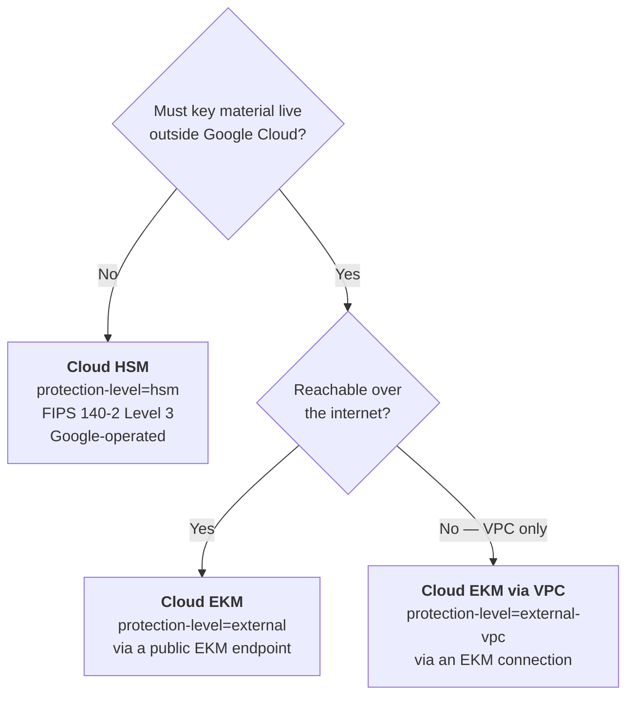

# Cloud HSM &amp; External Keys
{: .no_toc }

**Phase 6 — HSM tier.** FIPS 140-2 Level 3 hardware with no operational burden,
and the option to keep key material outside Google Cloud entirely.
{: .fs-5 .fw-300 }

---

## The three tiers above software

| | Cloud HSM | Cloud EKM | Cloud EKM via VPC |
|:--|:--|:--|:--|
| Key material location | Google's HSMs | **Your external key manager** | **Your external key manager** |
| Who operates the hardware | Google | **You / your vendor** | **You / your vendor** |
| FIPS | 140-2 Level 3 | Whatever your EKM holds | Same |
| Network path | Internal | Public internet | **VPC + Private Service Connect** |
| Added latency | Negligible | Tens to hundreds of ms | Lower than public EKM |
| Availability risk you own | **None** | **All of it** | **All of it** |
| Can you unilaterally revoke Google's access? | No | **Yes** | **Yes** |
| Operational burden | **None** | High | High |

{: .important }
> **Cloud HSM is a flag, not a project.** Unlike AWS CloudHSM and Azure Managed
> HSM — both of which hand you a cluster to operate, a ceremony to run, and backups
> to own — Cloud HSM is `--protection-level=hsm` on an otherwise identical key.
> Google runs the hardware, the HA, and the patching. That makes the FIPS 140-2
> Level 3 tier dramatically cheaper to *operate* on Google Cloud than on the other
> two, which is a genuine architectural advantage and the reason this guide
> recommends HSM as the production default.

{: .warning }
> **Cloud EKM is the highest-control and highest-risk option in this guide.** Your
> external key manager becomes a hard dependency of every Google Cloud service
> reading that data. An EKM outage is an outage of your buckets, your datasets, and
> your databases — and Cloud KMS will not cache around it. Build the EKM to the same
> availability standard as the workload it gates, then test that assumption with a
> game day.

## Choosing

| Driver | Tier |
|:--|:--|
| Production data of any sensitivity | **Cloud HSM** |
| FIPS 140-2 Level 3 requirement | **Cloud HSM** |
| Development, or genuinely public data | Software |
| Regulator requires keys outside the provider | **Cloud EKM** |
| Contractual right to unilaterally revoke provider access | **Cloud EKM** |
| Data-sovereignty rules pinning key custody to a jurisdiction | **Cloud EKM** |
| Existing enterprise HSM estate that must remain the system of record | **Cloud EKM** |
| EKM must not be reachable from the internet | **Cloud EKM via VPC** |

If none of the EKM drivers apply, use Cloud HSM. EKM bought "because it sounds
more secure" is a self-inflicted availability problem.

## Pages in this section

| Page | What it covers |
|:--|:--|
| [8.1 Cloud HSM]() | Creating and verifying HSM-protected keys, attestations, quotas |
| [8.2 Cloud EKM]() | External keys over the internet and via VPC, EKM connections, and the failure modes |

---

[Next: 8.1 Cloud HSM](){: .btn .btn-primary }
