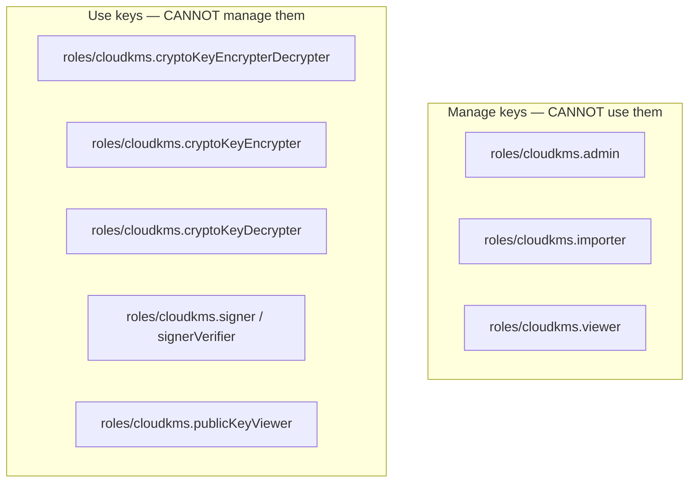
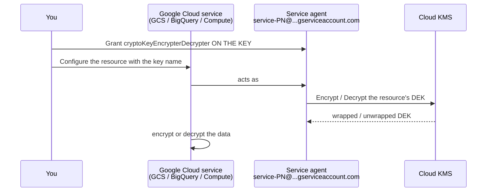

# IAM &amp; Access Control
{: .no_toc }

**Phase 4 — IAM.** The authorization model is where key management is actually
won or lost. Google Cloud gives you the separation of duties for free — the work
is not undoing it.
{: .fs-5 .fw-300 }

## On this page
{: .no_toc .text-delta }

1. TOC
{:toc}

---

## The Cloud KMS roles



| Role | Grants | Notably does **not** grant |
|:--|:--|:--|
| `roles/cloudkms.admin` | Create, update, disable, destroy keys and versions; manage IAM | **Any cryptographic operation** |
| `roles/cloudkms.importer` | Create import jobs and import key versions | Crypto operations |
| `roles/cloudkms.viewer` | Read key metadata and IAM policies | Key material, crypto operations |
| `roles/cloudkms.cryptoKeyEncrypterDecrypter` | `Encrypt`, `Decrypt` | Key management |
| `roles/cloudkms.cryptoKeyEncrypter` | `Encrypt` only | Decrypt |
| `roles/cloudkms.cryptoKeyDecrypter` | `Decrypt` only | Encrypt |
| `roles/cloudkms.signer` | `AsymmetricSign`, `MacSign` | Verify, key management |
| `roles/cloudkms.signerVerifier` | Sign and verify | Key management |
| `roles/cloudkms.verifier` | `MacVerify` | Sign |
| `roles/cloudkms.publicKeyViewer` | `GetPublicKey` | Sign |
| `roles/cloudkms.cryptoOperator` | All crypto operations | Key management |

{: .important }
> **`roles/cloudkms.admin` does not include cryptographic operations, by design.**
> A key administrator can create, rotate, disable, and destroy keys but cannot
> `Encrypt`, `Decrypt`, or `Sign`. That is the separation of duties SOC 2 CC6.3 and
> PCI DSS 3.6.x ask for, and unlike AWS and Azure you get it as the *default*
> behavior of the built-in role rather than having to construct it. The work is not
> undoing it — see the basic roles warning below.

{: .warning }
> **`roles/owner` and `roles/editor` include Cloud KMS crypto permissions**, and
> they silently destroy the separation above. Never grant a basic role on a
> key-management project. Check now:
>
> ```bash
> gcloud projects get-iam-policy contoso-keymgmt-prod \
>   --flatten="bindings[].members" \
>   --filter="bindings.role:(roles/owner OR roles/editor)" \
>   --format="table(bindings.role, bindings.members)"
> ```
>
> A non-empty result is a finding, and Security Command Center's
> `KMS_PROJECT_HAS_OWNER` detector reports it independently.

## Scope — the underused control

IAM can be bound at four levels. **Bind at the narrowest one that works.**

```mermaid
flowchart TB
    O["Organization"] --> P["Project"]
    P --> R["Key ring"]
    R --> K["Key"]
    O -.->|"almost never"| X1["✗"]
    P -.->|"only for admins"| X2["~"]
    R -->|"a trust domain"| G1["✓ groups"]
    K -->|"one workload,<br/>one key"| G2["✓ service agents"]
    style G1 fill:#1e4620,stroke:#4ade80
    style G2 fill:#1e4620,stroke:#4ade80
```



| Scope | Use for |
|:--|:--|
| **Key** | Service agents and workload identities — one identity, one key |
| **Key ring** | Human groups covering a whole trust domain |
| **Project** | Key administrators and auditors only |
| **Organization/folder** | Almost never for KMS |

```bash
LOCATION=us-east1
PROJECT=contoso-keymgmt-prod

# Key ring scope — a human group over a trust domain
gcloud kms keyrings add-iam-policy-binding prod-platform \
  --location="$LOCATION" --project="$PROJECT" \
  --member="group:gcp-key-admins@contoso.com" \
  --role="roles/cloudkms.admin"

# Key scope — one workload, one key
gcloud kms keys add-iam-policy-binding gcs-cmek-hsm \
  --keyring=prod-platform --location="$LOCATION" --project="$PROJECT" \
  --member="serviceAccount:payments-api@contoso-app-prod.iam.gserviceaccount.com" \
  --role="roles/cloudkms.cryptoKeyEncrypterDecrypter"

# Inspect
gcloud kms keys get-iam-policy gcs-cmek-hsm \
  --keyring=prod-platform --location="$LOCATION" --project="$PROJECT" \
  --format="table(bindings.role, bindings.members)"
```

{: .tip }
> **Key-level scope is the difference between "the payments service can use its
> key" and "the payments service can use every key in the ring, including the
> analytics key."** It costs one extra argument. Use it for every non-human
> identity.

## Service agents — the CMEK pattern

Every Google Cloud service that supports CMEK uses a **service agent**: a
Google-managed service account, per-project and per-service, that calls Cloud KMS
on your behalf.



### The service agent addresses

```bash
PROJECT=contoso-app-prod
PN=$(gcloud projects describe "$PROJECT" --format="value(projectNumber)")
echo "project number: $PN"
```

| Service | Service agent |
|:--|:--|
| Cloud Storage | `service-${PN}@gs-project-accounts.iam.gserviceaccount.com` |
| BigQuery | `bq-${PN}@bigquery-encryption.iam.gserviceaccount.com` |
| Compute Engine / PD / GKE nodes | `service-${PN}@compute-system.iam.gserviceaccount.com` |
| Cloud SQL | `service-${PN}@gcp-sa-cloud-sql.iam.gserviceaccount.com` |
| Secret Manager | `service-${PN}@gcp-sa-secretmanager.iam.gserviceaccount.com` |
| Pub/Sub | `service-${PN}@gcp-sa-pubsub.iam.gserviceaccount.com` |
| Artifact Registry | `service-${PN}@gcp-sa-artifactregistry.iam.gserviceaccount.com` |
| GKE (etcd / cluster) | `service-${PN}@container-engine-robot.iam.gserviceaccount.com` |
| Dataflow | `service-${PN}@dataflow-service-producer-prod.iam.gserviceaccount.com` |
| Spanner | `service-${PN}@gcp-sa-spanner.iam.gserviceaccount.com` |
| Filestore | `service-${PN}@cloud-filer.iam.gserviceaccount.com` |
| Cloud Composer | `service-${PN}@cloudcomposer-accounts.iam.gserviceaccount.com` |

{: .warning }
> **A service agent does not exist until the service has been used at least once
> in the project.** Granting a role to an agent that has not been created yet fails
> with "does not exist," which looks like a typo. Force it into existence first:
>
> ```bash
> gcloud beta services identity create \
>   --service=storage.googleapis.com --project="$PROJECT"
> ```
>
> Terraform's equivalent is `google_project_service_identity`. This is the number
> one cause of a first CMEK deployment failing.

### Granting them, at scale

```bash
#!/usr/bin/env bash
# scripts/grant_service_agents.sh — wire CMEK service agents to their keys
set -euo pipefail

KEY_PROJECT="${KEY_PROJECT:-contoso-keymgmt-prod}"
WORKLOAD_PROJECT="${WORKLOAD_PROJECT:-contoso-app-prod}"
LOCATION="${LOCATION:-us-east1}"
KEYRING="${KEYRING:-prod-platform}"

PN=$(gcloud projects describe "$WORKLOAD_PROJECT" --format="value(projectNumber)")

declare -A AGENT_FOR_KEY=(
  [gcs-cmek-hsm]="service-${PN}@gs-project-accounts.iam.gserviceaccount.com"
  [bq-cmek-hsm]="bq-${PN}@bigquery-encryption.iam.gserviceaccount.com"
  [disk-cmek-hsm]="service-${PN}@compute-system.iam.gserviceaccount.com"
  [sql-cmek-hsm]="service-${PN}@gcp-sa-cloud-sql.iam.gserviceaccount.com"
  [secrets-cmek-hsm]="service-${PN}@gcp-sa-secretmanager.iam.gserviceaccount.com"
)

declare -A API_FOR_KEY=(
  [gcs-cmek-hsm]="storage.googleapis.com"
  [bq-cmek-hsm]="bigquery.googleapis.com"
  [disk-cmek-hsm]="compute.googleapis.com"
  [sql-cmek-hsm]="sqladmin.googleapis.com"
  [secrets-cmek-hsm]="secretmanager.googleapis.com"
)

for KEY in "${!AGENT_FOR_KEY[@]}"; do
  AGENT="${AGENT_FOR_KEY[$KEY]}"
  API="${API_FOR_KEY[$KEY]}"

  # Force the service agent into existence
  gcloud beta services identity create --service="$API" \
    --project="$WORKLOAD_PROJECT" >/dev/null 2>&1 || true

  gcloud kms keys add-iam-policy-binding "$KEY" \
    --keyring="$KEYRING" --location="$LOCATION" --project="$KEY_PROJECT" \
    --member="serviceAccount:${AGENT}" \
    --role="roles/cloudkms.cryptoKeyEncrypterDecrypter" \
    --condition=None >/dev/null

  printf '  %-20s -> %s\n' "$KEY" "$AGENT"
done

echo
echo "Verifying:"
for KEY in "${!AGENT_FOR_KEY[@]}"; do
  N=$(gcloud kms keys get-iam-policy "$KEY" --keyring="$KEYRING" \
        --location="$LOCATION" --project="$KEY_PROJECT" \
        --format="value(bindings.members)" | tr ';' '\n' | grep -c . || echo 0)
  printf '  %-20s %s binding(s)\n' "$KEY" "$N"
done
```

## IAM conditions

Conditions narrow a binding by time, resource attribute, or request context.

```bash
# Time-bound access for a migration project
gcloud kms keys add-iam-policy-binding gcs-cmek-hsm \
  --keyring=prod-platform --location="$LOCATION" --project="$PROJECT" \
  --member="serviceAccount:migration-job@contoso-app-prod.iam.gserviceaccount.com" \
  --role="roles/cloudkms.cryptoKeyDecrypter" \
  --condition='expression=request.time < timestamp("2026-12-31T00:00:00Z"),title=migration-window,description=Data migration; expires 2026-12-31'

# Ring-scoped binding restricted to keys with a naming prefix
gcloud kms keyrings add-iam-policy-binding prod-platform \
  --location="$LOCATION" --project="$PROJECT" \
  --member="group:gcp-analytics@contoso.com" \
  --role="roles/cloudkms.cryptoKeyDecrypter" \
  --condition='expression=resource.name.startsWith("projects/contoso-keymgmt-prod/locations/us-east1/keyRings/prod-platform/cryptoKeys/bq-"),title=bigquery-keys-only,description=Analytics may decrypt only BigQuery CMEKs'
```

{: .tip }
> **Time-bound conditions are the cleanest answer to "temporary access."** An
> expiry in the binding itself means nobody has to remember to remove it, and the
> access review sees the expiry rather than an indefinite grant. Use them for every
> migration, every vendor engagement, and every incident-response grant.

{: .warning }
> **A binding without a condition on a key is permanent until someone removes it.**
> Cloud KMS has no grant expiry equivalent to AWS KMS grants. IAM conditions are
> the only expiry mechanism — use them.

## Privileged Access Manager — just-in-time elevation

Standing `roles/cloudkms.admin` on a production key project is a persistent risk.
PAM makes it request-and-approve, for a bounded window.

```bash
cat > /tmp/pam-entitlement.yaml <<'YAML'
privilegedAccess:
  gcpIamAccess:
    resourceType: cloudresourcemanager.googleapis.com/Project
    resource: //cloudresourcemanager.googleapis.com/projects/contoso-keymgmt-prod
    roleBindings:
      - role: roles/cloudkms.admin
maxRequestDuration: 7200s
requesterJustificationConfig:
  unstructured: {}
eligibleUsers:
  - principals:
      - group:gcp-key-admins@contoso.com
approvalWorkflow:
  manualApprovals:
    requireApproverJustification: true
    steps:
      - approvalsNeeded: 1
        approvers:
          - principals:
              - group:gcp-security-admins@contoso.com
YAML

gcloud beta pam entitlements create kms-admin-jit \
  --project=contoso-keymgmt-prod --location=global \
  --entitlement-file=/tmp/pam-entitlement.yaml
```

{: .tip }
> **PAM plus GCP's built-in role separation is the strongest key access posture
> available on Google Cloud.** It turns "who can destroy the payments key?" from a
> static list into "nobody, until someone requests it with a justification, gets
> approved, and holds it for two hours — all logged." That is very hard to beat in
> an audit.

## Workload Identity Federation

For CI and for external workloads, federation replaces service account keys
entirely.

```bash
PROJECT=contoso-app-prod
PN=$(gcloud projects describe "$PROJECT" --format="value(projectNumber)")

gcloud iam workload-identity-pools create github \
  --project="$PROJECT" --location=global --display-name="GitHub Actions"

gcloud iam workload-identity-pools providers create-oidc github-oidc \
  --project="$PROJECT" --location=global --workload-identity-pool=github \
  --issuer-uri="https://token.actions.githubusercontent.com" \
  --attribute-mapping="google.subject=assertion.sub,attribute.repository=assertion.repository,attribute.ref=assertion.ref" \
  --attribute-condition="assertion.repository == 'SmittyStuff/gcp-key-management'"

gcloud iam service-accounts create gha-keymgmt --project="$PROJECT" \
  --display-name="GitHub Actions key management"

# Only the main branch of the exact repository may impersonate it
gcloud iam service-accounts add-iam-policy-binding \
  "gha-keymgmt@${PROJECT}.iam.gserviceaccount.com" \
  --project="$PROJECT" \
  --role="roles/iam.workloadIdentityUser" \
  --member="principalSet://iam.googleapis.com/projects/${PN}/locations/global/workloadIdentityPools/github/attribute.repository/SmittyStuff/gcp-key-management"
```

{: .warning }
> **The `--attribute-condition` is the entire security boundary.** Without it, or
> with an over-broad `principalSet`, *any* GitHub repository can obtain a token for
> your service account — including a fork's pull request. Pin it to the exact
> repository, and use a separate, more tightly conditioned provider for the
> apply-capable identity. See [CI/CD]().

## Workload Identity on GKE

```bash
CLUSTER_PROJECT=contoso-app-prod

gcloud container clusters update platform-prod \
  --location=us-east1 --workload-pool="${CLUSTER_PROJECT}.svc.id.goog"

gcloud iam service-accounts create payments-api --project="$CLUSTER_PROJECT"

gcloud kms keys add-iam-policy-binding pci-chd-hsm \
  --keyring=prod-payments --location=us-east1 --project=contoso-keymgmt-prod \
  --member="serviceAccount:payments-api@${CLUSTER_PROJECT}.iam.gserviceaccount.com" \
  --role="roles/cloudkms.cryptoKeyEncrypterDecrypter"

gcloud iam service-accounts add-iam-policy-binding \
  "payments-api@${CLUSTER_PROJECT}.iam.gserviceaccount.com" \
  --role="roles/iam.workloadIdentityUser" \
  --member="serviceAccount:${CLUSTER_PROJECT}.svc.id.goog[payments/payments-sa]"
```

```yaml
apiVersion: v1
kind: ServiceAccount
metadata:
  name: payments-sa
  namespace: payments
  annotations:
    iam.gke.io/gcp-service-account: payments-api@contoso-app-prod.iam.gserviceaccount.com
---
apiVersion: apps/v1
kind: Deployment
metadata:
  name: payments-api
  namespace: payments
spec:
  template:
    spec:
      serviceAccountName: payments-sa
      containers:
        - name: api
          image: us-east1-docker.pkg.dev/contoso-app-prod/apps/payments-api:1.4.2
          env:
            - name: KMS_KEY
              value: projects/contoso-keymgmt-prod/locations/us-east1/keyRings/prod-payments/cryptoKeys/pci-chd-hsm
```

{: .note }
> The pod never holds a credential. GKE issues a projected token; Google exchanges
> it because the KSA-to-GSA binding exists. Rotating credentials is not a task
> because there are none.

## Proving the separation works

```bash
KEY_ARGS="--key=gcs-cmek-hsm --keyring=prod-platform --location=us-east1 --project=contoso-keymgmt-prod"

# As a key ADMIN — should SUCCEED
gcloud kms keys describe gcs-cmek-hsm $KEY_ARGS >/dev/null && echo "admin: describe OK"

# As the same admin — should FAIL
echo -n test | gcloud kms encrypt $KEY_ARGS \
  --plaintext-file=- --ciphertext-file=/dev/null 2>&1 | tail -2

# As a key USER — should SUCCEED
echo -n test | gcloud kms encrypt $KEY_ARGS \
  --plaintext-file=- --ciphertext-file=/dev/null && echo "user: encrypt OK"

# As the same user — should FAIL
gcloud kms keys versions destroy 1 $KEY_ARGS 2>&1 | tail -2
```

```text
admin: describe OK
ERROR: (gcloud.kms.encrypt) PERMISSION_DENIED: Permission
'cloudkms.cryptoKeyVersions.useToEncrypt' denied
user: encrypt OK
ERROR: (gcloud.kms.keys.versions.destroy) PERMISSION_DENIED: Permission
'cloudkms.cryptoKeyVersions.destroy' denied
```

{: .important }
> **Keep that transcript.** "Key administrators cannot decrypt data" and "key
> users cannot destroy keys" are SOC 2 CC6.3 and PCI DSS 3.6.x assertions, and a
> terminal showing two `PERMISSION_DENIED` errors is the cleanest possible
> evidence. Assertions without a test behind them are what get sampled and fail.

## Policy Analyzer — who can actually do what

```bash
# Every principal that can decrypt with a specific key, including via
# group membership and inherited bindings
gcloud asset analyze-iam-policy \
  --organization="$ORG_ID" \
  --full-resource-name="//cloudkms.googleapis.com/projects/contoso-keymgmt-prod/locations/us-east1/keyRings/prod-payments/cryptoKeys/pci-chd-hsm" \
  --permissions="cloudkms.cryptoKeyVersions.useToDecrypt" \
  --expand-groups --output-group-edges \
  --format="table(analysisResults[].iamBinding.members[], analysisResults[].iamBinding.role)"

# Everything one principal can reach across the org
gcloud asset analyze-iam-policy \
  --organization="$ORG_ID" \
  --identity="serviceAccount:payments-api@contoso-app-prod.iam.gserviceaccount.com" \
  --format="table(analysisResults[].attachedResourceFullName, analysisResults[].iamBinding.role)"
```

{: .tip }
> **`analyze-iam-policy --expand-groups` is the only way to get the real answer.**
> `get-iam-policy` shows you a group name; Policy Analyzer shows you the humans
> inside it, plus every inherited binding from the folder and organization. It is
> the difference between "three bindings" and "forty-one people."

## The access review

```bash
#!/usr/bin/env bash
# scripts/access_review.sh — quarterly key access review evidence
set -euo pipefail
KEY_PROJECT="${KEY_PROJECT:-contoso-keymgmt-prod}"
LOCATION="${LOCATION:-us-east1}"
STAMP="$(date -u +%Y%m%dT%H%M%SZ)"
OUT="kms-access-review-${STAMP}"
mkdir -p "$OUT"

# Project-level bindings — should be admins and auditors only
gcloud projects get-iam-policy "$KEY_PROJECT" --format=json > "$OUT/project-iam.json"

for RING in $(gcloud kms keyrings list --location="$LOCATION" \
                --project="$KEY_PROJECT" --format="value(name.basename())"); do
  echo "== $RING =="
  gcloud kms keyrings get-iam-policy "$RING" --location="$LOCATION" \
    --project="$KEY_PROJECT" --format=json > "$OUT/ring-${RING}.json"

  for KEY in $(gcloud kms keys list --keyring="$RING" --location="$LOCATION" \
                 --project="$KEY_PROJECT" --format="value(name.basename())"); do
    gcloud kms keys get-iam-policy "$KEY" --keyring="$RING" \
      --location="$LOCATION" --project="$KEY_PROJECT" --format=json \
      > "$OUT/key-${RING}-${KEY}.json"
    jq -r --arg k "$RING/$KEY" \
      '.bindings[]? | "  \($k)  \(.role)  <-  \(.members | join(", "))"' \
      "$OUT/key-${RING}-${KEY}.json"
  done
done

# Basic roles on the key project — should be empty
jq -r '.bindings[] | select(.role | test("roles/(owner|editor)")) |
       "FINDING: \(.role) -> \(.members | join(", "))"' "$OUT/project-iam.json" \
  | tee "$OUT/basic-role-findings.txt"

tar czf "${OUT}.tar.gz" "$OUT" && rm -rf "$OUT"
sha256sum "${OUT}.tar.gz" | tee "${OUT}.tar.gz.sha256"
```

| # | Question | Where the answer is |
|:--|:--|:--|
| 1 | Who holds `roles/cloudkms.admin`, and at what scope? | `project-iam.json`, `ring-*.json` |
| 2 | Are there any basic roles on the key project? | `basic-role-findings.txt` |
| 3 | Which identities can decrypt each key? | `key-*.json`, plus Policy Analyzer |
| 4 | Are service agents scoped per-key, or ring-wide? | `key-*.json` vs `ring-*.json` |
| 5 | Which humans are behind each group? | `analyze-iam-policy --expand-groups` |
| 6 | Do any conditional bindings need renewing or removing? | `key-*.json` conditions |
| 7 | Which keys were actually *used* last quarter? | BigQuery query in [Logging &amp; SIEM]() |
| 8 | Did any binding change outside the pipeline? | `SetIamPolicy` audit log |

---

[Next: 7. Key Operations](){: .btn .btn-primary }
