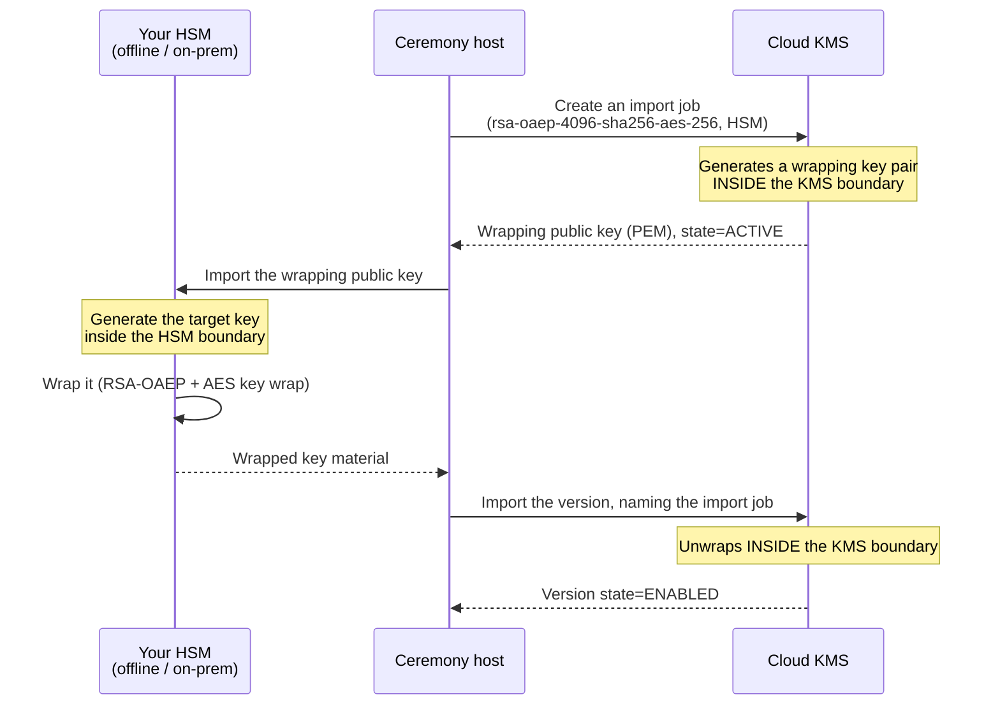

# Importing Your Own Key Material (BYOK)
{: .no_toc }

When the requirement is "we generate the key, Google only holds it," you import
key material through an **import job** — a short-lived wrapping key that Cloud
KMS generates for you.
{: .fs-5 .fw-300 }

## On this page
{: .no_toc .text-delta }

1. TOC
{:toc}

---

## Why and why not

| Reason to import | Reason not to |
|:--|:--|
| Regulator or contract requires you to generate key material | You become responsible for secure generation, storage, and backup |
| You must hold a copy outside Google Cloud for escrow or exit | **Automatic rotation is unavailable** |
| The same key must exist in Google Cloud and on-premises | Import jobs expire; ceremonies must be re-run |
| Provable key provenance from your own HSM | The ceremony is a real operational burden |

{: .warning }
> **Importing key material makes *you* the single point of failure.** If your copy
> is lost and the imported version is destroyed, the data is unrecoverable —
> permanently, by design. Google cannot help. Before importing anything, write down
> where the master copy lives, who can reach it, how it is backed up, and how that
> backup is tested.

## The import flow



{: .important }
> **The plaintext key material never exists outside an HSM.** It is generated in
> your HSM, wrapped there under a public key whose private half lives only inside
> Cloud KMS, and unwrapped inside Cloud KMS. Neither the ceremony host nor the
> network ever sees it in the clear. That property is what makes BYOK a defensible
> control rather than a file transfer.

## Step 1 — Create an import-only key

```bash
PROJECT=contoso-keymgmt-prod
LOCATION=us-east1
KEYRING=prod-payments

gcloud kms keys create pci-byok \
  --keyring="$KEYRING" --location="$LOCATION" --project="$PROJECT" \
  --purpose=encryption \
  --protection-level=hsm \
  --default-algorithm=google-symmetric-encryption \
  --skip-initial-version-creation \
  --import-only \
  --destroy-scheduled-duration=30d \
  --labels=environment=prod,data-class=restricted,origin=external-hsm,managed-by=byok-ceremony

gcloud kms keys describe pci-byok --keyring="$KEYRING" --location="$LOCATION" \
  --format="yaml(name,purpose,importOnly,versionTemplate)"
```

```yaml
importOnly: true
name: projects/contoso-keymgmt-prod/locations/us-east1/keyRings/prod-payments/cryptoKeys/pci-byok
purpose: ENCRYPT_DECRYPT
versionTemplate:
  algorithm: GOOGLE_SYMMETRIC_ENCRYPTION
  protectionLevel: HSM
```

{: .tip }
> **`--import-only` is worth setting.** It makes the key permanently incapable of
> generating its own versions, which means nobody can later add a
> Google-generated version alongside your imported one and quietly break the "all
> key material originates in our HSM" claim. Like everything else about a key, it
> is immutable.

## Step 2 — Create an import job

```bash
gcloud kms import-jobs create pci-import-2026-08 \
  --keyring="$KEYRING" --location="$LOCATION" --project="$PROJECT" \
  --import-method=rsa-oaep-4096-sha256-aes-256 \
  --protection-level=hsm

# Poll until ACTIVE — generation takes a few minutes
while true; do
  STATE=$(gcloud kms import-jobs describe pci-import-2026-08 \
    --keyring="$KEYRING" --location="$LOCATION" --project="$PROJECT" \
    --format="value(state)")
  echo "$(date -u +%H:%M:%SZ) import job: $STATE"
  [ "$STATE" = "ACTIVE" ] && break
  [ "$STATE" = "EXPIRED" ] && { echo "job expired — create a new one"; exit 1; }
  sleep 30
done

gcloud kms import-jobs describe pci-import-2026-08 \
  --keyring="$KEYRING" --location="$LOCATION" --project="$PROJECT" \
  --format="yaml(name,state,importMethod,protectionLevel,expireTime,generateTime)"
```

```yaml
expireTime: '2026-09-30T18:22:31.000000Z'
generateTime: '2026-08-18T18:25:04.000000Z'
importMethod: RSA_OAEP_4096_SHA256_AES_256
name: projects/contoso-keymgmt-prod/locations/us-east1/keyRings/prod-payments/importJobs/pci-import-2026-08
protectionLevel: HSM
state: ACTIVE
```

| Import method | Wrapping |
|:--|:--|
| `rsa-oaep-3072-sha1-aes-256` | Legacy; avoid |
| `rsa-oaep-4096-sha1-aes-256` | Legacy; avoid |
| `rsa-oaep-3072-sha256-aes-256` | Acceptable |
| **`rsa-oaep-4096-sha256-aes-256`** | **The recommended choice** |
| `rsa-oaep-4096-sha256` | Direct RSA wrap; only for material small enough for the modulus |

{: .warning }
> **Import jobs expire — typically about three days after creation.** The
> `expireTime` above is the hard deadline for completing the ceremony. Do not
> schedule a multi-day key ceremony around a three-day job; create the job on the
> ceremony day, and if the window slips, create a new job and re-wrap.

## Step 3 — Retrieve the wrapping public key

```bash
WORKDIR="$(mktemp -d /dev/shm/byok-ceremony.XXXXXX)"   # RAM-backed
cd "$WORKDIR"

gcloud kms import-jobs describe pci-import-2026-08 \
  --keyring="$KEYRING" --location="$LOCATION" --project="$PROJECT" \
  --format="value(publicKey.pem)" > wrapping-public.pem

openssl rsa -pubin -in wrapping-public.pem -text -noout | head -3
openssl rsa -pubin -in wrapping-public.pem -outform DER \
  | openssl dgst -sha256    # record this in the ceremony log
```

```text
Public-Key: (4096 bit)
Modulus:
    00:c4:1f:6a:2b:8e:...
SHA2-256(stdin)= 7f3a2c9e...4d1b
```

## Step 4 — Generate and wrap in your HSM

{: .account }
> **Ceremony step — perform this on an offline, hardened host or inside your
> HSM.** Two authorized custodians present, session recorded in a ceremony log, and
> the plaintext key material must never touch shared storage or a retained
> terminal scrollback.

### Thales Luna (shape of the operation)

```bash
# 1. Import the Cloud KMS wrapping public key into the partition
cmu import -inputFile=wrapping-public.pem -label=gcp-kms-wrapping-2026 \
  -keyType=RSA -PKCS8

# 2. Generate the target key inside the HSM
cmu generatekey -keyType=AES -keySize=32 -label=contoso-gcp-byok-2026-08 \
  -extractable=1 -sensitive=1 -modifiable=0

# 3. Wrap under the Cloud KMS public key with RSA-AES key wrap
cmu wrapkey -handle=<TARGET_HANDLE> -wrappingHandle=<KMS_PUBKEY_HANDLE> \
  -mech=CKM_RSA_AES_KEY_WRAP -hashAlg=SHA256 -mgf=MGF1_SHA256 \
  -outputFile=wrapped-target.bin
```

### The two-step wrap, explained

`RSA_OAEP_4096_SHA256_AES_256` is a hybrid scheme, and vendor tools implement it
for you:

```text
1. Generate an ephemeral AES-256 key                        (ephemeral KEK)
2. RSA-OAEP-SHA256 wrap the ephemeral key under the
   Cloud KMS wrapping public key                            -> 512 bytes
3. AES-KWP (RFC 5649) wrap the target key material under
   the ephemeral key                                        -> 40 bytes for AES-256
4. Concatenate: [RSA-wrapped ephemeral][AES-wrapped target]
```

### Software path (lab only — NOT for production)

```bash
# Generate 32 bytes of target material. In production this happens in an HSM.
openssl rand -out target-key.bin 32

# Google publishes a helper for the two-step wrap; check the current tooling.
# The manual equivalent, for understanding:
openssl rand -out ephemeral-aes.bin 32

openssl pkeyutl -encrypt -pubin -inkey wrapping-public.pem \
  -in ephemeral-aes.bin -out ephemeral-wrapped.bin \
  -pkeyopt rsa_padding_mode:oaep \
  -pkeyopt rsa_oaep_md:sha256 \
  -pkeyopt rsa_mgf1_md:sha256

# AES-KWP of the target under the ephemeral key (openssl 3.x)
openssl enc -id-aes256-wrap-pad \
  -K "$(xxd -p -c 64 ephemeral-aes.bin)" \
  -iv A65959A6 \
  -in target-key.bin -out target-wrapped.bin

cat ephemeral-wrapped.bin target-wrapped.bin > wrapped-target.bin
ls -l wrapped-target.bin    # 512 + 40 = 552 bytes
```

{: .warning }
> **The software path is for understanding the mechanism, not for production.** A
> key generated with `openssl` on a general-purpose host has none of the
> provenance, non-extractability, or attestation that motivates BYOK in the first
> place. If your reason for importing is a regulatory requirement, generating in
> software fails that requirement more completely than not importing at all.

## Step 5 — Import the version

```bash
gcloud kms keys versions import \
  --import-job=pci-import-2026-08 \
  --key=pci-byok \
  --keyring="$KEYRING" --location="$LOCATION" --project="$PROJECT" \
  --algorithm=google-symmetric-encryption \
  --target-key-file=wrapped-target.bin

# Poll until ENABLED — import is asynchronous
while true; do
  read -r VER STATE <<<"$(gcloud kms keys versions list --key=pci-byok \
    --keyring="$KEYRING" --location="$LOCATION" --project="$PROJECT" \
    --format="value(name.basename(),state)" | tail -1)"
  echo "$(date -u +%H:%M:%SZ) version $VER: $STATE"
  [ "$STATE" = "ENABLED" ] && break
  [ "$STATE" = "IMPORT_FAILED" ] && {
    gcloud kms keys versions describe "$VER" --key=pci-byok \
      --keyring="$KEYRING" --location="$LOCATION" \
      --format="yaml(state,importFailureReason)"; exit 1; }
  sleep 15
done

gcloud kms keys versions describe "$VER" --key=pci-byok \
  --keyring="$KEYRING" --location="$LOCATION" --project="$PROJECT" \
  --format="yaml(name,state,protectionLevel,algorithm,importJob,importTime,generateTime)"
```

```yaml
algorithm: GOOGLE_SYMMETRIC_ENCRYPTION
importJob: projects/contoso-keymgmt-prod/locations/us-east1/keyRings/prod-payments/importJobs/pci-import-2026-08
importTime: '2026-08-18T18:41:22.000000Z'
name: projects/contoso-keymgmt-prod/locations/us-east1/keyRings/prod-payments/cryptoKeys/pci-byok/cryptoKeyVersions/1
protectionLevel: HSM
state: ENABLED
```

{: .tip }
> **`importJob` and `importTime` on the version are your provenance record.** They
> prove, from Google's side, that this key material arrived via the named ceremony
> rather than being generated by Cloud KMS. Capture this output in the ceremony log
> — it is the single most useful piece of evidence for a BYOK control.

### Common import failures

```bash
gcloud kms keys versions describe 1 --key=pci-byok \
  --keyring="$KEYRING" --location="$LOCATION" \
  --format="value(importFailureReason)"
```

| Failure | Cause |
|:--|:--|
| `Wrapped key material is malformed` | Wrong concatenation order, or the wrong wrap mechanism |
| `Import job expired` | The ceremony ran past `expireTime` — create a new job |
| `Algorithm mismatch` | `--algorithm` does not match the key's `versionTemplate` |
| `Key material has the wrong length` | AES-256 needs exactly 32 bytes before wrapping |
| `Protection level mismatch` | Import job and key must both be `HSM`, or both `SOFTWARE` |

## Step 6 — Verify and clean up

```bash
KEY_ARGS="--key=pci-byok --keyring=$KEYRING --location=$LOCATION --project=$PROJECT"

echo -n "byok-canary" \
  | gcloud kms encrypt $KEY_ARGS --plaintext-file=- --ciphertext-file=/tmp/ct.bin
gcloud kms decrypt $KEY_ARGS --ciphertext-file=/tmp/ct.bin --plaintext-file=-; echo
rm -f /tmp/ct.bin
```

```bash
# Ceremony record
echo "=== BYOK CEREMONY RECORD $(date -u +%Y-%m-%dT%H:%M:%SZ) ==="
echo "Project:      $PROJECT"
echo "Key:          $(gcloud kms keys describe pci-byok --keyring=$KEYRING --location=$LOCATION --format='value(name)')"
echo "Import job:   pci-import-2026-08"
echo "Wrap pubkey:  $(openssl rsa -pubin -in wrapping-public.pem -outform DER | openssl dgst -sha256)"
echo "Version:      $VER (imported $(date -u +%Y-%m-%dT%H:%M:%SZ))"
echo "Source HSM:   contoso-luna-01, partition prod-payments"
echo "Custodians:   <name 1>, <name 2>    Witness: <name 3>"

# Destroy the working material
cd /
shred -vfzu -n 3 "$WORKDIR"/*.bin 2>/dev/null || true
rm -rf "$WORKDIR"
ls "$WORKDIR" 2>/dev/null || echo "ceremony workdir destroyed"
```

| Artifact | Sensitivity | Where it goes |
|:--|:--|:--|
| `wrapping-public.pem` | **Public** | Keep with the ceremony record |
| `wrapped-target.bin` | Sensitive but not plaintext | Destroy after import; usable only by that import job |
| **Target key material in your HSM** | **The master copy** | Stays in the HSM; back it up per your HSM's procedure |
| Ceremony log | Internal | Retain for the audit record |

{: .important }
> **`shred` is unreliable on modern storage.** Copy-on-write filesystems, SSD
> wear-levelling, and journaling all defeat overwrite-in-place. The real control is
> to perform the ceremony in a RAM disk (`/dev/shm`, as above) or on a host with an
> encrypted ephemeral volume that is destroyed when the ceremony ends. Record the
> destruction in the ceremony log.

## Limitations of imported keys

| Capability | Imported version |
|:--|:--|
| Automatic rotation | ❌ Not available — import a new version |
| Use as CMEK | ✅ Yes |
| Application encrypt/decrypt | ✅ Yes |
| Export back out of Google Cloud | ❌ No |
| Destroy and restore within the window | ✅ Yes |

```bash
gcloud kms keys update pci-byok --keyring="$KEYRING" --location="$LOCATION" \
  --rotation-period=90d --next-rotation-time="$(date -u -d '+90 days' +%Y-%m-%dT%H:%M:%SZ)" 2>&1 | tail -2
```

```text
ERROR: (gcloud.kms.keys.update) INVALID_ARGUMENT: Rotation is not supported for
import-only keys.
```

### "Rotating" an imported key

```bash
# 1. New import job (the old one has expired)
gcloud kms import-jobs create pci-import-2027-08 \
  --keyring="$KEYRING" --location="$LOCATION" \
  --import-method=rsa-oaep-4096-sha256-aes-256 --protection-level=hsm

# 2. Generate new material in your HSM, wrap under the new job's public key

# 3. Import as a NEW VERSION of the SAME key
gcloud kms keys versions import \
  --import-job=pci-import-2027-08 --key=pci-byok \
  --keyring="$KEYRING" --location="$LOCATION" \
  --algorithm=google-symmetric-encryption \
  --target-key-file=wrapped-target-2027.bin

# 4. Promote it
gcloud kms keys update pci-byok --keyring="$KEYRING" --location="$LOCATION" \
  --primary-version=2

# 5. Soak, then disable and destroy version 1
```

{: .tip }
> **Import as a new *version* of the same key, not a new key.** The version model
> means existing ciphertext keeps decrypting under version 1 while new encrypts use
> version 2 — exactly the transparent behavior of native rotation, with the ceremony
> supplying the material. That is a genuine advantage over the AWS and Azure BYOK
> models, where imported material is bound to the key rather than a version.

## Terraform

```hcl
resource "google_kms_crypto_key" "pci_byok" {
  name     = "pci-byok"
  key_ring = module.payments_ring.id
  purpose  = "ENCRYPT_DECRYPT"

  import_only                   = true
  skip_initial_version_creation = true
  destroy_scheduled_duration    = "2592000s"

  version_template {
    algorithm        = "GOOGLE_SYMMETRIC_ENCRYPTION"
    protection_level = "HSM"
  }

  labels = {
    environment = "prod"
    data-class  = "restricted"
    origin      = "external-hsm"
  }

  lifecycle { prevent_destroy = true }
}

resource "google_kms_key_ring_import_job" "pci_2026_08" {
  key_ring      = module.payments_ring.id
  import_job_id = "pci-import-2026-08"
  import_method = "RSA_OAEP_4096_SHA256_AES_256"

  protection_level = "HSM"
}

output "import_job_public_key" {
  description = "Wrapping public key PEM — feed this to the HSM ceremony."
  value       = google_kms_key_ring_import_job.pci_2026_08.public_key
}
```

{: .warning }
> **Terraform can create the import job but must never handle the wrapped
> material.** There is no argument for it on `google_kms_crypto_key_version`, and
> any workaround that passes the blob through a variable puts it in state. Run the
> import out-of-band with `gcloud`, and let Terraform manage only the key and the
> import job.

## BYOK checklist

| # | Check | Evidence |
|:--|:--|:--|
| 1 | Key created with `--import-only` and `--skip-initial-version-creation` | `gcloud kms keys describe` |
| 2 | Import job uses `rsa-oaep-4096-sha256-aes-256` and `HSM` | `gcloud kms import-jobs describe` |
| 3 | Wrapping public key fingerprint recorded | Ceremony log |
| 4 | Key material generated in a FIPS-validated HSM | HSM audit log |
| 5 | Two custodians present; ceremony log signed | Ceremony record |
| 6 | Master copy backed up to a second HSM or escrow | Backup attestation |
| 7 | Backup restore tested within the last 12 months | Test record |
| 8 | Imported version shows `importJob` and `importTime` | `versions describe` |
| 9 | Round trip verified | Command transcript |
| 10 | Ceremony material destroyed; RAM disk removed | Command transcript |
| 11 | Terraform state contains no key material | `terraform state pull \| grep -c target-key` |
| 12 | Re-import ceremony scheduled before the cryptoperiod ends | Calendar |

---

[Next: 7.3 CMEK Integrations](){: .btn .btn-primary }
