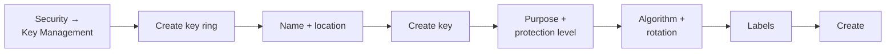

# Creating a Key Ring and Key in the Console
{: .no_toc }

The Console is the wrong tool for production and the right tool for
understanding what production is doing. Every field here maps to a `gcloud` flag
and a Terraform argument.
{: .fs-5 .fw-300 }

## On this page
{: .no_toc .text-delta }

1. TOC
{:toc}

---

## The click-path

{: .account }
> **Console step.** Sign in to
> [console.cloud.google.com](https://console.cloud.google.com/) with an identity
> in `gcp-key-admins@contoso.com`. **Confirm the project selector reads
> `contoso-keymgmt-prod`** — creating a key ring in the wrong project is permanent,
> because key rings cannot be deleted or moved.



### Step 1 — Create the key ring

Navigate to **Security → Key Management → Create key ring**.

| Field | Value | Why |
|:--|:--|:--|
| **Key ring name** | `prod-platform` | **Permanent.** Cannot be renamed or deleted |
| **Key ring location type** | Region | Regional gives the clearest data residency and lowest latency |
| **Region** | `us-east1` | **Permanent.** Must match the location of the resources it will encrypt |

{: .warning }
> **The location must match what you intend to encrypt.** A `us-east1` key
> cannot serve a `us` multi-region Cloud Storage bucket, or a `europe-west4`
> dataset. Because key rings are immutable and undeletable, the fix for a wrong
> location is a *new* key ring — leaving the mistake behind permanently. Decide
> now: list every resource that will use this key ring and confirm they share a
> location.

### Step 2 — Create the key

| Field | Value | Why |
|:--|:--|:--|
| **Key name** | `gcs-cmek-hsm` | **Permanent.** Encode the purpose and protection level |
| **Protection level** | **HSM** | **Immutable.** FIPS 140-2 Level 3, for a modest cost increase over Software |
| **Key material** | Generated key | "Imported key" is BYOK — see [Import &amp; BYOK]() |
| **Purpose** | Symmetric encrypt/decrypt | **Immutable.** The only purpose that works as CMEK |
| **Algorithm** | Google symmetric key | AES-256-GCM with Google's framing |
| **Rotation period** | 90 days | Changeable later |
| **Starting on** | Leave as the default (now + 90 days) | |

{: .important }
> **Choose HSM, not Software, for anything that will hold production data.** The
> operational burden is identical — Google runs the HSMs either way — and it is the
> difference between a FIPS 140-2 Level 1 claim and a Level 3 one. Since the
> protection level is immutable, changing your mind later means creating a new key
> and re-encrypting everything it protects.

### Step 3 — Additional settings

Expand **Additional settings**:

| Field | Value | Why |
|:--|:--|:--|
| **Scheduled for destruction duration** | 30 days | **The window in which you can cancel a version destruction.** The default is 24 hours — far too short |
| **Labels** | `environment=prod`, `data-class=confidential`, `owner=platform-team`, `cost-center=cc-4417`, `managed-by=console` | Lowercase only |

{: .warning }
> **The default destroy-scheduled duration is 24 hours, and it is set at key
> creation.** That is the entire window in which someone can notice a mistaken
> `versions destroy` and reverse it — and it is immutable per key on some paths, so
> set it deliberately. 30 days gives a person a realistic chance of catching the
> error; 24 hours does not. See
> [Backup, DR &amp; Destruction]().

### Step 4 — Create

Click **Create**. For an HSM key the first version briefly shows
`PENDING_GENERATION` before becoming `ENABLED`.

## Verify what you built

```bash
gcloud kms keys describe gcs-cmek-hsm \
  --keyring=prod-platform --location=us-east1 \
  --project=contoso-keymgmt-prod \
  --format="yaml(name,purpose,versionTemplate,rotationPeriod,nextRotationTime,destroyScheduledDuration,labels)"
```

```yaml
destroyScheduledDuration: 2592000s
labels:
  data-class: confidential
  environment: prod
  managed-by: console
  owner: platform-team
name: projects/contoso-keymgmt-prod/locations/us-east1/keyRings/prod-platform/cryptoKeys/gcs-cmek-hsm
nextRotationTime: '2026-11-16T18:22:31.000000Z'
purpose: ENCRYPT_DECRYPT
rotationPeriod: 7776000s
versionTemplate:
  algorithm: GOOGLE_SYMMETRIC_ENCRYPTION
  protectionLevel: HSM
```

```bash
gcloud kms keys versions list --key=gcs-cmek-hsm \
  --keyring=prod-platform --location=us-east1 \
  --format="table(name.basename(), state, protectionLevel, algorithm, createTime)"
```

```text
NAME  STATE    PROTECTION_LEVEL  ALGORITHM                    CREATE_TIME
1     ENABLED  HSM               GOOGLE_SYMMETRIC_ENCRYPTION  2026-08-18T18:22:31Z
```

{: .tip }
> **Confirm `protectionLevel: HSM`, not `SOFTWARE`.** Every FIPS 140-2 Level 3
> claim you plan to make depends on that one string, and it cannot be changed
> afterwards. It is the first thing to check in your verification suite.

## Round-trip test

```bash
KEY_ARGS="--key=gcs-cmek-hsm --keyring=prod-platform --location=us-east1"

echo -n "console-canary" \
  | gcloud kms encrypt $KEY_ARGS --plaintext-file=- --ciphertext-file=/tmp/ct.bin

gcloud kms decrypt $KEY_ARGS --ciphertext-file=/tmp/ct.bin --plaintext-file=-
echo

rm -f /tmp/ct.bin
```

```text
console-canary
```

{: .warning }
> **If that `encrypt` succeeds while you are signed in as a key administrator,
> your separation of duties is broken.** `roles/cloudkms.admin` does *not* include
> crypto permissions — so a successful encrypt means you also hold
> `roles/owner`, `roles/editor`, or an explicit crypto role. Fix it before
> continuing; see [IAM]().

## Enabling the destroy-protection you actually want

The Console does not expose a per-key "prevent destruction" flag. The equivalent
controls are:

| Control | Where |
|:--|:--|
| A long `destroyScheduledDuration` | Key creation |
| IAM: nobody holds `cloudkms.cryptoKeyVersions.destroy` routinely | [IAM]() |
| An alert on `DestroyCryptoKeyVersion` | [Monitoring]() |
| `lifecycle { prevent_destroy = true }` in Terraform | [5.3 Terraform]() |

## Console-created keys and Terraform

If this key is going to production, import it into Terraform now rather than
later — see
[Importing existing resources](#importing-existing-resources).
Then change the `managed-by` label from `console` to `terraform`.

---

[Next: 5.2 gcloud](){: .btn .btn-primary }
