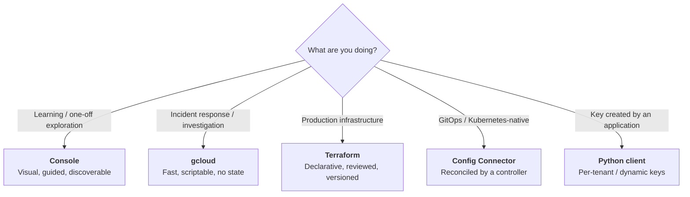

# Creating Keys
{: .no_toc }

**Phase 3 — Build.** One key ring, one key, five ways. The Console for
understanding, `gcloud` for operations, Terraform and Config Connector for
repeatability, the client library for applications.
{: .fs-5 .fw-300 }

---

## What you are about to build

Every page in this section produces the **same logical resources**:

| Attribute | Value |
|:--|:--|
| Project | `contoso-keymgmt-prod` |
| Location | `us-east1` |
| Key ring | `prod-platform` |
| Key | `gcs-cmek-hsm` |
| Purpose | `encryption` |
| Protection level | `HSM` (FIPS 140-2 Level 3) |
| Algorithm | `GOOGLE_SYMMETRIC_ENCRYPTION` |
| Rotation period | 90 days |
| Destroy scheduled duration | 30 days |
| Labels | `environment=prod`, `data-class=confidential`, `owner=platform-team`, `managed-by=…` |

## Which method to use when

{: .important }
> **Pick one system of record and stick to it.** A key created in the Console and
> later imported into Terraform is fine. A key edited in *both* places is a
> guaranteed incident: the next `terraform apply` will silently revert the Console
> change, and if that change was an IAM binding, you break production. Label every
> key with `managed-by` and mean it.

## The decisions that are permanent

```mermaid
flowchart LR
    A["Key ring name<br/>+ location"] -->|"undeletable,<br/>unmovable"| A2["Permanent"]
    B["Key name"] -->|"undeletable"| B2["Permanent"]
    C["Purpose"] -->|"immutable"| C2["Permanent"]
    D["Protection level"] -->|"immutable"| D2["Permanent"]
    E["Rotation period"] -->|"changeable"| E2["Adjustable"]
    F["IAM bindings"] -->|"changeable"| F2["Adjustable"]
    style A2 fill:#4a1e1e,stroke:#f87171
    style B2 fill:#4a1e1e,stroke:#f87171
    style C2 fill:#4a1e1e,stroke:#f87171
    style D2 fill:#4a1e1e,stroke:#f87171
    style E2 fill:#1e4620,stroke:#4ade80
    style F2 fill:#1e4620,stroke:#4ade80
```

{: .warning }
> **Practise in a disposable project.** Because key rings and keys cannot be
> deleted, every experiment leaves permanent residue in whatever project you run
> it in. Create `contoso-kms-sandbox`, do your learning there, and delete the
> *project* when you are done — that is the only way to clean up.

## Pages in this section

| Page | What it covers |
|:--|:--|
| [5.1 Console]() | The click-path, with every field explained |
| [5.2 gcloud]() | `gcloud kms` end to end, plus an idempotent provisioning script |
| [5.3 Terraform]() | Reusable modules, plan/apply, and importing existing keys |
| [5.4 Config Connector]() | Kubernetes-native key management for a GitOps estate |
| [5.5 Python client]() | Programmatic creation, idempotency, and an audit inventory exporter |

Access control is substantial enough to have its own page:
[6. IAM &amp; Access Control]().
