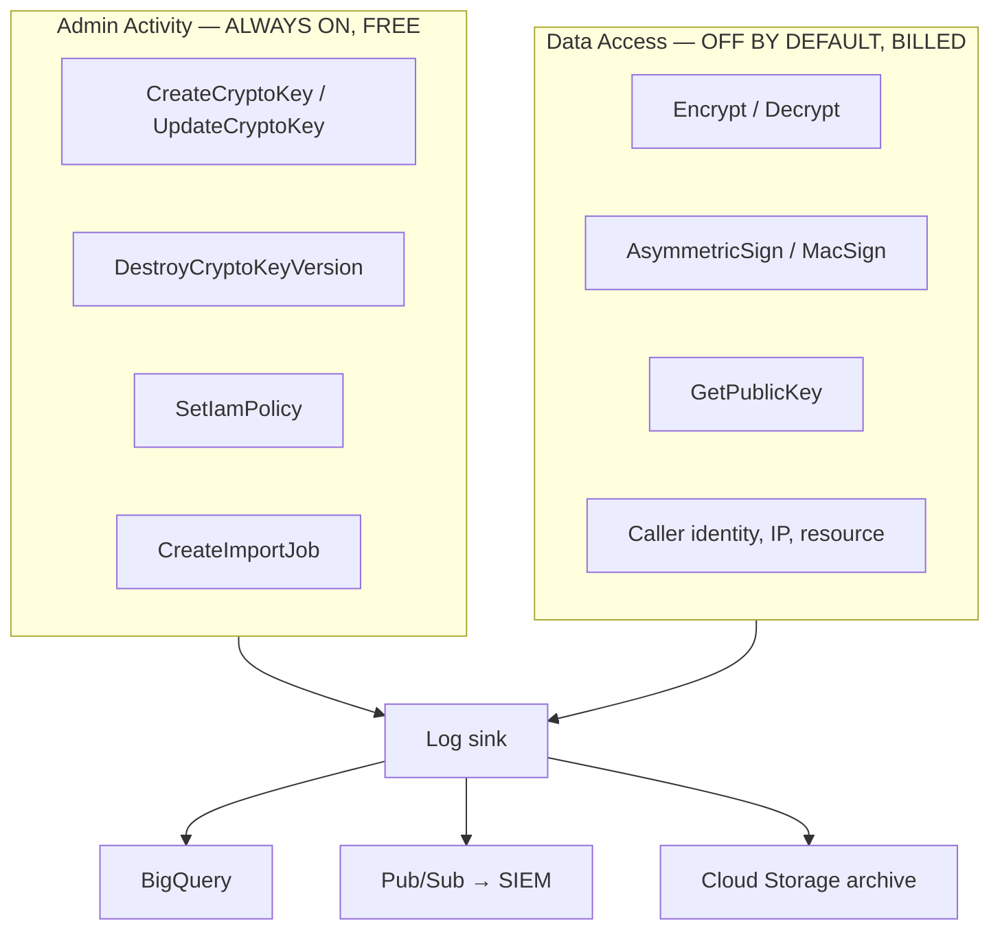
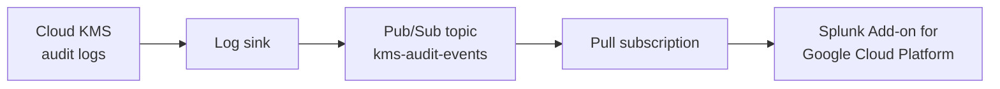

# Logging, Forensics &amp; SIEM Integration
{: .no_toc }

**Phase 7 — Observe.** Every use of a key is an API call — but only if you turned
Data Access logging on before it happened.
{: .fs-5 .fw-300 }

## On this page
{: .no_toc .text-delta }

1. TOC
{:toc}

---

## The two log streams



{: .warning }
> **Cloud KMS Data Access logs are off by default, and they are the ones that
> matter.** Admin Activity tells you a key was created; only Data Access tells you
> it was *used*. A project running for a year without them has a year of
> unanswerable questions. Enabling them at the organization level is Step 6 of
> [Organization Setup]() — if you skipped it, go
> back.

```bash
# Verify Data Access logging is on for Cloud KMS
gcloud organizations get-iam-policy "$ORG_ID" --format=json \
  | jq '.auditConfigs[] | select(.service=="cloudkms.googleapis.com")'
```

```json
{
  "service": "cloudkms.googleapis.com",
  "auditLogConfigs": [
    { "logType": "ADMIN_READ" },
    { "logType": "DATA_READ" },
    { "logType": "DATA_WRITE" }
  ]
}
```

| Log type | Captures |
|:--|:--|
| `ADMIN_READ` | `GetCryptoKey`, `ListCryptoKeys`, `GetIamPolicy` |
| `DATA_READ` | **`Decrypt`**, `AsymmetricDecrypt`, `MacVerify`, `GetPublicKey` |
| `DATA_WRITE` | **`Encrypt`**, `AsymmetricSign`, `MacSign` |
| Admin Activity | Always on; every mutating management operation |

## What a KMS audit entry contains

```bash
gcloud logging read '
  protoPayload.serviceName="cloudkms.googleapis.com"
  AND protoPayload.methodName:"Decrypt"' \
  --project=contoso-keymgmt-prod --limit=1 --format=json | jq '.[0].protoPayload'
```

```json
{
  "@type": "type.googleapis.com/google.cloud.audit.AuditLog",
  "authenticationInfo": {
    "principalEmail": "payments-api@contoso-app-prod.iam.gserviceaccount.com"
  },
  "authorizationInfo": [
    {
      "granted": true,
      "permission": "cloudkms.cryptoKeyVersions.useToDecrypt",
      "resource": "projects/contoso-keymgmt-prod/locations/us-east1/keyRings/prod-payments/cryptoKeys/pci-chd-hsm"
    }
  ],
  "methodName": "google.cloud.kms.v1.KeyManagementService.Decrypt",
  "requestMetadata": {
    "callerIp": "10.20.1.14",
    "callerSuppliedUserAgent": "grpc-python/1.62.0"
  },
  "resourceName": "projects/contoso-keymgmt-prod/locations/us-east1/keyRings/prod-payments/cryptoKeys/pci-chd-hsm",
  "serviceName": "cloudkms.googleapis.com"
}
```

{: .important }
> **Note what is *not* there: the key version, and the AAD.** Cloud KMS selects the
> version from the ciphertext, so `Decrypt` never names one — which means you cannot
> answer "is version 1 still in use?" from the log. And unlike AWS KMS encryption
> context, GCP's additional authenticated data is not logged. Both are real gaps
> against the AWS equivalent, and both shape how you retire versions
> ([Rotation]()) and how you attribute multi-tenant
> access (you must log the tenant yourself, in your application).

## Routing logs

The organization sink from [Organization Setup]()
captures everything. Add exclusions and a second sink for the SIEM.

```bash
ORG_ID=123456789012
LOG_PROJECT=contoso-logging-prod
DATASET=cloud_audit_logs

# Verify the org sink
gcloud logging sinks describe org-audit-to-bq --organization="$ORG_ID" \
  --format="yaml(name,destination,filter,includeChildren,writerIdentity)"

# A dedicated KMS sink to Pub/Sub for the SIEM
gcloud pubsub topics create kms-audit-events --project="$LOG_PROJECT"

SINK_SA=$(gcloud logging sinks create kms-to-siem \
  "pubsub.googleapis.com/projects/${LOG_PROJECT}/topics/kms-audit-events" \
  --organization="$ORG_ID" --include-children \
  --log-filter='protoPayload.serviceName="cloudkms.googleapis.com"' \
  --format="value(writerIdentity)")

gcloud pubsub topics add-iam-policy-binding kms-audit-events \
  --project="$LOG_PROJECT" \
  --member="$SINK_SA" --role="roles/pubsub.publisher"

# Long-term archive to Cloud Storage
gcloud storage buckets create gs://contoso-audit-archive \
  --project="$LOG_PROJECT" --location=us \
  --uniform-bucket-level-access --public-access-prevention \
  --default-storage-class=NEARLINE

# Retention lock: nobody, including an Owner, can delete before the period ends
gcloud storage buckets update gs://contoso-audit-archive \
  --retention-period=2555d
gcloud storage buckets update gs://contoso-audit-archive --lock-retention-period

ARCHIVE_SA=$(gcloud logging sinks create audit-archive \
  "storage.googleapis.com/contoso-audit-archive" \
  --organization="$ORG_ID" --include-children \
  --log-filter='logName:"cloudaudit.googleapis.com"' \
  --format="value(writerIdentity)")

gcloud storage buckets add-iam-policy-binding gs://contoso-audit-archive \
  --member="$ARCHIVE_SA" --role="roles/storage.objectCreator"
```

{: .tip }
> **`--lock-retention-period` is irreversible and that is exactly the point.** Once
> locked, the retention period cannot be shortened or removed by anyone — including
> an Organization Administrator. That turns your audit archive from "logs" into
> tamper-evident evidence, and it is Google Cloud's equivalent of S3 Object Lock in
> compliance mode. Lock it deliberately; you cannot undo it.

### Controlling the cost

```bash
# Exclude high-volume, low-value KMS reads from the default bucket
gcloud logging sinks update _Default --organization="$ORG_ID" \
  --add-exclusion='name=kms-verbose-reads,filter=protoPayload.serviceName="cloudkms.googleapis.com" AND protoPayload.methodName:"GetCryptoKey"'

# What is the KMS log volume actually costing?
gcloud logging read '
  protoPayload.serviceName="cloudkms.googleapis.com"
  AND timestamp>="'"$(date -u -d '1 day ago' +%Y-%m-%dT%H:%M:%SZ)"'"' \
  --organization="$ORG_ID" --format="value(protoPayload.methodName)" \
  | sort | uniq -c | sort -rn
```

```text
  482913 google.cloud.kms.v1.KeyManagementService.Decrypt
   91204 google.cloud.kms.v1.KeyManagementService.Encrypt
    3311 google.cloud.kms.v1.KeyManagementService.GetCryptoKey
      12 google.cloud.kms.v1.KeyManagementService.UpdateCryptoKey
```

{: .important }
> **Route Data Access logs to BigQuery and Cloud Storage, and exclude them from
> the `_Default` bucket.** Log Analytics-style retention in Cloud Logging is the
> expensive tier; BigQuery is far cheaper for the volume KMS produces, and it is
> where you want to query them anyway. Do not respond to the cost by disabling the
> logs — that converts a bill into an audit finding.

## BigQuery — the forensic query layer

### Who used which key, and how much

```sql
SELECT
  protopayload_auditlog.resourceName                        AS key_name,
  protopayload_auditlog.authenticationInfo.principalEmail   AS principal,
  REGEXP_EXTRACT(protopayload_auditlog.methodName, r'\.(\w+)$') AS operation,
  COUNT(*)                                                  AS operations,
  MIN(timestamp)                                            AS first_seen,
  MAX(timestamp)                                            AS last_seen,
  COUNT(DISTINCT protopayload_auditlog.requestMetadata.callerIp) AS distinct_ips
FROM `contoso-logging-prod.cloud_audit_logs.cloudaudit_googleapis_com_data_access`
WHERE protopayload_auditlog.serviceName = 'cloudkms.googleapis.com'
  AND timestamp > TIMESTAMP_SUB(CURRENT_TIMESTAMP(), INTERVAL 30 DAY)
GROUP BY 1, 2, 3
ORDER BY operations DESC
LIMIT 100;
```

### Keys with no usage — retirement candidates

```sql
WITH used AS (
  SELECT DISTINCT protopayload_auditlog.resourceName AS key_name
  FROM `contoso-logging-prod.cloud_audit_logs.cloudaudit_googleapis_com_data_access`
  WHERE protopayload_auditlog.serviceName = 'cloudkms.googleapis.com'
    AND timestamp > TIMESTAMP_SUB(CURRENT_TIMESTAMP(), INTERVAL 90 DAY)
),
inventory AS (
  -- Load from scripts/key_inventory.py output
  SELECT FullName AS key_name, KeyRing, Key, ProtectionLevel
  FROM `contoso-logging-prod.kms.key_inventory`
)
SELECT i.KeyRing, i.Key, i.ProtectionLevel, 'UNUSED_90_DAYS' AS finding
FROM inventory i
LEFT JOIN used u ON i.key_name = u.key_name
WHERE u.key_name IS NULL
ORDER BY i.KeyRing, i.Key;
```

### Denied operations — misconfiguration or reconnaissance

```sql
SELECT
  timestamp,
  protopayload_auditlog.authenticationInfo.principalEmail   AS principal,
  protopayload_auditlog.methodName                          AS method,
  protopayload_auditlog.resourceName                        AS key_name,
  protopayload_auditlog.status.code                         AS status_code,
  protopayload_auditlog.status.message                      AS status_message,
  protopayload_auditlog.requestMetadata.callerIp            AS caller_ip
FROM `contoso-logging-prod.cloud_audit_logs.cloudaudit_googleapis_com_data_access`
WHERE protopayload_auditlog.serviceName = 'cloudkms.googleapis.com'
  AND protopayload_auditlog.status.code IS NOT NULL
  AND protopayload_auditlog.status.code != 0
  AND timestamp > TIMESTAMP_SUB(CURRENT_TIMESTAMP(), INTERVAL 7 DAY)
ORDER BY timestamp DESC
LIMIT 200;
```

{: .tip }
> **Separate status code 7 (`PERMISSION_DENIED`) from 9 (`FAILED_PRECONDITION`).**
> A cluster of 7s from one principal against many keys is reconnaissance or a broken
> deployment; a 9 usually means a disabled or destroyed key version, which is an
> operational incident. Grouping by `status.code` makes the distinction visible.

### Every administrative change

```sql
SELECT
  timestamp,
  protopayload_auditlog.methodName                          AS method,
  protopayload_auditlog.authenticationInfo.principalEmail   AS principal,
  protopayload_auditlog.resourceName                        AS resource,
  protopayload_auditlog.requestMetadata.callerIp            AS caller_ip,
  TO_JSON_STRING(protopayload_auditlog.requestJson)         AS request
FROM `contoso-logging-prod.cloud_audit_logs.cloudaudit_googleapis_com_activity`
WHERE protopayload_auditlog.serviceName = 'cloudkms.googleapis.com'
  AND timestamp > TIMESTAMP_SUB(CURRENT_TIMESTAMP(), INTERVAL 30 DAY)
  AND REGEXP_CONTAINS(protopayload_auditlog.methodName,
        r'(Create|Update|Destroy|Restore|SetIamPolicy|Import)')
ORDER BY timestamp DESC;
```

### Decrypt volume anomaly — bulk exfiltration signature

```sql
WITH hourly AS (
  SELECT
    TIMESTAMP_TRUNC(timestamp, HOUR)                          AS hour,
    protopayload_auditlog.authenticationInfo.principalEmail   AS principal,
    protopayload_auditlog.resourceName                        AS key_name,
    COUNT(*)                                                  AS ops
  FROM `contoso-logging-prod.cloud_audit_logs.cloudaudit_googleapis_com_data_access`
  WHERE protopayload_auditlog.serviceName = 'cloudkms.googleapis.com'
    AND protopayload_auditlog.methodName LIKE '%Decrypt'
    AND timestamp > TIMESTAMP_SUB(CURRENT_TIMESTAMP(), INTERVAL 30 DAY)
  GROUP BY 1, 2, 3
),
baseline AS (
  SELECT principal, key_name,
         AVG(ops) AS mean_ops, STDDEV(ops) AS stddev_ops
  FROM hourly
  WHERE hour < TIMESTAMP_SUB(CURRENT_TIMESTAMP(), INTERVAL 1 DAY)
  GROUP BY principal, key_name
)
SELECT h.hour, h.principal, h.key_name, h.ops,
       ROUND(b.mean_ops, 1)                                   AS baseline,
       ROUND(SAFE_DIVIDE(h.ops - b.mean_ops, b.stddev_ops), 2) AS z_score
FROM hourly h
JOIN baseline b USING (principal, key_name)
WHERE h.hour >= TIMESTAMP_SUB(CURRENT_TIMESTAMP(), INTERVAL 1 DAY)
  AND SAFE_DIVIDE(h.ops - b.mean_ops, b.stddev_ops) > 3
  AND h.ops > 100
ORDER BY z_score DESC;
```

{: .important }
> **That query is the one that finds a breach.** Normal applications have a
> characteristic decrypt rate. A principal that suddenly issues fifty times its
> usual volume is either a batch job nobody told you about, or somebody reading your
> entire dataset. Baseline it, alert on deviation, and make sure the on-call knows
> which applications are expected to spike.

### A principal used a key for the first time

```sql
WITH known AS (
  SELECT DISTINCT
    protopayload_auditlog.authenticationInfo.principalEmail AS principal,
    protopayload_auditlog.resourceName                      AS key_name
  FROM `contoso-logging-prod.cloud_audit_logs.cloudaudit_googleapis_com_data_access`
  WHERE protopayload_auditlog.serviceName = 'cloudkms.googleapis.com'
    AND timestamp BETWEEN TIMESTAMP_SUB(CURRENT_TIMESTAMP(), INTERVAL 90 DAY)
                      AND TIMESTAMP_SUB(CURRENT_TIMESTAMP(), INTERVAL 1 DAY)
)
SELECT
  d.timestamp,
  d.protopayload_auditlog.authenticationInfo.principalEmail AS principal,
  d.protopayload_auditlog.resourceName                      AS key_name,
  d.protopayload_auditlog.methodName                        AS method,
  d.protopayload_auditlog.requestMetadata.callerIp          AS caller_ip
FROM `contoso-logging-prod.cloud_audit_logs.cloudaudit_googleapis_com_data_access` d
LEFT JOIN known k
  ON d.protopayload_auditlog.authenticationInfo.principalEmail = k.principal
 AND d.protopayload_auditlog.resourceName = k.key_name
WHERE d.protopayload_auditlog.serviceName = 'cloudkms.googleapis.com'
  AND d.timestamp > TIMESTAMP_SUB(CURRENT_TIMESTAMP(), INTERVAL 1 DAY)
  AND k.principal IS NULL
ORDER BY d.timestamp DESC;
```

### Human access to production keys

```sql
SELECT
  timestamp,
  protopayload_auditlog.authenticationInfo.principalEmail AS principal,
  protopayload_auditlog.methodName                        AS method,
  protopayload_auditlog.resourceName                      AS key_name,
  protopayload_auditlog.requestMetadata.callerIp          AS caller_ip
FROM `contoso-logging-prod.cloud_audit_logs.cloudaudit_googleapis_com_data_access`
WHERE protopayload_auditlog.serviceName = 'cloudkms.googleapis.com'
  -- Humans, not service accounts
  AND NOT REGEXP_CONTAINS(
        protopayload_auditlog.authenticationInfo.principalEmail,
        r'gserviceaccount\.com$')
  AND protopayload_auditlog.resourceName LIKE '%/prod-%'
  AND timestamp > TIMESTAMP_SUB(CURRENT_TIMESTAMP(), INTERVAL 7 DAY)
ORDER BY timestamp DESC;
```

{: .tip }
> **A human decrypting production data should be rare enough to investigate every
> time.** Applications use service accounts; a named person calling `Decrypt`
> against a production key is either a debugging session that should have used a
> non-production copy, or something worse. Alert on it, and expect a small number of
> explainable hits.

## Streaming to a SIEM

### Splunk



```bash
gcloud pubsub subscriptions create kms-audit-splunk \
  --topic=kms-audit-events --project="$LOG_PROJECT" \
  --ack-deadline=60 --message-retention-duration=7d

gcloud iam service-accounts create splunk-log-reader --project="$LOG_PROJECT"

gcloud pubsub subscriptions add-iam-policy-binding kms-audit-splunk \
  --project="$LOG_PROJECT" \
  --member="serviceAccount:splunk-log-reader@${LOG_PROJECT}.iam.gserviceaccount.com" \
  --role="roles/pubsub.subscriber"

# Prefer Workload Identity Federation over a service account key
gcloud iam workload-identity-pools create splunk \
  --project="$LOG_PROJECT" --location=global
```

```text
# Key administrative changes, last 24 hours
index=gcp sourcetype="google:gcp:pubsub:message"
  protoPayload.serviceName="cloudkms.googleapis.com"
  (protoPayload.methodName="*DestroyCryptoKeyVersion" OR
   protoPayload.methodName="*SetIamPolicy" OR
   protoPayload.methodName="*UpdateCryptoKey")
| table _time protoPayload.methodName protoPayload.authenticationInfo.principalEmail
        protoPayload.resourceName protoPayload.requestMetadata.callerIp
| sort -_time

# Decrypt rate per principal with a 7-day baseline
index=gcp sourcetype="google:gcp:pubsub:message"
  protoPayload.serviceName="cloudkms.googleapis.com"
  protoPayload.methodName="*Decrypt"
| bin _time span=1h
| stats count AS decrypts BY _time, protoPayload.authenticationInfo.principalEmail
| eventstats avg(decrypts) AS baseline, stdev(decrypts) AS sd
    BY protoPayload.authenticationInfo.principalEmail
| eval z = (decrypts - baseline) / sd
| where z > 3
```

### Google Security Operations (Chronicle)

```bash
gcloud scc notifications create kms-findings \
  --organization="$ORG_ID" \
  --pubsub-topic="projects/${LOG_PROJECT}/topics/scc-findings" \
  --filter='category:"KMS_KEY_NOT_ROTATED" OR category:"KMS_ROLE_SEPARATION" OR category:"KMS_PUBLIC_KEY" OR category:"KMS_PROJECT_HAS_OWNER"'
```

```text
// Chronicle YARA-L rule: key version destroyed
rule kms_key_version_destroyed {
  meta:
    author = "security-engineering"
    severity = "CRITICAL"
    description = "A Cloud KMS key version was scheduled for destruction"

  events:
    $e.metadata.product_name = "Google Cloud KMS"
    $e.metadata.product_event_type = "DestroyCryptoKeyVersion"
    $e.target.resource.name = $key

  match:
    $key over 5m

  outcome:
    $principal = array_distinct($e.principal.user.email_addresses)

  condition:
    $e
}
```

## A logging health check

The audit trail is itself a control, and it needs its own monitoring.

```sql
-- Projects that have STOPPED sending KMS logs — a silent audit gap
WITH expected AS (
  SELECT DISTINCT resource.labels.project_id AS project_id
  FROM `contoso-logging-prod.cloud_audit_logs.cloudaudit_googleapis_com_data_access`
  WHERE protopayload_auditlog.serviceName = 'cloudkms.googleapis.com'
    AND timestamp BETWEEN TIMESTAMP_SUB(CURRENT_TIMESTAMP(), INTERVAL 14 DAY)
                      AND TIMESTAMP_SUB(CURRENT_TIMESTAMP(), INTERVAL 2 DAY)
),
recent AS (
  SELECT DISTINCT resource.labels.project_id AS project_id
  FROM `contoso-logging-prod.cloud_audit_logs.cloudaudit_googleapis_com_data_access`
  WHERE protopayload_auditlog.serviceName = 'cloudkms.googleapis.com'
    AND timestamp > TIMESTAMP_SUB(CURRENT_TIMESTAMP(), INTERVAL 2 DAY)
)
SELECT e.project_id, 'NO_KMS_LOGS_IN_48H' AS finding
FROM expected e
LEFT JOIN recent r USING (project_id)
WHERE r.project_id IS NULL;
```

```bash
# Projects with Cloud KMS enabled but Data Access logging off
for P in $(gcloud projects list --format="value(projectId)"); do
  gcloud services list --enabled --project="$P" 2>/dev/null \
    | grep -q cloudkms.googleapis.com || continue
  HAS=$(gcloud projects get-iam-policy "$P" --format=json 2>/dev/null \
    | jq -r '.auditConfigs[]? | select(.service=="cloudkms.googleapis.com" or .service=="allServices") | .service' \
    | head -1)
  [ -z "$HAS" ] && echo "NO KMS DATA ACCESS LOGGING: $P"
done
```

{: .warning }
> **Deleting a log sink or an audit config is an Admin Activity event, and Admin
> Activity cannot be disabled.** That makes it the one thing an attacker cannot hide.
> Alert at high severity on `SetIamPolicy` changes that touch `auditConfigs`, and on
> `DeleteSink` — those are the first moves of anyone who intends to use a key
> quietly.

```bash
gcloud logging metrics create audit_config_changed \
  --project="$LOG_PROJECT" \
  --description="An audit config or log sink was modified" \
  --log-filter='
    (protoPayload.methodName="SetIamPolicy" AND protoPayload.serviceData.policyDelta.auditConfigDeltas:*)
    OR protoPayload.methodName="google.logging.v2.ConfigServiceV2.DeleteSink"
    OR protoPayload.methodName="google.logging.v2.ConfigServiceV2.UpdateSink"'
```

---

[Next: 11. Monitoring &amp; Alerting](){: .btn .btn-primary }
