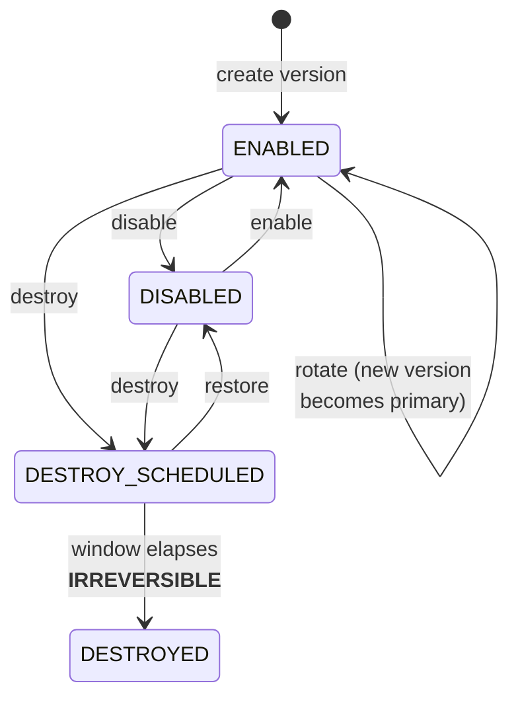

# Key Operations
{: .no_toc }

**Phase 5 — Operate.** Keys exist and access is scoped. Now put them to work and
keep them healthy through their whole lifecycle.
{: .fs-5 .fw-300 }

---

## The key lifecycle

Two Google-specific behaviors dominate everything in this section:

1. **Ciphertext carries its own version pointer**, so `Decrypt` never needs a
   version hint and rotation is genuinely transparent. The corollary: destroying a
   version silently destroys everything encrypted under it.
2. **Keys and key rings are never deleted.** Only versions are destroyed. A key
   with every version destroyed is a permanent, unusable resource.

## Pages in this section

| Page | What it covers |
|:--|:--|
| [7.1 Rotation]() | Automatic and manual rotation, version management, and re-encryption |
| [7.2 Import &amp; BYOK]() | Import jobs, key wrapping, and the ceremony |
| [7.3 CMEK Integrations]() | GCS, BigQuery, Compute, Cloud SQL, GKE, Pub/Sub, Secret Manager |
| [7.4 Envelope Encryption]() | DEKs in application code, and Tink |
| [7.5 Autokey]() | Automatic, per-resource CMEK provisioning |

Backup, recovery, and destruction are covered separately in
[9. Backup, DR &amp; Destruction](), because they span
Cloud KMS and Cloud EKM.
