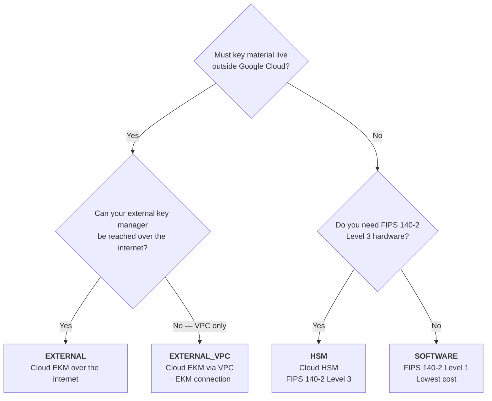
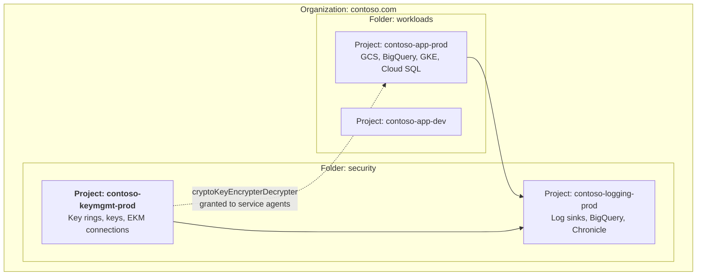

# Overview &amp; Service Selection
{: .no_toc }

**Phase 1 — Plan.** Before you create a single key, understand the protection
levels, the resource model, and the three decisions that are permanent.
{: .fs-5 .fw-300 }

## On this page
{: .no_toc .text-delta }

1. TOC
{:toc}

---

## The problem key management solves

Encryption is easy. **Key management is the hard part.** Any encryption scheme
reduces "protect this data" to "protect this key" — which means the security of a
terabyte of customer records collapses to a 32-byte value and the rules about who
may use it.

A cloud key management service exists to answer five questions, continuously and
provably:

| Question | What the service must provide |
|:--|:--|
| Where does the key live? | A hardened boundary the key never leaves in plaintext |
| Who may use it? | An authorization model — IAM, at the right granularity |
| What was it used for? | A tamper-evident audit trail of every cryptographic operation |
| How does it change over time? | Rotation, versioning, import, and destruction with safeguards |
| How do I prove all of the above? | Attestation, certification, and exportable evidence |

## The Cloud KMS resource model

Cloud KMS has a four-level hierarchy, and understanding it resolves most
questions about naming, IAM, and cost.

```text
Project:  contoso-keymgmt-prod
  │
  └── Location:  us-east1           (regional, multi-regional, or global)
        │
        └── Key ring:  prod-platform
              │        ── an IAM boundary and a naming container
              │        ── CANNOT BE DELETED
              │
              ├── Key:  gcs-cmek     ── purpose + protection level + rotation
              │     │                ── CANNOT BE DELETED
              │     │
              │     ├── Version 1  (DESTROYED)
              │     ├── Version 2  (ENABLED, previous)
              │     └── Version 3  (ENABLED, PRIMARY ← new encrypts use this)
              │
              └── Key:  bq-cmek
                    └── Version 1  (ENABLED, PRIMARY)
```

{: .warning }
> **Key rings and keys cannot be deleted. There is no API for it.** Once you
> create `projects/p/locations/l/keyRings/r/cryptoKeys/k`, that resource exists
> for the life of the project. You can destroy all its *versions*, which makes it
> unusable, but the resource remains — visible in listings, in Terraform state, and
> in your inventory. This is the single biggest structural difference from AWS KMS
> and Azure Key Vault, and it means:
>
> - **Naming mistakes are permanent.** Adopt a convention before key #1.
> - **Test keys accumulate forever.** Use a disposable *project* for experiments,
>   because deleting the project is the only way to clean up.
> - **Terraform `destroy` will not remove them**, and will report success anyway.

## Protection levels

The protection level is set **per key** and is **immutable**.



| Level | Where the key lives | FIPS | Cost | Latency | Availability you own |
|:--|:--|:--|:--|:--|:--|
| `SOFTWARE` | Google-managed software boundary | 140-2 Level 1 | Lowest | Lowest | None |
| `HSM` | Google-operated FIPS 140-2 Level 3 HSMs | **140-2 Level 3** | Higher | Low | None |
| `EXTERNAL` | **Your** external key manager, reached over the internet | Whatever your EKM holds | Higher + your EKM | **Highest** | **Yours** |
| `EXTERNAL_VPC` | Your EKM, reached via a VPC and an EKM connection | Same | Same | High | **Yours** |

{: .tip }
> **Use `HSM` for anything production.** The cost difference over `SOFTWARE` is
> modest, the operational burden is identical — Google still runs the HSMs — and it
> gives you a FIPS 140-2 Level 3 claim without taking on any of the single-tenancy
> operational weight that AWS CloudHSM or Azure Managed HSM would. `SOFTWARE` is
> for development and for genuinely low-sensitivity data. `EXTERNAL` is for
> key-custody mandates, and it makes your external key manager a hard dependency of
> every service that reads the data.

## Key purposes and algorithms

Purpose and algorithm are set at creation. **Purpose is immutable**; the default
algorithm can be changed for future versions on symmetric keys.

| Purpose | Algorithms | Use for |
|:--|:--|:--|
| `encryption` | `GOOGLE_SYMMETRIC_ENCRYPTION` (AES-256-GCM) | **The default.** CMEK for every Google Cloud service, envelope encryption |
| `asymmetric-signing` | `RSA_SIGN_PSS_2048/3072/4096_SHA256`, `RSA_SIGN_PKCS1_*`, `EC_SIGN_P256_SHA256`, `EC_SIGN_P384_SHA384`, `EC_SIGN_SECP256K1_SHA256` | Code signing, JWT/JWS, document signing, blockchain |
| `asymmetric-encryption` | `RSA_DECRYPT_OAEP_2048/3072/4096_SHA256`, `..._SHA512` | Interop with systems that hand you RSA-wrapped data |
| `mac` | `HMAC_SHA1/224/256/384/512` | Message authentication, token integrity |
| `raw-encryption` | `AES_128_GCM`, `AES_256_GCM`, `AES_*_CBC`, `AES_*_CTR` | Interop where you must control the IV and produce raw ciphertext |

{: .warning }
> **Only `encryption`-purpose keys work as CMEK for Google Cloud services.**
> Creating an `asymmetric-signing` key and pointing a Cloud Storage bucket at it
> fails. Asymmetric and MAC keys exist for application-level and interop use
> cases.

{: .important }
> **`GOOGLE_SYMMETRIC_ENCRYPTION` ciphertext is not raw AES-GCM.** It carries
> Google's own framing, including the key version that produced it — which is what
> makes rotation transparent, because `Decrypt` needs no version hint. The
> trade-off is that the ciphertext is only decryptable by Cloud KMS. Use
> `raw-encryption` only when an external system genuinely requires bare AES
> ciphertext, and accept that you then manage the IV and the version binding
> yourself.

## Locations

The location is set on the **key ring** and is **immutable**.

| Location type | Example | Use for |
|:--|:--|:--|
| **Regional** | `us-east1`, `europe-west4` | The default. Lowest latency, clearest data residency |
| **Dual-region** | `nam4`, `eur5` | Paired-region resilience |
| **Multi-regional** | `us`, `europe`, `asia` | CMEK for multi-region Cloud Storage buckets and BigQuery datasets |
| **`global`** | `global` | Convenience only — **avoid** |

{: .warning }
> **The key's location must match the resource's location.** A `us-east1` key
> cannot encrypt a bucket in `europe-west4`, and a regional key cannot serve a
> multi-region bucket. Getting this wrong is the most common Cloud KMS error, and
> because key rings are immutable and undeletable, the fix is a *new* key ring —
> leaving the mistake behind permanently. Plan locations before you create
> anything.

{: .tip }
> **Avoid `global` for production keys.** It offers no data-residency guarantee
> and no latency benefit over a well-chosen region, and you cannot move a key ring
> afterwards. Use it only for genuinely location-agnostic development keys.

## The three permanent decisions

```mermaid
flowchart LR
    A["Key ring<br/>name + location"] -->|"cannot be deleted<br/>or moved"| A2["Permanent"]
    B["Key name"] -->|"cannot be deleted"| B2["Permanent"]
    C["Purpose +<br/>protection level"] -->|"immutable"| C2["Permanent"]
    style A2 fill:#4a1e1e,stroke:#f87171
    style B2 fill:#4a1e1e,stroke:#f87171
    style C2 fill:#4a1e1e,stroke:#f87171
```



Everything else — rotation period, IAM bindings, labels, the primary version, the
default algorithm on symmetric keys — is changeable.

## The reference design this guide builds



**Why keys live in a separate project.** Putting key rings in a dedicated
key-management project, and granting workload service agents *use* (not *admin*)
rights at the key level, gives you a structural separation of duties: a
compromised workload project cannot destroy key versions or re-bind IAM on the
keys protecting its own data. It is the highest-leverage design decision in this
guide, and Google's own organization policy
(`constraints/gcp.restrictCmekCryptoKeyProjects`) exists to enforce it.

## Naming convention

Adopt one before you create key ring #1 — these names are permanent.

```text
Key ring:  <env>-<domain>
           prod-platform
           prod-payments
           dev-platform

Key:       <service-or-purpose>-<protection>
           gcs-cmek-hsm
           bq-cmek-hsm
           sql-cmek-hsm
           artifact-signing-hsm
           token-mac-hsm

Full name: projects/contoso-keymgmt-prod/locations/us-east1/keyRings/prod-platform/cryptoKeys/gcs-cmek-hsm

Labels:    environment  = prod | stage | dev
           data-class   = restricted | confidential | internal | public
           owner        = platform-team
           cost-center  = cc-4417
           compliance   = pci | hipaa | sox | none
           managed-by   = terraform | gcloud | console
```

{: .note }
> **Labels must be lowercase**, may contain only letters, digits, hyphens, and
> underscores, and are limited to 63 characters. Email addresses do not fit —
> `owner = platform-team` works, `owner = platform@contoso.com` does not. Use a
> team slug and keep the mapping elsewhere.

## What you are about to build, in order

| Step | Artifact | Page |
|:--|:--|:--|
| 1 | Organization, folders, projects, org policies | [Organization Setup]() |
| 2 | `gcloud`, Terraform, Config Connector, Python | [Toolchain]() |
| 3 | First key ring + key, five ways | [Creating Keys]() |
| 4 | Key-level IAM bindings and service agents | [IAM]() |
| 5 | Rotation, import, CMEK, Tink, Autokey | [Key Operations]() |
| 6 | Cloud HSM keys and Cloud EKM | [Cloud HSM &amp; External Keys]() |
| 7 | Audit logs → BigQuery → SIEM | [Logging &amp; SIEM]() |
| 8 | Org policy constraints, CI policy gate | [Policy as Code]() |

---

[Next: Architecture &amp; Key Hierarchy](){: .btn .btn-primary }
