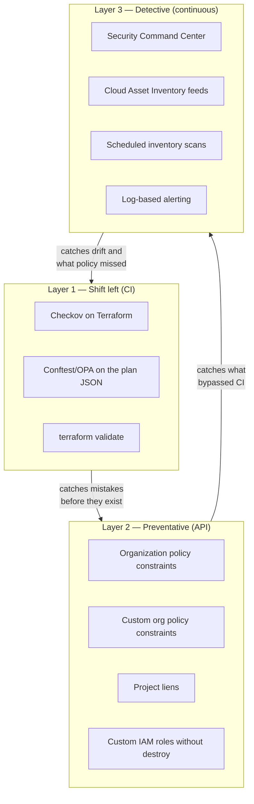

# Policy as Code — Preventative &amp; Detective Guardrails
{: .no_toc }

**Phase 8 — Govern.** Three layers: stop it in CI, stop it at the API, and catch
it if it happens anyway.
{: .fs-5 .fw-300 }

## On this page
{: .no_toc .text-delta }

1. TOC
{:toc}

---

## The three layers



{: .important }
> **Layer 2 matters more on Google Cloud than on the other clouds**, because the
> mistakes it prevents are permanent. A key ring created in the wrong location, or a
> `SOFTWARE` key in a production folder, cannot be deleted — only worked around
> forever. Preventative organization policy is the only control that stops those
> before they exist.

## Layer 1 — OPA/Rego on the Terraform plan

`policies/opa/kms.rego`

```rego
package main

import future.keywords.contains
import future.keywords.if
import future.keywords.in

# ---------------------------------------------------------------------------
# Helpers
# ---------------------------------------------------------------------------
key_rings[r] {
    r := input.resource_changes[_]
    r.type == "google_kms_key_ring"
    r.change.actions[_] in {"create", "update"}
}

keys[r] {
    r := input.resource_changes[_]
    r.type == "google_kms_crypto_key"
    r.change.actions[_] in {"create", "update"}
}

iam[r] {
    r := input.resource_changes[_]
    r.type in {"google_kms_crypto_key_iam_member",
               "google_kms_key_ring_iam_member",
               "google_kms_crypto_key_iam_binding",
               "google_kms_key_ring_iam_binding"}
    r.change.actions[_] in {"create", "update"}
}

after(r) := r.change.after

approved_locations := {"us-east1", "us-west1", "us", "europe-west4", "eur5"}

admin_roles := {"roles/cloudkms.admin"}
crypto_roles := {
    "roles/cloudkms.cryptoKeyEncrypterDecrypter",
    "roles/cloudkms.cryptoKeyEncrypter",
    "roles/cloudkms.cryptoKeyDecrypter",
    "roles/cloudkms.signer",
    "roles/cloudkms.signerVerifier",
    "roles/cloudkms.cryptoOperator",
}

# ---------------------------------------------------------------------------
# DENY — these fail the build
# ---------------------------------------------------------------------------

deny contains msg if {
    r := keys[_]
    level := after(r).version_template[_].protection_level
    level == "SOFTWARE"
    msg := sprintf("%s: protection_level is SOFTWARE; production keys must be HSM, EXTERNAL, or EXTERNAL_VPC",
                   [r.address])
}

deny contains msg if {
    r := keys[_]
    after(r).purpose == "ENCRYPT_DECRYPT"
    not after(r).rotation_period
    not after(r).import_only
    msg := sprintf("%s: symmetric encryption keys must have a rotation_period",
                   [r.address])
}

deny contains msg if {
    r := keys[_]
    period := after(r).rotation_period
    seconds := to_number(trim_suffix(period, "s"))
    seconds > 31536000                       # 365 days
    msg := sprintf("%s: rotation_period is %d days; the standard maximum is 365",
                   [r.address, seconds / 86400])
}

deny contains msg if {
    r := keys[_]
    duration := after(r).destroy_scheduled_duration
    seconds := to_number(trim_suffix(duration, "s"))
    seconds < 2592000                        # 30 days
    msg := sprintf("%s: destroy_scheduled_duration is %d days; the standard requires 30",
                   [r.address, seconds / 86400])
}

deny contains msg if {
    r := keys[_]
    not after(r).destroy_scheduled_duration
    msg := sprintf("%s: destroy_scheduled_duration is unset; the API default of 24h is too short",
                   [r.address])
}

deny contains msg if {
    r := key_rings[_]
    loc := after(r).location
    not loc in approved_locations
    msg := sprintf("%s: location %q is not approved. Key ring locations are PERMANENT — approved: %v",
                   [r.address, loc, approved_locations])
}

deny contains msg if {
    r := key_rings[_]
    after(r).location == "global"
    msg := sprintf("%s: location 'global' offers no data-residency guarantee and cannot be changed later",
                   [r.address])
}

deny contains msg if {
    r := keys[_]
    required := {"environment", "data-class", "owner"}
    present := {k | some k, _ in after(r).labels}
    missing := required - present
    count(missing) > 0
    msg := sprintf("%s: missing required labels %v", [r.address, missing])
}

# Public access
deny contains msg if {
    r := iam[_]
    member := after(r).member
    member in {"allUsers", "allAuthenticatedUsers"}
    msg := sprintf("%s: grants %q — Cloud KMS keys must never be public", [r.address, member])
}

# Basic roles on a key resource
deny contains msg if {
    r := iam[_]
    role := after(r).role
    role in {"roles/owner", "roles/editor", "roles/viewer"}
    msg := sprintf("%s: basic role %q on a key resource collapses the admin/use separation",
                   [r.address, role])
}

# Never destroy from CI
deny contains msg if {
    r := input.resource_changes[_]
    r.type in {"google_kms_key_ring", "google_kms_crypto_key"}
    "delete" in r.change.actions
    msg := sprintf("%s: plan would destroy a key resource — Cloud KMS key rings and keys CANNOT be deleted",
                   [r.address])
}

# ---------------------------------------------------------------------------
# WARN — visible, but does not fail the build
# ---------------------------------------------------------------------------

warn contains msg if {
    r := key_rings[_]
    "create" in r.change.actions
    msg := sprintf("%s: creating key ring %q in %q — this is PERMANENT and cannot be renamed, moved, or deleted",
                   [r.address, after(r).name, after(r).location])
}

warn contains msg if {
    r := keys[_]
    "create" in r.change.actions
    msg := sprintf("%s: creating key %q — this is PERMANENT and cannot be deleted",
                   [r.address, after(r).name])
}

warn contains msg if {
    r := iam[_]
    contains(after(r).role, "cloudkms")
    not contains(r.address, "crypto_key_iam")
    msg := sprintf("%s: binding at the key-ring scope; prefer key scope for service agents",
                   [r.address])
}

warn contains msg if {
    r := keys[_]
    after(r).version_template[_].protection_level in {"EXTERNAL", "EXTERNAL_VPC"}
    msg := sprintf("%s: EXTERNAL key — confirm the EKM's availability meets the workload's SLO",
                   [r.address])
}
```

```bash
terraform plan -out=tfplan
terraform show -json tfplan > tfplan.json
conftest test --policy policies/opa tfplan.json
```

```text
WARN - tfplan.json - main - module.platform_ring.google_kms_key_ring.this: creating key ring "prod-platform" in "us-east1" — this is PERMANENT and cannot be renamed, moved, or deleted
FAIL - tfplan.json - main - module.scratch.google_kms_crypto_key.this: protection_level is SOFTWARE; production keys must be HSM, EXTERNAL, or EXTERNAL_VPC
FAIL - tfplan.json - main - module.scratch.google_kms_crypto_key.this: destroy_scheduled_duration is unset; the API default of 24h is too short
FAIL - tfplan.json - main - module.scratch.google_kms_crypto_key.this: missing required labels {"data-class", "owner"}

18 tests, 14 passed, 1 warning, 3 failures
```

### Unit-testing the policy

```rego
package main

import future.keywords.if

test_software_protection_denied if {
    result := deny with input as {
        "resource_changes": [{
            "address": "module.t.google_kms_crypto_key.this",
            "type": "google_kms_crypto_key",
            "change": {
                "actions": ["create"],
                "after": {
                    "purpose": "ENCRYPT_DECRYPT",
                    "rotation_period": "7776000s",
                    "destroy_scheduled_duration": "2592000s",
                    "version_template": [{"protection_level": "SOFTWARE",
                                          "algorithm": "GOOGLE_SYMMETRIC_ENCRYPTION"}],
                    "labels": {"environment": "p", "data-class": "c", "owner": "o"}
                }
            }
        }]
    }
    count(result) == 1
}

test_compliant_key_passes if {
    result := deny with input as {
        "resource_changes": [{
            "address": "module.t.google_kms_crypto_key.this",
            "type": "google_kms_crypto_key",
            "change": {
                "actions": ["create"],
                "after": {
                    "purpose": "ENCRYPT_DECRYPT",
                    "rotation_period": "7776000s",
                    "destroy_scheduled_duration": "2592000s",
                    "version_template": [{"protection_level": "HSM",
                                          "algorithm": "GOOGLE_SYMMETRIC_ENCRYPTION"}],
                    "labels": {"environment": "p", "data-class": "c", "owner": "o"}
                }
            }
        }]
    }
    count(result) == 0
}
```

```bash
opa test policies/opa -v
```

## Layer 1b — Checkov

```bash
checkov -d . --framework terraform --compact \
  --external-checks-dir policies/checkov
```

| Built-in check | Enforces |
|:--|:--|
| `CKV_GCP_43` | KMS keys have a rotation period ≤ 90 days |
| `CKV_GCP_82` | KMS keys are not publicly accessible |
| `CKV_GCP_115` | KMS keys prevent destruction |
| `CKV_GCP_5` | Cloud SQL uses a CMEK |
| `CKV_GCP_62` | Cloud Storage buckets have logging |
| `CKV_GCP_88` | Compute disks use a CMEK |

A custom check:

`policies/checkov/KmsHsmProtectionLevel.py`

```python
from checkov.common.models.enums import CheckCategories, CheckResult
from checkov.terraform.checks.resource.base_resource_check import BaseResourceCheck


class KmsHsmProtectionLevel(BaseResourceCheck):
    def __init__(self) -> None:
        super().__init__(
            name="Ensure Cloud KMS keys use HSM or EXTERNAL protection",
            id="CKV_CUSTOM_KMS_1",
            categories=[CheckCategories.ENCRYPTION],
            supported_resources=["google_kms_crypto_key"],
        )

    def scan_resource_conf(self, conf) -> CheckResult:
        templates = conf.get("version_template")
        if not templates:
            return CheckResult.FAILED
        level = templates[0][0].get("protection_level", [""])
        level = level[0] if isinstance(level, list) else level
        if level in ("HSM", "EXTERNAL", "EXTERNAL_VPC"):
            return CheckResult.PASSED
        return CheckResult.FAILED


check = KmsHsmProtectionLevel()
```

## Layer 2 — Organization policy constraints

These evaluate at the API layer, so they apply to the Console, `gcloud`,
Terraform, and direct API calls alike.

### The built-in constraints that matter

| Constraint | Effect |
|:--|:--|
| `gcp.restrictNonCmekServices` | Deny resource creation without a CMEK |
| `gcp.restrictCmekCryptoKeyProjects` | Only keys from named projects may be CMEK |
| `cloudkms.allowedProtectionLevels` | Only HSM/EXTERNAL keys may be created |
| `iam.disableServiceAccountKeyCreation` | No long-lived SA keys |
| `iam.allowedPolicyMemberDomains` | No external identities in IAM |
| `gcp.resourceLocations` | Resources only in approved locations |
| `storage.uniformBucketLevelAccess` | No per-object ACLs |
| `storage.publicAccessPrevention` | No public buckets |

```bash
ORG_ID=123456789012
WORKLOADS_FOLDER=987654321098

apply_policy () {
  local FILE="$1"
  gcloud org-policies set-policy "$FILE"
  echo "  applied: $(grep '^name:' "$FILE" | awk '{print $2}')"
}

# --- CMEK required, and only from the key project ---------------------------
cat > /tmp/restrict-non-cmek.yaml <<YAML
name: organizations/${ORG_ID}/policies/gcp.restrictNonCmekServices
spec:
  rules:
    - values:
        deniedValues:
          - storage.googleapis.com
          - bigquery.googleapis.com
          - compute.googleapis.com
          - sqladmin.googleapis.com
          - pubsub.googleapis.com
          - secretmanager.googleapis.com
          - artifactregistry.googleapis.com
          - container.googleapis.com
          - spanner.googleapis.com
YAML
apply_policy /tmp/restrict-non-cmek.yaml

cat > /tmp/restrict-cmek-projects.yaml <<YAML
name: organizations/${ORG_ID}/policies/gcp.restrictCmekCryptoKeyProjects
spec:
  rules:
    - values:
        allowedValues:
          - under:projects/contoso-keymgmt-prod
YAML
apply_policy /tmp/restrict-cmek-projects.yaml

# --- Only HSM and external protection levels in workloads -------------------
cat > /tmp/allowed-protection-levels.yaml <<YAML
name: folders/${WORKLOADS_FOLDER}/policies/cloudkms.allowedProtectionLevels
spec:
  rules:
    - values:
        allowedValues:
          - HSM
          - EXTERNAL
          - EXTERNAL_VPC
YAML
apply_policy /tmp/allowed-protection-levels.yaml

# --- Location restriction ---------------------------------------------------
cat > /tmp/resource-locations.yaml <<YAML
name: organizations/${ORG_ID}/policies/gcp.resourceLocations
spec:
  rules:
    - values:
        allowedValues:
          - in:us-east1-locations
          - in:us-west1-locations
          - in:us-locations
          - in:europe-west4-locations
YAML
apply_policy /tmp/resource-locations.yaml

# --- Identity hardening -----------------------------------------------------
for C in iam.disableServiceAccountKeyCreation \
         iam.automaticIamGrantsForDefaultServiceAccounts \
         storage.uniformBucketLevelAccess \
         storage.publicAccessPrevention \
         sql.restrictPublicIp \
         compute.requireOsLogin
do
  cat > /tmp/enforce.yaml <<YAML
name: organizations/${ORG_ID}/policies/${C}
spec:
  rules:
    - enforce: true
YAML
  apply_policy /tmp/enforce.yaml
done

gcloud org-policies list --organization="$ORG_ID" --format="table(constraint, spec.rules)"
```

{: .warning }
> **`gcp.restrictNonCmekServices` is a genuine breaking change.** Once enforced,
> creating a bucket or a dataset without a CMEK fails. That is the control you want
> in production, and it will break every pipeline that does not specify a key. Apply
> it to a sandbox folder first, fix the pipelines, then move it up the hierarchy.

{: .important }
> **`gcp.restrictCmekCryptoKeyProjects` is the constraint that makes the separate
> key project meaningful.** Without it, a workload team can create keys in their own
> project and use those — which looks compliant on a CMEK dashboard while defeating
> the entire separation of duties. It is the single highest-value organization
> policy in this guide.

### A custom constraint

Custom constraints let you express rules the built-ins do not cover.

`policies/custom-constraints/require-key-rotation.yaml`

```yaml
name: organizations/123456789012/customConstraints/custom.kmsRequireRotation
resourceTypes:
  - cloudkms.googleapis.com/CryptoKey
methodTypes:
  - CREATE
  - UPDATE
condition: >-
  resource.purpose != "ENCRYPT_DECRYPT" ||
  (has(resource.rotationPeriod) &&
   duration(resource.rotationPeriod) <= duration("7776000s"))
actionType: ALLOW
displayName: Symmetric KMS keys must rotate at least every 90 days
description: >-
  Symmetric ENCRYPT_DECRYPT keys must have a rotation period no longer than
  90 days. Asymmetric and MAC keys are exempt because Cloud KMS does not
  support automatic rotation for them.
```

`policies/custom-constraints/require-long-destroy-window.yaml`

```yaml
name: organizations/123456789012/customConstraints/custom.kmsDestroyWindow
resourceTypes:
  - cloudkms.googleapis.com/CryptoKey
methodTypes:
  - CREATE
condition: >-
  has(resource.destroyScheduledDuration) &&
  duration(resource.destroyScheduledDuration) >= duration("2592000s")
actionType: ALLOW
displayName: KMS keys must have a 30-day destroy-scheduled duration
description: >-
  The API default of 24 hours gives almost no window to reverse a mistaken
  version destruction. Require 30 days.
```

```bash
for F in policies/custom-constraints/*.yaml; do
  gcloud org-policies set-custom-constraint "$F"
  echo "  constraint: $(grep '^name:' "$F" | awk '{print $2}')"
done

# Enforce them
cat > /tmp/enforce-custom.yaml <<YAML
name: organizations/${ORG_ID}/policies/custom.kmsRequireRotation
spec:
  rules:
    - enforce: true
YAML
gcloud org-policies set-policy /tmp/enforce-custom.yaml

cat > /tmp/enforce-destroy-window.yaml <<YAML
name: organizations/${ORG_ID}/policies/custom.kmsDestroyWindow
spec:
  rules:
    - enforce: true
YAML
gcloud org-policies set-policy /tmp/enforce-destroy-window.yaml

# Verify: a non-compliant key should now be rejected
gcloud kms keys create should-fail \
  --keyring=prod-platform --location=us-east1 --project=contoso-keymgmt-prod \
  --purpose=encryption --protection-level=hsm 2>&1 | tail -3
```

```text
ERROR: (gcloud.kms.keys.create) FAILED_PRECONDITION: Operation denied by custom
org policy: ["custom.kmsRequireRotation": "Symmetric ENCRYPT_DECRYPT keys must
have a rotation period no longer than 90 days."]
```

{: .tip }
> **Custom constraints are Google Cloud's answer to "Azure Policy for KMS," and
> they are underused.** Anything expressible as a CEL condition over the resource
> can become a hard, API-layer deny — including rules the built-in constraints do
> not cover. Test them with `--dry-run` semantics on a sandbox folder before
> enforcing at the organization.

### Project liens

```bash
# The only wholesale key-loss path on Google Cloud is deleting the project
gcloud alpha resource-manager liens create \
  --project=contoso-keymgmt-prod \
  --restrictions=resourcemanager.projects.delete \
  --reason="Contains production key material; deletion is unrecoverable" \
  --origin=security-team

gcloud alpha resource-manager liens list --project=contoso-keymgmt-prod \
  --format="table(name, restrictions, reason, origin)"
```

## Layer 3 — Detective controls

### Security Command Center

```bash
gcloud scc settings services enable \
  --organization="$ORG_ID" --service=SECURITY_HEALTH_ANALYTICS

# KMS-relevant findings
gcloud scc findings list "organizations/${ORG_ID}" \
  --filter='category:("KMS_KEY_NOT_ROTATED" OR "KMS_PROJECT_HAS_OWNER" OR "KMS_PUBLIC_KEY" OR "KMS_ROLE_SEPARATION")
            AND state="ACTIVE"' \
  --format="table(category, resourceName, severity, eventTime)"
```

| Detector | What it finds |
|:--|:--|
| `KMS_KEY_NOT_ROTATED` | Keys without rotation, or rotating slower than 90 days |
| `KMS_PROJECT_HAS_OWNER` | An `owner` binding on a project containing keys |
| `KMS_PUBLIC_KEY` | A key granted to `allUsers` or `allAuthenticatedUsers` |
| `KMS_ROLE_SEPARATION` | A principal holding both admin and crypto-use roles |
| `BUCKET_CMEK_DISABLED` | A bucket without a CMEK |
| `SQL_CMEK_DISABLED` | A Cloud SQL instance without a CMEK |
| `BIGQUERY_TABLE_CMEK_DISABLED` | A BigQuery table without a CMEK |
| `DATAPROC_CMEK_DISABLED` | A Dataproc cluster without a CMEK |

```bash
# Stream findings to Pub/Sub for your SIEM
gcloud scc notifications create kms-findings \
  --organization="$ORG_ID" \
  --pubsub-topic="projects/contoso-logging-prod/topics/scc-findings" \
  --filter='category:"KMS_" AND state="ACTIVE" AND severity:("HIGH" OR "CRITICAL")'
```

{: .tip }
> **`KMS_ROLE_SEPARATION` is the detector that watches the control this whole guide
> is built around.** It fires when the same principal holds both
> `roles/cloudkms.admin` and a crypto-use role. It costs nothing, runs continuously,
> and independently corroborates the `ROLE_SEPARATION_VIOLATION` finding from your
> own inventory script.

### Cloud Asset Inventory — real-time feeds

```bash
# Alert the moment a key resource changes, anywhere in the org
gcloud asset feeds create kms-changes \
  --organization="$ORG_ID" \
  --asset-types="cloudkms.googleapis.com/CryptoKey,cloudkms.googleapis.com/KeyRing,cloudkms.googleapis.com/CryptoKeyVersion" \
  --content-type=resource \
  --pubsub-topic="projects/contoso-logging-prod/topics/asset-changes"

# Point-in-time inventory query
gcloud asset search-all-resources \
  --scope="organizations/${ORG_ID}" \
  --asset-types="cloudkms.googleapis.com/CryptoKey" \
  --format="table(name, location, project, labels)"

# Every resource using a specific key — the blast-radius query
gcloud asset search-all-resources \
  --scope="organizations/${ORG_ID}" \
  --query='kmsKey:"projects/contoso-keymgmt-prod/locations/us-east1/keyRings/prod-platform/cryptoKeys/gcs-cmek-hsm"' \
  --format="table(name, assetType, location, project)"

# Export the whole inventory to BigQuery for joins against the audit log
gcloud asset export \
  --organization="$ORG_ID" \
  --content-type=resource \
  --asset-types="cloudkms.googleapis.com/CryptoKey,cloudkms.googleapis.com/KeyRing" \
  --bigquery-table="projects/contoso-logging-prod/datasets/asset_inventory/tables/kms" \
  --output-bigquery-force
```

{: .important }
> **`asset search-all-resources --query='kmsKey:...'` is the blast-radius query.**
> It is the fastest way to answer "what breaks if I disable this key?" across the
> whole organization, and it is the command your destruction checklist in
> [Backup, DR &amp; Destruction]() depends on. It works
> because Google indexes CMEK references in the asset inventory — there is no
> equivalent single query on the other clouds.

### Compliance reporting

```sql
-- Join the asset inventory against key usage: which keys are configured,
-- and which are actually used?
WITH inventory AS (
  SELECT
    name                                          AS key_name,
    JSON_VALUE(resource.data, '$.purpose')        AS purpose,
    JSON_VALUE(resource.data, '$.versionTemplate.protectionLevel') AS protection,
    JSON_VALUE(resource.data, '$.rotationPeriod') AS rotation_period,
    JSON_VALUE(resource.data, '$.labels.environment') AS environment
  FROM `contoso-logging-prod.asset_inventory.kms`
  WHERE asset_type = 'cloudkms.googleapis.com/CryptoKey'
),
usage AS (
  SELECT
    protopayload_auditlog.resourceName AS key_name,
    COUNT(*)                           AS operations,
    MAX(timestamp)                     AS last_used
  FROM `contoso-logging-prod.cloud_audit_logs.cloudaudit_googleapis_com_data_access`
  WHERE protopayload_auditlog.serviceName = 'cloudkms.googleapis.com'
    AND timestamp > TIMESTAMP_SUB(CURRENT_TIMESTAMP(), INTERVAL 90 DAY)
  GROUP BY 1
)
SELECT
  i.key_name, i.purpose, i.protection, i.rotation_period, i.environment,
  IFNULL(u.operations, 0) AS operations_90d,
  u.last_used,
  ARRAY_TO_STRING(ARRAY(
    SELECT f FROM UNNEST([
      IF(i.protection = 'SOFTWARE', 'SOFTWARE_PROTECTION', NULL),
      IF(i.purpose = 'ENCRYPT_DECRYPT' AND i.rotation_period IS NULL, 'NO_ROTATION', NULL),
      IF(u.key_name IS NULL, 'UNUSED_90_DAYS', NULL),
      IF(i.environment IS NULL, 'MISSING_ENVIRONMENT_LABEL', NULL)
    ]) f WHERE f IS NOT NULL
  ), ';') AS findings
FROM inventory i
LEFT JOIN usage u USING (key_name)
ORDER BY findings DESC, i.key_name;
```

## The full guardrail set

| # | Control | Layer | Effect |
|:--|:--|:--|:--|
| 1 | Keys must be HSM/EXTERNAL | CI + org policy | Deny |
| 2 | Symmetric keys must rotate ≤ 90 days | CI + custom constraint | Deny |
| 3 | `destroy_scheduled_duration` ≥ 30 days | CI + custom constraint | Deny |
| 4 | Key ring locations from an approved list | CI + `gcp.resourceLocations` | Deny |
| 5 | No `global` key rings | CI | Deny |
| 6 | Required labels on keys | CI | Deny |
| 7 | CMEK required for supported services | Org policy | Deny |
| 8 | CMEK only from the key project | Org policy | Deny |
| 9 | No public IAM members on keys | CI + SCC | Deny + detect |
| 10 | No basic roles on key resources | CI + SCC | Deny + detect |
| 11 | No destruction from CI | CI + custom IAM role | Deny |
| 12 | Project lien on the key project | Manual | Prevent |
| 13 | No service account keys | Org policy | Deny |
| 14 | Data Access audit logging enabled | Org IAM + alert | Detect |
| 15 | Role separation maintained | SCC `KMS_ROLE_SEPARATION` | Detect |
| 16 | Real-time alerting on key changes | Asset feed | Detect |

## Testing the guardrails

```bash
#!/usr/bin/env bash
# scripts/test_guardrails.sh — run in a SANDBOX project; every key is permanent
set -uo pipefail
SANDBOX="${SANDBOX:?set SANDBOX to a disposable project}"
LOCATION=us-east1

expect_fail () {
  local desc="$1"; shift
  if "$@" >/dev/null 2>&1; then
    printf '  FAIL  %s (succeeded but should have been denied)\n' "$desc"
  else
    printf '  PASS  %s\n' "$desc"
  fi
}

gcloud kms keyrings create guardrail-test --location="$LOCATION" \
  --project="$SANDBOX" 2>/dev/null || true

expect_fail "SOFTWARE protection level denied" \
  gcloud kms keys create sw-key --keyring=guardrail-test --location="$LOCATION" \
    --project="$SANDBOX" --purpose=encryption --protection-level=software

expect_fail "key without rotation denied" \
  gcloud kms keys create no-rot --keyring=guardrail-test --location="$LOCATION" \
    --project="$SANDBOX" --purpose=encryption --protection-level=hsm

expect_fail "short destroy window denied" \
  gcloud kms keys create short-win --keyring=guardrail-test --location="$LOCATION" \
    --project="$SANDBOX" --purpose=encryption --protection-level=hsm \
    --rotation-period=90d --next-rotation-time="$(date -u -d '+90 days' +%Y-%m-%dT%H:%M:%SZ)" \
    --destroy-scheduled-duration=24h

expect_fail "bucket without CMEK denied" \
  gcloud storage buckets create "gs://guardrail-test-$RANDOM" \
    --project="$SANDBOX" --location="$LOCATION"

expect_fail "service account key creation denied" \
  gcloud iam service-accounts keys create /tmp/sa-key.json \
    --iam-account="test@${SANDBOX}.iam.gserviceaccount.com"
```

{: .warning }
> **Run guardrail tests in a project you intend to delete.** Any key or key ring
> that *does* get created during the test is permanent, and a sandbox littered with
> `guardrail-test`, `sw-key`, and `no-rot` is a permanent embarrassment in your
> inventory. Delete the project when the test suite is done.

---

[Next: 14. Governance &amp; Compliance](){: .btn .btn-primary }
