# Verification &amp; Operational Runbook
{: .no_toc }

**Phase 9 — Verify.** Prove the build works, then keep proving it.
{: .fs-5 .fw-300 }

## On this page
{: .no_toc .text-delta }

1. TOC
{:toc}

---

## The acceptance test suite

```bash
#!/usr/bin/env bash
# scripts/verify_key_management.sh — end-to-end acceptance tests
set -uo pipefail

KEY_PROJECT="${KEY_PROJECT:-contoso-keymgmt-prod}"
WORKLOAD_PROJECT="${WORKLOAD_PROJECT:-contoso-app-prod}"
LOG_PROJECT="${LOG_PROJECT:-contoso-logging-prod}"
LOCATION="${LOCATION:-us-east1}"
KEYRING="${KEYRING:-prod-platform}"
ORG_ID="${ORG_ID:-}"

PASS=0; FAIL=0; SKIP=0
GREEN=$'\033[0;32m'; RED=$'\033[0;31m'; YEL=$'\033[1;33m'; NC=$'\033[0m'

check ()       { local d="$1"; shift; if "$@" >/dev/null 2>&1; then
                   printf "  ${GREEN}PASS${NC}  %s\n" "$d"; PASS=$((PASS+1));
                 else printf "  ${RED}FAIL${NC}  %s\n" "$d"; FAIL=$((FAIL+1)); fi; }
expect_fail () { local d="$1"; shift; if "$@" >/dev/null 2>&1; then
                   printf "  ${RED}FAIL${NC}  %s (succeeded but should have been denied)\n" "$d"; FAIL=$((FAIL+1));
                 else printf "  ${GREEN}PASS${NC}  %s\n" "$d"; PASS=$((PASS+1)); fi; }
skip ()        { printf "  ${YEL}SKIP${NC}  %s\n" "$1"; SKIP=$((SKIP+1)); }
section ()     { printf "\n${YEL}== %s ==${NC}\n" "$1"; }

KA="--keyring=$KEYRING --location=$LOCATION --project=$KEY_PROJECT"

# ---------------------------------------------------------------------------
section "1. Identity and access"
# ---------------------------------------------------------------------------
check "authenticated to Google Cloud"  gcloud auth print-access-token
check "key project is reachable"       gcloud projects describe "$KEY_PROJECT"
check "Cloud KMS API is enabled" \
  bash -c "gcloud services list --enabled --project=$KEY_PROJECT | grep -q cloudkms"

check "no basic roles on the key project" \
  bash -c "[ -z \"\$(gcloud projects get-iam-policy $KEY_PROJECT \
    --flatten='bindings[].members' \
    --filter='bindings.role:(roles/owner OR roles/editor)' \
    --format='value(bindings.members)')\" ]"

# ---------------------------------------------------------------------------
section "2. Key rings and keys"
# ---------------------------------------------------------------------------
check "key ring $KEYRING exists" \
  gcloud kms keyrings describe "$KEYRING" --location="$LOCATION" --project="$KEY_PROJECT"

for KEY in gcs-cmek-hsm bq-cmek-hsm disk-cmek-hsm sql-cmek-hsm; do
  check "key $KEY exists" gcloud kms keys describe "$KEY" $KA

  PROT=$(gcloud kms keys describe "$KEY" $KA \
    --format="value(versionTemplate.protectionLevel)" 2>/dev/null || echo MISSING)
  if [ "$PROT" = "HSM" ]; then
    printf "  ${GREEN}PASS${NC}  key %s is HSM-backed\n" "$KEY"; PASS=$((PASS+1))
  else
    printf "  ${RED}FAIL${NC}  key %s protection level is %s\n" "$KEY" "$PROT"; FAIL=$((FAIL+1))
  fi

  ROT=$(gcloud kms keys describe "$KEY" $KA \
    --format="value(rotationPeriod)" 2>/dev/null)
  if [ -n "$ROT" ]; then
    DAYS=$(( ${ROT%s} / 86400 ))
    if [ "$DAYS" -le 365 ]; then
      printf "  ${GREEN}PASS${NC}  key %s rotates every %sd\n" "$KEY" "$DAYS"; PASS=$((PASS+1))
    else
      printf "  ${RED}FAIL${NC}  key %s rotation is %sd (max 365)\n" "$KEY" "$DAYS"; FAIL=$((FAIL+1))
    fi
  else
    printf "  ${RED}FAIL${NC}  key %s has no rotation period\n" "$KEY"; FAIL=$((FAIL+1))
  fi

  DW=$(gcloud kms keys describe "$KEY" $KA \
    --format="value(destroyScheduledDuration)" 2>/dev/null)
  DWD=$(( ${DW:-86400} / 86400 ))
  if [ "$DWD" -ge 30 ]; then
    printf "  ${GREEN}PASS${NC}  key %s destroy window is %sd\n" "$KEY" "$DWD"; PASS=$((PASS+1))
  else
    printf "  ${RED}FAIL${NC}  key %s destroy window is only %sd\n" "$KEY" "$DWD"; FAIL=$((FAIL+1))
  fi

  check "key $KEY has an ENABLED primary version" \
    bash -c "[ \"\$(gcloud kms keys describe $KEY $KA --format='value(primary.state)')\" = 'ENABLED' ]"
done

# ---------------------------------------------------------------------------
section "3. Cryptographic round trips"
# ---------------------------------------------------------------------------
roundtrip () {
  local key="$1" ct pt
  ct=$(mktemp)
  echo -n "verify-canary" \
    | gcloud kms encrypt --key="$key" $KA --plaintext-file=- --ciphertext-file="$ct" 2>/dev/null || {
        rm -f "$ct"; return 1; }
  pt=$(gcloud kms decrypt --key="$key" $KA --ciphertext-file="$ct" --plaintext-file=- 2>/dev/null) || {
        rm -f "$ct"; return 1; }
  rm -f "$ct"
  [ "$pt" = "verify-canary" ]
}

for KEY in gcs-cmek-hsm bq-cmek-hsm; do
  check "$KEY round trip" roundtrip "$KEY"
done

aad_binds () {
  local ct aad_a aad_b
  ct=$(mktemp); aad_a=$(mktemp); aad_b=$(mktemp)
  echo -n "tenant=alpha" > "$aad_a"
  echo -n "tenant=beta"  > "$aad_b"
  echo -n "aad-test" | gcloud kms encrypt --key=gcs-cmek-hsm $KA \
    --plaintext-file=- --ciphertext-file="$ct" \
    --additional-authenticated-data-file="$aad_a" 2>/dev/null
  ! gcloud kms decrypt --key=gcs-cmek-hsm $KA --ciphertext-file="$ct" \
      --plaintext-file=- --additional-authenticated-data-file="$aad_b" >/dev/null 2>&1
  local rc=$?
  rm -f "$ct" "$aad_a" "$aad_b"
  return $rc
}
check "AAD is cryptographically binding" aad_binds

# ---------------------------------------------------------------------------
section "4. Separation of duties"
# ---------------------------------------------------------------------------
# Run this section AS A KEY ADMINISTRATOR for it to be meaningful.
expect_fail "key admin cannot encrypt" \
  bash -c "echo -n t | gcloud kms encrypt --key=gcs-cmek-hsm $KA --plaintext-file=- --ciphertext-file=/dev/null"

# ---------------------------------------------------------------------------
section "5. IAM scoping"
# ---------------------------------------------------------------------------
check "no public members on any key" \
  bash -c "! for K in \$(gcloud kms keys list $KA --format='value(name.basename())'); do
             gcloud kms keys get-iam-policy \$K $KA --format='value(bindings.members)'
           done | grep -qE 'allUsers|allAuthenticatedUsers'"

check "service agents are scoped per-key, not ring-wide" \
  bash -c "! gcloud kms keyrings get-iam-policy $KEYRING --location=$LOCATION \
             --project=$KEY_PROJECT --format='value(bindings.role)' \
           | grep -q cryptoKeyEncrypterDecrypter"

# ---------------------------------------------------------------------------
section "6. CMEK integrations"
# ---------------------------------------------------------------------------
bucket_has_cmek () {
  local b="$1"
  gcloud storage buckets describe "gs://$b" --format="value(default_kms_key)" 2>/dev/null \
    | grep -q "cryptoKeys/"
}
if gcloud storage buckets describe gs://contoso-prod-data >/dev/null 2>&1; then
  check "prod bucket uses a CMEK" bucket_has_cmek contoso-prod-data
else
  skip "prod bucket not present in this environment"
fi

check "no buckets in the workload project without a CMEK" \
  bash -c "[ -z \"\$(gcloud storage buckets list --project=$WORKLOAD_PROJECT \
    --format='value(name,default_kms_key)' 2>/dev/null | awk 'NF==1')\" ]"

# ---------------------------------------------------------------------------
section "7. Logging"
# ---------------------------------------------------------------------------
if [ -n "$ORG_ID" ]; then
  check "Cloud KMS Data Access logging enabled at the org" \
    bash -c "gcloud organizations get-iam-policy $ORG_ID --format=json \
      | jq -e '.auditConfigs[] | select(.service==\"cloudkms.googleapis.com\") \
               | .auditLogConfigs[] | select(.logType==\"DATA_READ\")' >/dev/null"

  check "organization log sink exists with --include-children" \
    bash -c "gcloud logging sinks list --organization=$ORG_ID \
      --format='value(name,includeChildren)' | grep -q 'True'"
else
  skip "ORG_ID not set — skipping org-level logging checks"
fi

check "KMS audit events are arriving in BigQuery" \
  bash -c "[ \"\$(bq query --project_id=$LOG_PROJECT --nouse_legacy_sql --format=csv \
    'SELECT COUNT(*) FROM \`$LOG_PROJECT.cloud_audit_logs.cloudaudit_googleapis_com_data_access\`
     WHERE protopayload_auditlog.serviceName=\"cloudkms.googleapis.com\"
       AND timestamp > TIMESTAMP_SUB(CURRENT_TIMESTAMP(), INTERVAL 24 HOUR)' \
    2>/dev/null | tail -1)\" -gt 0 ]"

# ---------------------------------------------------------------------------
section "8. Guardrails"
# ---------------------------------------------------------------------------
if [ -n "$ORG_ID" ]; then
  for C in gcp.restrictNonCmekServices gcp.restrictCmekCryptoKeyProjects \
           iam.disableServiceAccountKeyCreation; do
    check "org policy $C is set" \
      gcloud org-policies describe "$C" --organization="$ORG_ID"
  done
else
  skip "ORG_ID not set — skipping org policy checks"
fi

check "project lien on the key project" \
  bash -c "gcloud alpha resource-manager liens list --project=$KEY_PROJECT \
    --format='value(restrictions)' 2>/dev/null | grep -q projects.delete"

check "no key versions pending destruction" \
  bash -c "! for K in \$(gcloud kms keys list $KA --format='value(name.basename())'); do
             gcloud kms keys versions list --key=\$K $KA --format='value(state)'
           done | grep -q DESTROY_SCHEDULED"

# ---------------------------------------------------------------------------
section "9. Cloud EKM (skipped if not present)"
# ---------------------------------------------------------------------------
EKM_KEYS=$(gcloud kms keys list $KA \
  --filter="versionTemplate.protectionLevel:EXTERNAL" \
  --format="value(name.basename())" 2>/dev/null)
if [ -n "$EKM_KEYS" ]; then
  for K in $EKM_KEYS; do
    check "EKM key $K round trip" roundtrip "$K"
  done
else
  skip "no EXTERNAL keys in this key ring"
fi

# ---------------------------------------------------------------------------
printf "\n%s\n" "-----------------------------------------------"
printf "  ${GREEN}PASS: %d${NC}   ${RED}FAIL: %d${NC}   ${YEL}SKIP: %d${NC}\n" "$PASS" "$FAIL" "$SKIP"
printf "%s\n" "-----------------------------------------------"
[ "$FAIL" -eq 0 ] || exit 1
```

```bash
chmod +x scripts/verify_key_management.sh
ORG_ID=123456789012 ./scripts/verify_key_management.sh
```

```text
== 1. Identity and access ==
  PASS  authenticated to Google Cloud
  PASS  key project is reachable
  PASS  Cloud KMS API is enabled
  PASS  no basic roles on the key project

== 2. Key rings and keys ==
  PASS  key ring prod-platform exists
  PASS  key gcs-cmek-hsm exists
  PASS  key gcs-cmek-hsm is HSM-backed
  PASS  key gcs-cmek-hsm rotates every 90d
  PASS  key gcs-cmek-hsm destroy window is 30d
  ...

-----------------------------------------------
  PASS: 38   FAIL: 0   SKIP: 2
-----------------------------------------------
```

## The dependency map

Google Cloud has the best answer of the three clouds here: Cloud Asset Inventory
indexes CMEK references directly.

```bash
#!/usr/bin/env bash
# scripts/key_dependency_map.sh — what breaks if this key goes away?
set -euo pipefail
ORG_ID="${ORG_ID:?set ORG_ID}"
KEY="${1:?usage: key_dependency_map.sh <full-key-resource-name>}"

echo "Dependencies on:"
echo "  $KEY"
echo

echo "-- Resources referencing this key (Cloud Asset Inventory) ------------"
gcloud asset search-all-resources \
  --scope="organizations/${ORG_ID}" \
  --query="kmsKey:\"${KEY}\"" \
  --format="table(name, assetType, location, project)" 2>/dev/null \
  || echo "  (none found, or insufficient permissions)"

echo
echo "-- IAM bindings on the key -------------------------------------------"
RING=$(echo "$KEY" | sed -E 's|.*/keyRings/([^/]+)/.*|\1|')
LOC=$(echo "$KEY"  | sed -E 's|.*/locations/([^/]+)/.*|\1|')
PROJ=$(echo "$KEY" | sed -E 's|projects/([^/]+)/.*|\1|')
NAME=$(basename "$KEY")

gcloud kms keys get-iam-policy "$NAME" --keyring="$RING" --location="$LOC" \
  --project="$PROJ" --format="table(bindings.role, bindings.members)"

echo
echo "-- Every principal that can use it (expanded) ------------------------"
gcloud asset analyze-iam-policy \
  --organization="$ORG_ID" \
  --full-resource-name="//cloudkms.googleapis.com/${KEY}" \
  --permissions="cloudkms.cryptoKeyVersions.useToDecrypt" \
  --expand-groups \
  --format="table(analysisResults[].iamBinding.members[])" 2>/dev/null

echo
echo "-- Versions and their states -----------------------------------------"
gcloud kms keys versions list --key="$NAME" --keyring="$RING" \
  --location="$LOC" --project="$PROJ" \
  --format="table(name.basename(), state, createTime)"

echo
echo "-- Principals that used it in the last 90 days -----------------------"
echo "  (run the BigQuery query in the Logging & SIEM section)"
```

{: .important }
> **This script covers configuration, not application-level usage.** An application
> doing its own envelope encryption will not appear in the asset inventory — the only
> record of that dependency is the audit log. Always run both the asset query *and*
> the 90-day BigQuery usage query before touching a production key.

## Incident runbooks

### Key version accidentally destroyed (scheduled)

```mermaid
flowchart TD
    A["Alert: DestroyCryptoKeyVersion"] --> B["Check state and destroyTime"]
    B --> C{"Still DESTROY_SCHEDULED?"}
    C -->|"Yes"| D["versions restore IMMEDIATELY"]
    D --> E["versions enable"]
    E --> F["Round-trip test"]
    F --> G["Investigate the caller"]
    C -->|"No — DESTROYED"| H["Data under that version<br/>is UNRECOVERABLE"]
    H --> I["Assess scope: what was<br/>encrypted under it?"]
    I --> J["Restore data from backup<br/>if any exists"]
    J --> K["Incident report"]
    style H fill:#4a1e1e,stroke:#f87171
```



```bash
KA="--keyring=prod-platform --location=us-east1 --project=contoso-keymgmt-prod"

# 1. What state is it in?
gcloud kms keys versions describe 2 --key=gcs-cmek-hsm $KA \
  --format="yaml(state,destroyTime)"

# 2. If DESTROY_SCHEDULED — restore NOW
gcloud kms keys versions restore 2 --key=gcs-cmek-hsm $KA
gcloud kms keys versions enable 2 --key=gcs-cmek-hsm $KA    # restore leaves it DISABLED

# 3. Verify
./scripts/verify_key_management.sh

# 4. Who did it?
gcloud logging read '
  protoPayload.serviceName="cloudkms.googleapis.com"
  AND protoPayload.methodName="DestroyCryptoKeyVersion"
  AND timestamp>="'"$(date -u -d '24 hours ago' +%Y-%m-%dT%H:%M:%SZ)"'"' \
  --project=contoso-keymgmt-prod \
  --format="table(timestamp, protoPayload.authenticationInfo.principalEmail,
                  protoPayload.resourceName, protoPayload.requestMetadata.callerIp)"
```

{: .important }
> **`versions restore` returns the version to `DISABLED`, not `ENABLED`.** The
> second command is not optional. Every minute a version spends disabled is a
> minute its data is unreadable.

### Suspected key compromise

```bash
# --- Containment, fastest first ---------------------------------------------

# Option A — revoke one principal (surgical, no outage for others)
gcloud kms keys remove-iam-policy-binding gcs-cmek-hsm $KA \
  --member="serviceAccount:compromised@contoso-app-prod.iam.gserviceaccount.com" \
  --role="roles/cloudkms.cryptoKeyEncrypterDecrypter"

# Option B — rotate (new primary version; no outage; old versions still decrypt)
gcloud kms keys versions create --key=gcs-cmek-hsm $KA --primary

# Option C — disable the compromised version (TOTAL OUTAGE for its ciphertext)
gcloud kms keys versions disable 1 --key=gcs-cmek-hsm $KA

# --- Investigation -----------------------------------------------------------
bq query --project_id=contoso-logging-prod --nouse_legacy_sql '
  SELECT timestamp,
         protopayload_auditlog.authenticationInfo.principalEmail AS principal,
         protopayload_auditlog.methodName                        AS method,
         protopayload_auditlog.requestMetadata.callerIp          AS caller_ip,
         protopayload_auditlog.status.code                       AS status
  FROM `contoso-logging-prod.cloud_audit_logs.cloudaudit_googleapis_com_data_access`
  WHERE protopayload_auditlog.serviceName = "cloudkms.googleapis.com"
    AND protopayload_auditlog.resourceName LIKE "%gcs-cmek-hsm"
    AND timestamp > TIMESTAMP_SUB(CURRENT_TIMESTAMP(), INTERVAL 30 DAY)
  ORDER BY timestamp DESC'
```

{: .warning }
> **Rotating does not contain a compromise.** Creating a new primary version stops
> new encrypts from using the old material, but the old version stays `ENABLED` and
> keeps decrypting — so an attacker who can still call `Decrypt` is unaffected. Only
> removing their IAM binding (Option A) or disabling the version (Option C) actually
> contains it, and Option C is an outage for everything encrypted under that version.

### CMEK integration broken

```bash
# 1. Is the key version enabled?
gcloud kms keys versions list --key=gcs-cmek-hsm $KA \
  --format="table(name.basename(), state)"

# 2. Does the service agent still hold its binding?
PN=$(gcloud projects describe contoso-app-prod --format="value(projectNumber)")
gcloud kms keys get-iam-policy gcs-cmek-hsm $KA \
  --format="value(bindings.members)" | tr ';' '\n' | grep "$PN"

# 3. Does the org policy still allow this key's project?
gcloud org-policies describe gcp.restrictCmekCryptoKeyProjects \
  --organization="$ORG_ID" --format="yaml(spec.rules)"

# 4. What does the audit log say?
gcloud logging read '
  protoPayload.serviceName="cloudkms.googleapis.com"
  AND severity>=ERROR
  AND timestamp>="'"$(date -u -d '2 hours ago' +%Y-%m-%dT%H:%M:%SZ)"'"' \
  --project=contoso-keymgmt-prod --limit=20 \
  --format="table(timestamp, protoPayload.methodName,
                  protoPayload.authenticationInfo.principalEmail,
                  protoPayload.status.message)"
```

| Symptom | Most likely cause |
|:--|:--|
| Worked yesterday, fails today | A key version was disabled or destroyed |
| Fails right after a Terraform apply | An `_iam_policy` resource overwrote the service agent binding |
| Fails for a new resource only | The service agent does not exist yet |
| Fails in one region only | Key location does not match the resource location |
| `FAILED_PRECONDITION` | Disabled/destroyed version, or mismatched AAD |
| `PERMISSION_DENIED` | Missing IAM binding, or org policy blocking the key project |

### Key project deletion requested

```bash
# Undelete IMMEDIATELY — the window is roughly 30 days
gcloud projects undelete contoso-keymgmt-prod

# Verify the keys survived
gcloud kms keyrings list --location=us-east1 --project=contoso-keymgmt-prod
./scripts/verify_key_management.sh

# Add the lien that should have been there
gcloud alpha resource-manager liens create \
  --project=contoso-keymgmt-prod \
  --restrictions=resourcemanager.projects.delete \
  --reason="Contains production key material; deletion is unrecoverable" \
  --origin=security-team
```

{: .warning }
> **Project deletion is the only wholesale key-loss path on Google Cloud, and the
> recovery window is finite.** Everything else about Cloud KMS is unusually safe —
> keys cannot be deleted, versions have a restore window — which makes this the one
> failure mode worth the lien, the alert, and a place in the runbook.

## Operational cadence

| Frequency | Task | Command / artifact |
|:--|:--|:--|
| Every 5 min | Encrypt/decrypt canary | Cloud Run job from [Monitoring]() |
| Continuous | Asset feed on key changes | Cloud Asset Inventory feed |
| Daily | Terraform drift detection | GitHub Actions workflow |
| Daily | Key configuration backup | `scripts/backup_kms_config.sh` |
| Weekly | Rotation coverage report | `scripts/rotation_report.sh` |
| Weekly | Security Command Center KMS findings review | `gcloud scc findings list` |
| Monthly | Unused-key report | BigQuery query |
| Monthly | Billable key version count | The version-count loop in [Cloud HSM](#cost) |
| Monthly | Logging health check | The "stopped sending logs" query |
| Quarterly | Key access review with Policy Analyzer | `scripts/access_review.sh` |
| Quarterly | Evidence pack for the auditor | `scripts/collect_audit_evidence.sh` |
| Quarterly | HSM attestation capture | `scripts/collect_attestations.sh` |
| Annually | Cross-region DR exercise | DR test record |
| Annually | Cryptoperiod and policy review | Key management policy document |
| Annually | Guardrail test suite in a fresh sandbox | `scripts/test_guardrails.sh` |

## Final acceptance checklist

| # | Criterion | Verified by |
|:--|:--|:--|
| 1 | No basic roles on the key project | `verify_key_management.sh` §1 |
| 2 | Every production key is HSM (or EXTERNAL) | §2 |
| 3 | Every symmetric key has a rotation period ≤ 365 days | §2 |
| 4 | Every key has a ≥ 30-day destroy window | §2 |
| 5 | Encrypt/decrypt round trips succeed | §3 |
| 6 | AAD is cryptographically binding | §3 |
| 7 | Key administrators cannot encrypt | §4 |
| 8 | No public IAM members on any key | §5 |
| 9 | Service agents are scoped per-key, not ring-wide | §5 |
| 10 | Every eligible resource uses a CMEK | §6 |
| 11 | Data Access logging enabled and flowing to BigQuery | §7 |
| 12 | Org policy constraints in force | §8 |
| 13 | Project lien on the key project | §8 |
| 14 | No key versions unexpectedly pending destruction | §8 |
| 15 | Dependency map produced for every production key | `key_dependency_map.sh` |
| 16 | HSM attestations captured for FIPS-claiming keys | `collect_attestations.sh` |
| 17 | Cross-region DR pattern documented and exercised | DR test record |
| 18 | Evidence pack generates cleanly | `collect_audit_evidence.sh` |

---

[Next: Cost Model](){: .btn .btn-primary }
