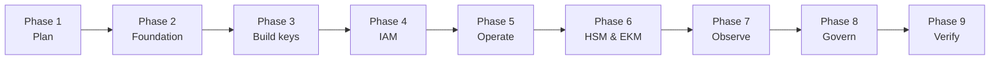

# Google Cloud KMS &amp; Cloud HSM — Key Management Deployment Guide
{: .fs-9 }

A sequential, command-level walkthrough for standing up cryptographic key
management on Google Cloud from an empty organization through to a governed,
monitored, HSM-backed production service — with the exact commands, the Console
click-paths, the Terraform and Config Connector to codify it, and an explanation
of *what each step actually does* and *why it matters*.
{: .fs-6 .fw-300 }

[Start with the Overview](){: .btn .btn-primary .fs-5 .mb-4 .mb-md-0 .mr-2 }
[Jump to Organization Setup](){: .btn .fs-5 .mb-4 .mb-md-0 }

---

## Who this guide is for

Security engineers, platform teams, cloud architects, and GRC practitioners who
need to design and build a key management capability on Google Cloud — not just
create a key, but decide **which** protection level to use, **who** is allowed to
use it, **how** it is provisioned repeatably, **where** its usage is logged, and
**how** it is proven compliant.

It assumes comfort with a terminal and general Google Cloud concepts (projects,
IAM, regions). It explains the Cloud KMS-specific pieces in full.

## What you'll accomplish

By the end of this guide you will have:

1. A **planned key hierarchy** with a documented decision across the four
   protection levels — `SOFTWARE`, `HSM`, `EXTERNAL`, and `EXTERNAL_VPC`.
2. An **organization and project foundation** — folders, a dedicated key-management
   project, service accounts, and organization policy constraints.
3. **Key rings and keys created five different ways** — the Console, `gcloud`,
   Terraform, Config Connector, and the Python client library.
4. An **IAM model** with separation of duties between key administrators,
   encrypter/decrypters, and auditors — scoped at the key level, not the project.
5. **Automatic rotation** configured correctly, plus manual rotation and the
   version-management model that makes both safe.
6. **CMEK integration** across Cloud Storage, BigQuery, Compute Engine, Cloud SQL,
   GKE, Pub/Sub, Secret Manager, and Artifact Registry.
7. **Cloud HSM** keys at FIPS 140-2 Level 3, and a **Cloud EKM** design for
   keys held entirely outside Google Cloud.
8. **Cloud KMS Autokey** for automatic, per-resource key provisioning.
9. **Audit logging into BigQuery, a SIEM, and Chronicle**, with SQL queries for
   key-usage forensics.
10. **Preventative and detective guardrails as code** — organization policy
    constraints, OPA/Conftest in CI, and Security Command Center — mapped to
    NIST 800-53, ISO 27001, SOC 2, and PCI DSS.

## How to read this guide

The guide is **sequential**. Each phase builds on the one before it.

| Phase | Section | What it covers |
|:--|:--|:--|
| 1 | [Overview]() | Protection levels, key purposes, and the decisions that are permanent |
| 1 | [Architecture &amp; Key Hierarchy]() | The key ring / key / version model, envelope encryption, and reference topologies |
| 2 | [Organization &amp; Project Setup]() | **Account creation and service enablement** — org, billing, folders, projects |
| 2 | [Toolchain Setup]() | `gcloud`, Terraform, Config Connector, Python, and the repo layout |
| 3 | [Creating Keys]() | The same key ring and key built five ways |
| 4 | [IAM &amp; Access Control]() | Roles, key-level bindings, service agents, separation of duties |
| 5 | [Key Operations]() | Rotation, import/BYOK, CMEK integrations, envelope encryption with Tink, Autokey |
| 6 | [Cloud HSM &amp; External Keys]() | FIPS 140-2 Level 3 HSM keys, Cloud EKM, and EKM via VPC |
| 5 | [Backup, DR &amp; Destruction]() | The keys-cannot-be-deleted model, version destruction, and multi-region design |
| 7 | [Logging &amp; SIEM]() | Cloud Audit Logs, log sinks, BigQuery forensics, Chronicle, Splunk |
| 7 | [Monitoring &amp; Alerting]() | Metrics, alerting policies, canaries, and the on-call runbook |
| 8 | [CI/CD Automation]() | GitHub Actions with Workload Identity Federation |
| 8 | [Policy as Code]() | Organization policy constraints, custom constraints, OPA/Conftest |
| 8 | [Governance &amp; Compliance]() | FIPS posture and control mappings to NIST, ISO 27001, SOC 2, PCI DSS |
| 9 | [Verification &amp; Runbook]() | End-to-end acceptance tests proving the build actually works |
| — | [Cost Model]() | What each component costs and how the bill is shaped |
| — | [Sources]() | Official Google Cloud documentation for every claim in this guide |

{: .warning }
> **Cloud services change fast.** Commands, API shapes, Console navigation, and
> pricing in this guide reflect publicly documented behavior at the time of
> writing. Treat every command as a *template* — verify against the
> [official Google Cloud documentation]() for your
> location and project before running anything in production.

{: .important }
> **The single most consequential thing to know about Cloud KMS:** key rings and
> keys **cannot be deleted, ever**. Only key *versions* can be destroyed. That one
> fact shapes naming, project layout, cost, and testing in ways that surprise
> people coming from AWS or Azure. It is covered in detail in
> [Overview]() and
> [Backup, DR &amp; Destruction]().

## Companion guides

This is one of three parallel guides covering cloud-native key management:

- [AWS KMS &amp; CloudHSM](https://itnet-steven-smith.github.io/aws-kms-cloudhsm-key-management-guide/)
- [Azure Key Vault &amp; Managed HSM](https://itnet-steven-smith.github.io/azure-key-vault-managed-hsm-key-management-guide/)
- **Google Cloud KMS &amp; Cloud HSM** — this guide

They share a structure deliberately, so the same concept can be compared across
providers.
